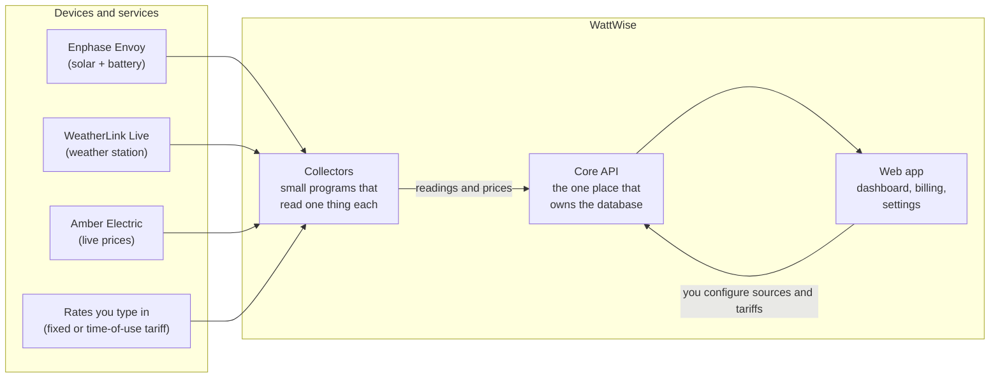

# WattWise documentation

WattWise records a home's solar, battery, grid and weather data once a minute, combines it with electricity prices, and shows what the home is costing or earning right now, today and this billing period. The aim is simple: you should not need a spreadsheet and a tariff PDF to know whether running the dishwasher now is a good idea.

## Start here

| You are... | Read this first | Then |
|---|---|---|
| **A homeowner using the app** | [User guide](../webapp/src/docs/index.md) (also available inside the app under Help) | [Troubleshooting](../webapp/src/docs/09-troubleshooting.md) |
| **Setting up a new electricity provider or tariff** | [Adding a provider](adding-a-provider.md) | [Operations](operations.md) if a collector needs to run |
| **The person who has to keep it running** | [Operations](operations.md) and its [handover checklist](operations.md#handover-checklist) | [Architecture](architecture.md) |
| **A developer taking over the code** | [Architecture](architecture.md) | [Development](development.md), [Data model](data-model.md), [Core API](core-api.md) |
| **An AI agent working in this repository** | [For AI agents](for-ai-agents.md) | The file map in that page points to everything else |

## The 60-second picture

Three ideas explain most of the design:

1. **One owner of the data.** Only Core API touches the database. Collectors and the web app talk to it over HTTP.
2. **Collectors pull their instructions.** You add a *source* in the web app (an Envoy, an Amber account, a fixed tariff). Within a few minutes the matching collector finds it and starts work. Nobody edits a config file or restarts a container.
3. **Money is calculated on demand.** The database stores readings and prices. Cost is worked out from them when you ask, so fixing a wrong rate corrects the past without a data migration.

## Pages in this folder

| Page | What it covers |
|---|---|
| [Architecture](architecture.md) | Services, networks, trust boundaries, the reasons behind the main design choices |
| [How it works](how-it-works.md) | Flowcharts for each process: reading a meter, fetching prices, fixed-tariff pricing, the cost formula, demand charges, login |
| [Data model](data-model.md) | Tables, units, sign conventions, retention |
| [Core API](core-api.md) | Modules, endpoints, authentication, background jobs, configuration |
| [Collectors](collectors.md) | What each collector reads, how often, and what it does when something fails |
| [Web app](webapp.md) | Pages, routes, data fetching, the in-app help |
| [Adding a provider](adding-a-provider.md) | A decision tree for non-programmers, and a technical contract for developers |
| [Operations](operations.md) | Deploying, configuration, backups, upgrades, secrets, the handover checklist |
| [Development](development.md) | Running tests, changing the schema, conventions, common change recipes |
| [For AI agents](for-ai-agents.md) | Invariants, file map, commands and traps, written to be read quickly |

Design history lives in [`docs/superpowers/specs`](superpowers/specs) (why something was built) and [`docs/superpowers/plans`](superpowers/plans) (how it was built). They are dated records. When a spec and the code disagree, the code wins.

## Accuracy

These pages describe the code at commit `79651e9` (2026-10-14). Statements about behaviour were checked against the source at that commit. Screenshots are shared with the in-app help and live in [`webapp/src/docs/images`](../webapp/src/docs/images). They were retaken on 2026-10-26 from a demo site with generated data.
