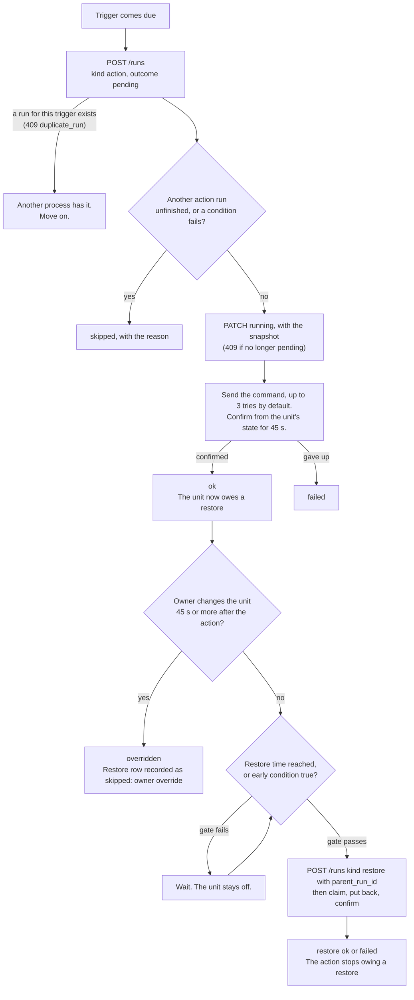
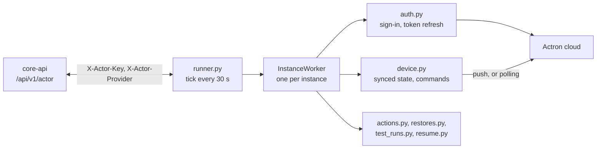

# Actors

An actor sends commands to a device. A [collector](collectors.md) brings data in; an actor reads site data from Core API and acts on it. The first actor, [`actron-neo-actor`](../actron-neo-actor), turns a ducted Actron Neo air conditioner off at the start of a tariff demand window and puts it back afterwards.

Actors follow the collector design: one small Python container per kind of device, one shared key, instances discovered from Core API, and no state that a restart cannot recover. They differ in three ways.

| | Collector | Actor |
|---|---|---|
| Direction | Device to Core API | Core API to device |
| Configured by | A source in Settings | A schedule on the **Schedule** page |
| Key | One per kind (`ENVOY_COLLECTOR_KEY`, and so on) | `ACTOR_KEY`, shared by all actors |
| Provider header | `X-Collector-Provider` (optional on most routes) | `X-Actor-Provider` (required on per-instance routes) |
| Endpoints | `/collector/...` and `/sources/{id}/...` | `/actor/...` |
| Records its work | No | Every run is a row in `actor_runs` |

The owner builds a schedule in the web app from dropdowns and tick boxes. The actor declares what it can do, and the web app draws the form from that declaration, so a new actor needs no web app change.

## The contract

An actor is a container with `CORE_API_URL` and `ACTOR_KEY` in its environment. It sends `X-Actor-Key` and `X-Actor-Provider` (for example `actron_neo`) on its calls. Core API returns and accepts only instances of that provider. One `ACTOR_KEY` covers every actor and every site. As with the pricing collectors' provider header, this stops mistakes, not an attacker who holds the key.

All paths are under `/api/v1/actor`.

| Step | Endpoint | What it does |
|---|---|---|
| Discover | `GET /instances?provider=` | Lists the provider's instances on enabled sites, with the site `timezone` and the stored `config`. An instance with an unfinished action run stays in the list when it or its site is disabled, with `restore_only: true`, so the actor can still put the unit back. |
| Report sign-in | `PATCH /instances/{id}/discovered-config` | Merges `config` (the refresh token) into the stored config and sets `auth_state` (the sign-in code and link, or `needs_sign_in`). |
| Declare | `PUT /instances/{id}/capabilities` | Sends the actions and readings the device supports. See [Capabilities](#capabilities). |
| Fetch schedules | `GET /instances/{id}/schedules` | Enabled schedules, plus any disabled schedule that still has an unfinished action run. |
| Fetch context | `GET /instances/{id}/context` | `now`, the site `timezone`, `outdoor_temp_c`, `battery_soc_pct`, `price_c_per_kwh`, and `windows`. |
| Report readings | `PUT /instances/{id}/readings` | Replaces `latest_readings` with the body's `state` object and sets `last_seen_at`. Only the latest value is kept. |
| List runs | `GET /instances/{id}/runs` | Needs exactly one of `unfinished=true`, `pending_test=true` or `since=<time>`; anything else is 422 `invalid_filter`. |
| Create a run | `POST /instances/{id}/runs` | Creates a run in outcome `pending`. |
| Update a run | `PATCH /instances/{id}/runs/{run_id}` | Moves a run to `running`, `ok`, `skipped`, `failed` or `overridden`, and can set `message`, `attempts` and `snapshot`. |

Every per-instance route returns 401 `invalid_actor_key` for a wrong key, a wrong provider or an unknown instance (the same code, so ids cannot be probed). A disabled instance or site gets 403 `instance_disabled` or `site_disabled`, unless an action run still needs its restore.

### Capabilities

The declaration is JSON with `version: 1`, `actions` and `readings`.

- An action has an `id`, a `label`, `restorable` and a list of `params`. A param has a `name`, `label`, `type` (`number`, `choice`, `bool` or `multi_choice`), optional `min`, `max` and `unit`, and `options` (`value` and `label`) for the two choice types. Options can come from the device, such as the zone list, so the actor re-sends the declaration whenever it changes.
- A reading has an `id`, `label`, `unit`, `type` (default `number`) and optional `target_options`, such as one entry per zone.

Core API checks every saved schedule against the instance's declaration. The action must be declared, every declared param must be present, no other param is allowed, numbers must sit inside `min` and `max`, and choices must be declared options. A condition may read a reading the actor declared, or one of the site readings `outdoor_temp_c`, `battery_soc_pct` and `price_c_per_kwh`. A condition that names a target needs a reading that declares that target. A schedule is refused with 422 `no_capabilities` until the actor has declared once. The actor checks again before it acts.

### Context

Core API works out the demand window times so the actor does no time zone logic. `windows` lists each occurrence that starts between 24 hours ago and 48 hours ahead, with `window_id`, `label`, and `start` and `end` as UTC instants. Occurrences follow the billing rule: each instant is tested against its own weekday and month, so a Friday-only window from 22:00 to 06:00 gives Friday 00:00 to 06:00 and Friday 22:00 to midnight. Daylight saving gaps and repeats are handled in `actor_context.py`.

`outdoor_temp_c` and `battery_soc_pct` come from the latest reading in the past 15 minutes, and are `null` when there is none. `price_c_per_kwh` is the buy price of the interval that covers `now`.

### Schedules

A schedule has one trigger, optional conditions, one action, a restore rule and a retry rule. The JSON shapes are in [Data model](data-model.md#actor-tables).

| Trigger | Fires |
|---|---|
| `window_start`, `window_end` | At the start or end of each occurrence of a demand window of the site's tariff |
| `time` | At a set `HH:MM` in the site time zone on chosen days (0 is Monday) |
| `price_above` | When the buy price rises above a level, at most once per 5-minute step. After an actor restart the previous price is unknown, so a price already above the level counts as a crossing. |

Conditions ("only if") all have to pass or the run is skipped. A reading that is missing or older than 5 minutes fails a condition. A condition row can be switched off with its tick box: it is kept but ignored.

### Restore

An action that is `restorable` saves the fields it changes (the snapshot) before it acts, then puts them back.

| `restore.when` | Restore time |
|---|---|
| `window_end` | The end of the window occurrence that started the run. Offered only for a `window_start` trigger. |
| `after_minutes` | `minutes` after the trigger |
| `at_time` | The next `HH:MM` in the site time zone at or after the trigger |
| `conditions_only` | No time. The unit is put back when a "restore early" condition holds. |

- **Only restore if** (`only_if`) is a gate. Until every ticked condition passes, the actor does not restore and the unit stays off. A missing or stale reading passes the gate, so a dead sensor never keeps the unit off.
- **Restore early when** (`early_if`) brings the restore forward when every ticked condition is evaluable and true. The gate still applies.
- **Disabling** the schedule, the instance or the site while a run holds the unit off restores it at once, subject to the gate.
- A schedule with restore switched off never restores, and Core API does not count its runs as holding the unit off.

## Runs

Every attempt is one row in `actor_runs`, with a `kind`, an `outcome` and a message.

| Kind | Meaning |
|---|---|
| `action` | The schedule's action, created when a trigger comes due |
| `restore` | Puts the unit back. `parent_run_id` points at the action run that holds the snapshot, and `trigger_at` is the restore time. |
| `test` | Created by **Test now** in the web app |

| Outcome | Meaning |
|---|---|
| `pending` | Created, not started |
| `running` | The actor has claimed it |
| `ok` | Done |
| `skipped` | Not run, with the reason in `message` |
| `failed` | Gave up, with the last error in `message` |
| `overridden` | The owner changed the unit after the action |

Rules Core API enforces:

- The unique key on (`schedule_id`, `kind`, `trigger_at`) makes a second create fail with 409 `duplicate_run`, so one process runs a trigger.
- Claiming (`pending` to `running`) succeeds only while the row is still `pending`, otherwise 409 `run_not_pending`. Finishing succeeds only from `pending` or `running`, otherwise 409 `run_finished`. A run cannot go back to `pending` (422 `invalid_outcome`).
- The one change allowed on a finished run is `ok` to `overridden`.
- A restore run needs a `parent_run_id` that is an action run of the same schedule, otherwise 422 `invalid_parent`.
- When an actor marks a run `failed` and the schedule has **Email me if it still fails** on, Core API emails the site owner at once through the mail relay. The actor cannot reach the relay.

An action run is **unfinished** while its outcome is `pending`, `running` or `ok` and it has no restore row that ended `ok`, `skipped` or `failed`. A failed restore closes the action run. The actor does not retry it later, and the unit stays as it was. The failure shows on the Dashboard until a later run succeeds.

Skip and failure messages the actor writes include `missed` (the actor was down for more than 10 minutes after the trigger), `another schedule is active` (schedules on one instance are not checked for overlap when saved, so the second one is skipped), `reading unavailable: <reading>`, a failed comparison such as `indoor_temp_c 24.0 is not above 27.0`, and `owner override`.

A trigger that is no more than 10 minutes old still runs. An older one that has no run is recorded as `skipped: missed`. The actor looks back 24 hours, and not before the schedule was created. Price triggers are never recorded as missed.

### Test now

**Test now** calls `POST /sites/{site_id}/actors/schedules/{schedule_id}/test`, which inserts a `test` run in outcome `pending`. Core API refuses with 409 `instance_disabled` or `no_capabilities` when the actor could not pick it up. The actor claims it on its next tick (within about 30 seconds) and applies the action immediately, ignoring the trigger and the conditions. If the schedule restores, it puts the unit back after `TEST_HOLD_SECONDS` (default 30). If another action holds the unit, the test is skipped with `another schedule is active`, because it would save the actor's own change as the state to restore.

## The owner API

The web app uses these routes under `/api/v1/sites/{site_id}/actors`. Reads need site access (owner or viewer). Every write needs the site owner; a viewer gets 403.

| Endpoint | Purpose |
|---|---|
| `GET /instances`, `POST /instances` | List and add an instance. The body of `POST` is `provider` (lowercase letters, digits and underscore) and `name`. |
| `PATCH /instances/{id}` | Change `name` or `enabled` |
| `DELETE /instances/{id}` | Delete the instance, its schedules and their run history |
| `POST /instances/{id}/sign-in/reset` | Drop the stored refresh token so the actor starts a new sign-in |
| `GET /schedules`, `POST /schedules` | List and create |
| `PATCH /schedules/{id}` | Merges the fields sent into the stored schedule, then validates the whole |
| `DELETE /schedules/{id}` | Delete the schedule and its run history |
| `POST /schedules/{id}/test` | Queue a test run |
| `GET /runs?limit=` | The site's newest runs with `schedule_name` (1 to 200, default 50) |
| `GET /schedules/{id}/runs?limit=` | One schedule's newest runs |
| `GET /failures` | The current failures. See [Failures](#failures). |

Instances never include `config`, which holds the refresh token. A schedule that fails the capability check returns 422 `invalid_schedule`.

Deleting a schedule or an instance deletes its run history, restore rows first because they point at their action run. Disabling keeps history. Delete and sign-in reset return 409 `unit_held_off` while an action run still owes a restore: for an instance, any of its runs, for a schedule, that schedule's runs.

## Failures

`GET .../failures` lists what is wrong now. The Dashboard tile reads it every 15 seconds.

| Kind | Raised when | Cleared when |
|---|---|---|
| `run_failed` | The latest action or restore run of a schedule is `failed` | A later run of that schedule ends `ok`, `skipped` or `overridden` (a successful test run counts) |
| `still_off` | An action run is unfinished and now is past its restore time plus the schedule's give-up minutes. Never raised for `conditions_only`. | The restore finishes |
| `actor_silent` | An action run is unfinished and the actor has not reported for more than 5 minutes (or never has, dated from the trigger) | The actor reports again |
| `needs_sign_in` | The instance's `auth_state` says `needs_sign_in` | The stored token works again, or the owner starts a new sign-in. It has no start time. |

Each row has `kind`, `instance_id`, `schedule_id`, `schedule_name`, `message` and `since`, oldest first.

The watchdog job (`actor_watchdog` in [`scheduler.py`](../core-api/core_api/scheduler.py)) runs every minute. For each `still_off` or `actor_silent` case on a schedule with email on, it sets `watchdog_notified_at` on the run and emails the site owner once. A conditional update claims the run first, so two job runs never both send. A run gets one watchdog email in total, whichever case came first.

## What fails and what you see

| Situation | What you see | Recovery |
|---|---|---|
| Actor container stopped while the unit is off | `actor_silent` after 5 minutes. The watchdog email goes out if the schedule has email on. | Start the container. It resumes the open runs from Core API and restores. |
| Actor restarted mid-run | A run left `running` is finished from the unit's state: `ok` (`confirmed after a restart`), applied again within the give-up time, or `failed`. A `pending` run is `skipped: the actor restarted before the run`. | Automatic on the next tick |
| Unit does not confirm a command | The run retries, then `failed: failed after N attempts: not confirmed`. A last look 15 seconds later counts a late command as `ok`. | Check the unit. Use **Test now** after fixing. |
| Restore fails | `run_failed` on the Dashboard. The unit stays as it is. | Turn the unit on by hand |
| Owner turns the unit on during an off window | The action run becomes `overridden` ("You took over"). The restore is recorded as `skipped: owner override`. No email and no Dashboard entry. | None needed |
| Condition gate never passes | The unit stays off. `still_off` appears after the restore time plus the give-up minutes. | Fix the condition, or turn the unit on |
| Actron rejects the stored token | After three failed refreshes at least a minute apart, **needs sign-in** and a **Sign in again** button. The actor retries the old token every 10 minutes. | Press **Sign in again** and approve the code. If the unit is held off, Core API refuses until it is restored (409 `unit_held_off`). |
| Sign-in code expires | The actor requests a new code after 30 seconds and posts it | Open the new link |
| Core API unreachable | The actor logs `Discovery failed: <error type>` or `Tick failed (instance N): <error type>` every 30 seconds. Nothing new is scheduled or recorded. | Automatic on the next tick after Core API returns |
| A reading is missing or older than 5 minutes | An "only if" condition fails: `skipped: reading unavailable`. A restore gate passes. | Check the actor and the unit |
| Push updates (MQTT) fail | The actor polls every 30 seconds and retries push after 30, 60, 120, 240, then every 300 seconds | Automatic |

## The Actron Neo actor

The container runs [`actron_neo_actor.main`](../actron-neo-actor/actron_neo_actor/main.py). `runner.py` lists instances every `TICK_SECONDS` and gives each its own `InstanceWorker` (`worker.py`), so one failing unit never stops another. The worker uses the first air conditioner on the Actron account.

### Sign-in

1. The owner opens **Schedule** and adds an air conditioner (provider `actron_neo`).
2. The actor requests an Actron device code and posts the code, the link and the expiry in `auth_state`. The page shows them.
3. The owner approves the code on the Actron page. The actor stores the refresh token in `ActorInstance.config`, an `EncryptedJSON` column, and clears `auth_state`.
4. On later starts the actor signs in from the stored token. If Actron rotates the token, the actor stores the new one. Tokens and codes never go into logs.

### What it can do

| Action | Parameters | Restore |
|---|---|---|
| Turn off (`system_off`) | none | Puts the saved power and mode back |
| Turn on (`system_on`) | `mode` | The same |
| Set mode (`set_mode`) | `mode` | The same |
| Set temperature (`set_temperature`) | `temperature_c`, within the unit's limits | Puts the saved setpoint back |
| Set fan speed (`set_fan_mode`) | `fan_mode`: `AUTO`, `LOW`, `MED`, `HIGH` | Puts the saved speed back |
| Switch zones (`set_zones`) | `zones` (by name), `enabled` | Puts back only the zones the action changed |

Readings for conditions: `indoor_temp_c`, `outdoor_temp_c`, `humidity_pct`, `is_on` (1 or 0) and `zone_temp_c` (one target per zone). The actor does not expose the library's continuous, quiet, turbo or away modes.

The restore rule applies per field. Before it puts a field back, the actor compares it with what the action set. If they differ, the owner changed it, and the actor leaves that field alone and says so in the message, for example `left alone because the owner changed them: zone Study`. After a `system_off`, which sets no mode, a mode the owner picked while the unit was off is kept, and the power restore turns the unit on in that mode.

### Device facts

These were observed on the owner's unit.

- **On and off go through the system mode.** `set_system_mode("OFF")` turns the unit off, and any real mode turns it on. `is_on` and `mode` are separate: after OFF the mode still reads `COOL`. A command takes about 6 seconds to show, so the actor waits for the state to confirm it, for up to 45 seconds.
- **Zones** switch with `remote_zone_info[i].enable(bool)`, which takes about 6 seconds. Zone names come from each zone's `title`. Zones with an empty or repeated title are left out.
- **Indoor and outdoor readings come from `master_info`** (`live_temp_c`, `live_outdoor_temp_c`, `live_humidity_pc`). `ac_system.outdoor_unit.amb_temp` read 0.0 when the real value was 18.6, so the actor does not use it. When the unit omits a value, the actor reports `null`, not the library's 0.0 default.
- **The raw status holds the wall controller PIN and the installer's contact details.** The actor builds its state from named, typed fields and never logs or stores the raw status. `main.py` sets the `actron_neo_api` logger to ERROR because the library's warnings can quote raw values.
- A temperature below or above the unit's limits is clamped to them in `COOL` and `HEAT`, and sent as given in `AUTO`.

### Keeping in step with the unit

The actor asks the library for push updates and keeps a copy of the unit's state. It polls `update_status()` every `RECONCILE_SECONDS` (default 120) as a safety net while push works, and every `POLL_FALLBACK_SECONDS` (default 30) while push is down. A reading is stale after 5 minutes, which is why the safety poll runs more often than that. The actor sends the state to Core API when it changes (no more than once every 2 seconds) and at least every `HEARTBEAT_SECONDS` (default 60). The Schedule page shows **Not updating** when `last_seen_at` is more than 2 minutes old.

### Settings

| Variable | Default | Meaning |
|---|---|---|
| `CORE_API_URL` | none (required) | Where Core API is. Compose sets `http://core-api:8000`. |
| `ACTOR_KEY` | none (required) | Must equal Core API's `ACTOR_KEY` |
| `TICK_SECONDS` | 30 | Discovery and tick interval |
| `POLL_FALLBACK_SECONDS` | 30 | Poll interval while push is down |
| `RECONCILE_SECONDS` | 120 | Poll interval while push works |
| `HEARTBEAT_SECONDS` | 60 | Longest gap between readings sent to Core API |
| `TEST_HOLD_SECONDS` | 30 | How long a test run holds the action before restoring |

Each must be a whole number of at least 1.

### Stopping

When the container stops, a test run that has sent its command is asked to finish: it restores within about 60 seconds, and the worker waits at most 65 seconds before it cancels. The Compose service sets `stop_grace_period: 90s` so Docker does not kill the process first. An action run that holds the unit off is not touched. It stays in Core API, and the next start carries on to the restore.

## Adding another actor

An actor for another device is a new directory and a provider name. Core API and the web app need no change for the schedule form, because the form is drawn from the capabilities.

1. Pick a provider string, lowercase with underscores. The owner API accepts any string that matches `^[a-z0-9_]{1,64}$`, and the web app's add form currently offers only `actron_neo` (`PROVIDER` in [`AddInstanceForm.tsx`](../webapp/src/actors/AddInstanceForm.tsx)), so a second provider needs a choice added there.
2. Copy [`actron-neo-actor/`](../actron-neo-actor). Keep `core_api_client.py`, `async_core.py`, `config.py`, `runner.py`, `models.py`, `schedule_eval.py`, `view.py`, `executor.py`, `actions.py`, `restores.py`, `resume.py` and `test_runs.py`, which hold the contract logic. Replace `auth.py`, `connector.py`, `device.py`, `device_state.py`, `device_snapshot.py` and `capabilities.py`. Set the provider in `core_api_client.py` (`PROVIDER`).
3. Implement the `Device` protocol in `device.py`: `state`, `refresh`, `capabilities`, `snapshot_for`, `apply`, `restore`, `matches_action`, `start_sync` and `stop_sync`. `apply` and `restore` must wait until the device state confirms the change.
4. Declare actions and readings in the shape of [Capabilities](#capabilities). Mark an action `restorable` only if `snapshot_for` saves everything `restore` needs.
5. Never log tokens, codes or raw device status. Log the instance id and the exception type.
6. Add the package to the matrix in `.github/workflows/ci.yml` and `publish-images.yml`, add a service to `docker-compose.yml` and `docker-compose.prod.yml` with `ACTOR_KEY` and a `stop_grace_period` long enough for a restore, and add the Dockerfile.

What Core API checks for you: the key and provider on every call, that a schedule's action and conditions match the declared capabilities, that a schedule's demand window belongs to the site, that runs are unique per trigger, and the run state transitions above. It does not check that a command is safe for the device. That is the actor's job.
