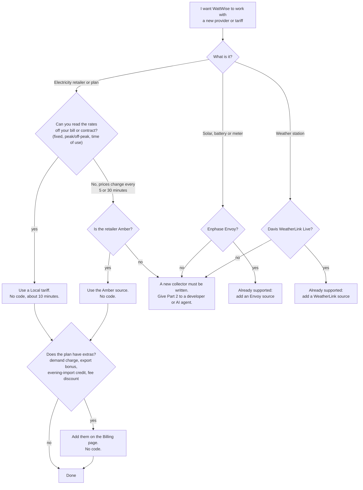
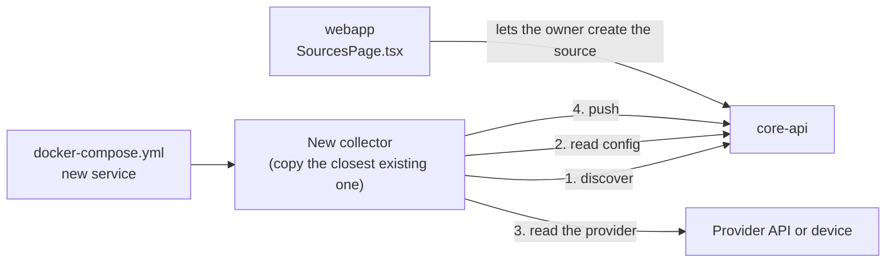

# Adding a provider

"Provider" here means whoever supplies the data or the price: an electricity retailer, an inverter or meter brand, a weather station. This page has two parts. Part 1 is for anyone, with no programming. Part 2 is the technical contract, for a developer or an AI agent.

## Part 1: What do you need?

Start with the question below. Most people finish in the first two steps.



Everything you need for the no-code paths is in the web app. The numbers to type come from your bill or your retailer's fact sheet.

### Path A: a fixed or time-of-use tariff

You will type your rates in once. WattWise then prices every minute from them, the same way it would from a live feed.

**Before you start, have these ready:**

- Your site's time zone (set when the site was created).
- The rates in cents per kWh for buying electricity, selling it back (feed-in), and a controlled-load circuit if you have one.
- The times of day each rate applies, and whether it changes by season or weekday.
- Your daily supply (service) charge in cents, and the date your bill period starts.

**Steps:**

1. Open **Sources** from the sidebar.
2. Under **Kind** choose `pricing`, under **Provider** choose **Local tariff**, and type a **Tariff name** such as `Origin Fixed`.
3. Click **Create source**. A **Rate windows** panel appears.
4. Add one window per rate, using the form at the bottom of the panel.
5. Open **Billing** and enter the daily supply charge and billing cycle (see [Path C](#path-c-the-extras-on-your-plan)).


**Worked example.** A plan with 32 c/kWh from 07:00 to 23:00, 22 c/kWh overnight, and 6 c/kWh paid for exports:

| Direction | Label | Rate (c/kWh) | Start | End | Months and days |
|---|---|---|---|---|---|
| Import | Peak | 32 | 07:00 | 23:00 | all |
| Import | Off-peak | 22 | 23:00 | 07:00 | all |
| Export (feed-in) | Feed-in | 6 | 00:00 | 00:00 | all |

Things that trip people up:

- **Type the export rate as a positive number.** WattWise stores it as negative internally, because a payment to you is negative cost.
- **Equal start and end times mean all day.** That is how a flat rate is entered.
- **An end time earlier than the start time runs past midnight.** 23:00 to 07:00 is an overnight window.
- **Windows for the same direction must not overlap.** WattWise refuses the second one and names the clash.
- **Gaps are allowed but cost you accuracy.** A minute with no price is left out of your cost totals. The panel tells you the first uncovered time it finds.
- **Fix a typo with Edit rate.** Do not delete and re-add the window. Editing reprices from the window's start.
- **To change a rate from today, End the old window, then add the new one with From set to today.** You cannot schedule a future change in advance.
- **One pricing source per site.** To switch from Amber to a local tariff, the Amber source must be deleted or ended first. Disabling it is not enough. If it already holds prices, ask a developer or AI agent to set its end date through the API.

Prices appear within about a minute of saving.

### Path B: Amber, Envoy or WeatherLink

These are already supported. The steps, with screenshots, are in the user guide's [Sources chapter](../webapp/src/docs/05-sources.md). In short: Amber needs your API key (under Account settings) and a site ID; the Envoy needs its address on your network and either a token or your Enlighten login; the WeatherLink Live needs its address.

### Path C: the extras on your plan

Retail plans often add rules on top of the energy rates. All are on the **Billing** page and none need code.

| If your plan has... | Add it as | Chapter |
|---|---|---|
| A daily supply charge | Tariff, service availability | [Billing](../webapp/src/docs/07-billing.md#tariffs) |
| A monthly fee, perhaps discounted for a year | Tariff monthly fee, then a Monthly fee discount | [Billing](../webapp/src/docs/07-billing.md#monthly-fee-discounts) |
| A charge for your highest evening draw | Demand window | [Billing](../webapp/src/docs/07-billing.md#demand-windows) |
| A bonus or penalty on the feed-in rate at certain times | Export adjustment | [Billing](../webapp/src/docs/07-billing.md#export-adjustments) |
| "Keep evening import under 300 W and earn 50 cents" | Conditional credit | [Billing](../webapp/src/docs/07-billing.md#conditional-credits) |
| A bill that closes on a set day | Billing cycle | [Billing](../webapp/src/docs/07-billing.md#billing-cycles) |


### Path D: nothing above fits

The provider has a live price feed (or a device) that WattWise does not know. Someone has to write a small program, a *collector*, for it. This is routine: the existing ones are between 280 and 820 lines of Python. Give the person or AI agent this page and the [AI agent guide](for-ai-agents.md). Part 2 below is the checklist they need.

---

## Part 2: The technical contract

A new provider is a new collector plus, usually, a few lines in the web app. Core API does not change for a provider that fits the existing kinds, because `sources.provider` is free text.



### Step 0: pick a kind and a name

| Kind | Use when the provider supplies | Push endpoint | Closest example |
|---|---|---|---|
| `pricing` | Prices per kWh | `POST /api/v1/sources/{id}/prices` | [`amber-pricing-collector`](../amber-pricing-collector) |
| `energy` | Power flows | `POST /api/v1/sources/{id}/readings/energy` | [`envoy-collector`](../envoy-collector) |
| `weather` | Weather | `POST /api/v1/sources/{id}/readings/weather` | [`weatherlink-local-collector`](../weatherlink-local-collector) |

Choose a lowercase `provider` name with underscores, for example `acme_energy`. It appears in the database, in the discovery request and in the `X-Collector-Provider` header, so it must be identical in all three places. A site can have one active `pricing` source and one `weather` source. A different provider of the same kind therefore replaces the current one rather than running beside it.

### Step 1: discover sources

```bash
curl -s "$CORE_API_URL/api/v1/collector/sources?kind=pricing&provider=acme_energy" \
  -H "X-Collector-Key: $COLLECTOR_KEY"
```

```json
[
  { "source_id": 7, "site_id": 3, "config": { "account_id": "A-123", "api_token": "..." } }
]
```

Only enabled sources inside their effective dates are returned. `config` is whatever the owner stored on the source. Poll this list every 5 minutes so a source added in the web app is picked up without a restart. If the list request fails, keep the last known sources.

The collector key is the shared secret for the kind: `PRICING_COLLECTOR_KEY`, `ENVOY_COLLECTOR_KEY` (energy) or `WEATHER_COLLECTOR_KEY`.

### Step 2: push data

**Prices.** Prices are cents per kWh, as strings or numbers. Channels are `buy`, `sell` and `controlled_load`.

```bash
curl -s -X POST "$CORE_API_URL/api/v1/sources/7/prices" \
  -H "X-Collector-Key: $COLLECTOR_KEY" \
  -H "X-Collector-Provider: acme_energy" \
  -H "Content-Type: application/json" \
  -d '{
    "intervals": [
      {"channel": "buy",  "interval_start": "2026-10-14T00:00:00Z", "interval_end": "2026-10-14T00:05:00Z", "price": "31.5"},
      {"channel": "sell", "interval_start": "2026-10-14T00:00:00Z", "interval_end": "2026-10-14T00:05:00Z", "price": "-6.0"}
    ]
  }'
```

Response: `202 {"ingested": 2, "readings_fanned_out": 10}`.

Rules that cause wrong money if broken:

- **Sell is negative when the customer is paid.** Cost is `export_kWh × sell`, so a positive sell price reduces revenue.
- `interval_end` must be after `interval_start`, and one interval may span at most 1440 minutes.
- Send every timestamp as UTC with `Z`, or with an explicit offset. A timestamp with no offset is treated as UTC.
- The same `(source, channel, interval_start)` can be sent again. The latest value wins, which is how revisions are applied.
- Core API turns each interval into one price per minute. A start with seconds (`00:00:01Z`) is floored to the minute for that purpose.

**Energy.** One row per metric per minute, at `second=0`. Names and units are in [Data model](data-model.md#metrics).

```bash
curl -s -X POST "$CORE_API_URL/api/v1/sources/4/readings/energy" \
  -H "X-Collector-Key: $COLLECTOR_KEY" -H "Content-Type: application/json" \
  -d '{"readings": [
        {"ts": "2026-10-14T03:21:00Z", "metric": "production_w",  "value": 4210},
        {"ts": "2026-10-14T03:21:00Z", "metric": "consumption_w", "value": 1320},
        {"ts": "2026-10-14T03:21:00Z", "metric": "grid_export_w", "value": 2890}
      ]}'
```

Write `grid_import_w` only while importing and `grid_export_w` only while exporting, both as positive watts. Cost treats a minute with only one of the two readings as zero for the other, and ignores a minute with neither.

Failed pushes raise `401 invalid_collector_key` (wrong key, provider header mismatch, unknown source), `403 source_disabled`, `403 source_expired` or `403 wrong_source_kind`.

### Step 3: optional services Core API offers

| Need | Endpoint |
|---|---|
| Save something you learned about a device (serial, token) | `PATCH /sources/{id}/discovered-config` with a JSON object. It is merged into the stored config. |
| Fill history | `GET /sources/{id}/site-data-floor` for the earliest data on the site, `GET /sources/{id}/prices/gaps?since=` for missing days, `POST /sources/{id}/prices/gap-markers` for days the provider has nothing |
| Secrets the owner should not retype | Store them in `sources.config`, which is encrypted at rest. Viewers never see keys named `token`, `api_key`, `password`, `secret` or `username`. |

If the provider needs a credential that belongs to the user rather than a site (as Amber's API key does), add it to the resolver `resolve_source_config()` in [`routers/collector_config.py`](../core-api/core_api/routers/collector_config.py). That is the one place Core API has per-provider logic.

### Step 4: wire it in

1. **Collector code.** Copy the nearest collector directory. Keep `config.py` (two environment variables), `core_api_client.py` and the loop shape. Replace the provider client and `mapping.py`.
2. **Docker.** Copy the service block of a similar collector in [`docker-compose.yml`](../docker-compose.yml). Set `CORE_API_URL: http://core-api:8000` and `COLLECTOR_KEY` to the kind's key. Add the service to the table in the root [README](../README.md).
3. **Web app.** In `webapp/src/pages/SourcesPage.tsx`, add the provider name to `PROVIDERS_BY_KIND`, a display name, and a config form in `CONFIG_FORMS` (without one the owner gets a raw JSON editor, which works but is unfriendly).
4. **User guide.** Add a section to [`05-sources.md`](../webapp/src/docs/05-sources.md) and the glossary if there are new terms. Tests fail on broken links.
5. **Tests.** Mirror the collector tests: mapping with fixture JSON from the real provider, client with mocked HTTP, config, and the core API client.
6. **Spec and plan.** The repository records each feature as a dated spec and plan in [`docs/superpowers`](superpowers). Follow suit.

### Definition of done

- [ ] A source of the new provider can be created in the web app.
- [ ] The collector finds it within five minutes of creation with no restart.
- [ ] Data appears on the dashboard, and a spot check against the provider's own app matches.
- [ ] A sell price is negative where the customer is paid.
- [ ] Killing the collector mid-cycle and restarting it loses no history it could have recovered.
- [ ] A wrong credential produces a clear log line and does not crash the loop.
- [ ] Collector tests pass with `uv run pytest`, and `npm test` and `npm run lint` pass in `webapp/`.
- [ ] The user guide and this documentation match the change.
