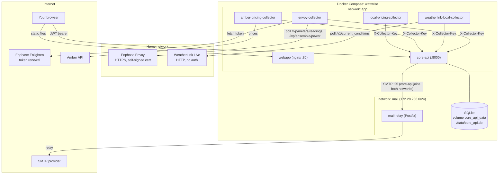
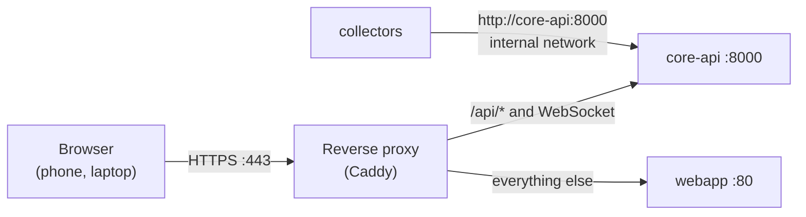
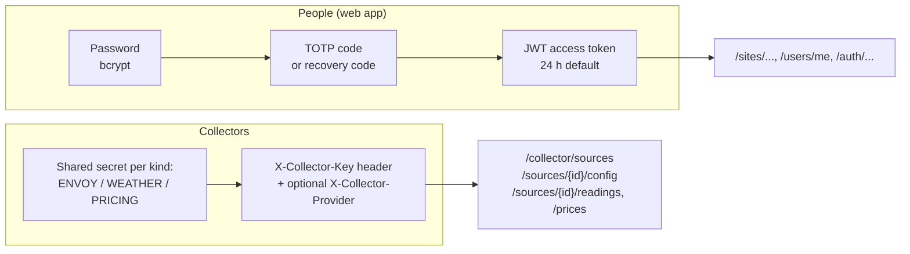

# Architecture

## Services

WattWise is seven containers started by one [`docker-compose.yml`](../docker-compose.yml). Compose project name: `wattwise`.

| Service | Directory | Language | Role | Talks to |
|---|---|---|---|---|
| `core-api` | [`core-api/`](../core-api) | Python 3.12, FastAPI, SQLAlchemy 2, Alembic | Owns the SQLite database. REST API under `/api/v1`. Runs the background jobs. | SQLite file, `mail-relay` |
| `webapp` | [`webapp/`](../webapp) | TypeScript, React 19, Vite, Tailwind, TanStack Query, Recharts | Single-page app served by nginx. | `core-api` (from the browser) |
| `envoy-collector` | [`envoy-collector/`](../envoy-collector) | Python | Polls the Enphase Envoy every 60 s. | Envoy (LAN), Enlighten (internet), `core-api` |
| `weatherlink-local-collector` | [`weatherlink-local-collector/`](../weatherlink-local-collector) | Python | Polls the WeatherLink Live every 60 s. | WeatherLink Live (LAN), `core-api` |
| `amber-pricing-collector` | [`amber-pricing-collector/`](../amber-pricing-collector) | Python | Fetches Amber prices: live, recent revisions, history. | Amber API (internet), `core-api` |
| `local-pricing-collector` | [`local-pricing-collector/`](../local-pricing-collector) | Python | Turns typed-in rate windows into price intervals. | `core-api` |
| `mail-relay` | [`mail-relay/`](../mail-relay) | Postfix | Sends password-reset and confirmation email. | Your SMTP provider |

## How the services connect

Two details here are deliberate:

- **`mail-relay` is on its own network.** Postfix trusts its whole subnet to relay mail without authentication. Putting it on `app` would let any collector send mail. Only `core-api` joins both networks.
- **The browser calls `core-api` directly.** The web app is static files. Its `API_BASE_URL` is written into `config.js` when the container starts (see [Web app](webapp.md#runtime-configuration)), so the address must be reachable from the user's browser, not only from inside Docker.

### Reaching the stack from the internet

For use away from home, a reverse proxy terminates HTTPS and sends `/api/*` to `core-api` and everything else to `webapp`. The collectors keep using the internal network and never pass through the proxy. Machines holding a collector key could reach the same `/api/*` paths from the internet, so keep the keys private (see [Operations](operations.md#putting-wattwise-on-the-internet)).

## Who is allowed to do what

Two separate authentication schemes exist. They never mix.

| Caller | Credential | Sees | Cannot |
|---|---|---|---|
| Site owner | JWT after password and TOTP | Everything on their sites, including device credentials | Touch other users' sites |
| Viewer (granted by an owner) | JWT | Site data, with device credentials hidden | Change anything |
| Collector | One shared key per kind (`energy`, `weather`, `pricing`) | Sources of its own kind; pushes readings or prices | Read user data. Push readings to a source of another kind. |

The `X-Collector-Provider` header narrows a collector further, so the Amber collector cannot reach a `local` source. The README is explicit that this is a guard against mistakes, not a security boundary: any process holding the pricing key can claim to be either provider.

## Design decisions and the reasons

| Decision | Reason | Cost |
|---|---|---|
| Collectors are separate containers. | The Envoy and WeatherLink units are only reachable from the home LAN. A collector must run on a machine that can see them, which may not be the machine running Core API. | More containers to start. |
| Only Core API writes to the database. | One place enforces the rules. Collectors stay small and stateless. | Core API is a single point of failure. A collector that cannot reach it drops that cycle's data. |
| Collectors discover sources by polling `GET /collector/sources`. | Adding a site needs no restart and no compose change. | A new source takes up to 5 minutes to be picked up (`DISCOVERY_REFRESH_SECONDS`, default 300). |
| Readings are stored one row per (source, minute, metric). | Adding a metric is a new enum value, not a new column. Idempotent upserts make retries safe. | More rows than a wide table. |
| Prices are stored twice: `price_intervals` as published, `price_readings` per minute. | Cost is a join on exact minute timestamps. The interval table keeps what the provider said. | Roughly 5 rows per 5-minute interval. |
| Cost is computed on request, not stored. | A corrected rate or a late-arriving reading fixes history automatically. | Each cost query reads minute-level rows. Fine for one home, not for thousands. |
| `provider` is free text on a source, not a database enum. | A new provider needs new collector code anyway. It should not also need a schema migration. | A typo in a provider name is not caught by the database. |
| Background jobs run inside Core API (APScheduler). | Three light jobs do not justify another service. | Core API must run as a single worker, or each job runs once per worker. |
| SQLite. | One home, one writer, one file to back up. | No concurrent writers. The upsert code uses SQLite's `ON CONFLICT` syntax, so moving to Postgres needs those statements ported. |
| Login lockouts are held in process memory. | No extra store for a single-instance service. | A restart clears lockouts. Does not work across several workers. |

## Constraints that shape the code

- **One Uvicorn worker.** The scheduler and the lockout counters are per process.
- **Everything is UTC in the database and the API.** Local time appears only when a rule is defined in the site's time zone (tariff windows, billing cycles, the daily fee). See [Data model](data-model.md#time-and-units).
- **A site has one active pricing source and one weather source.** Energy sources can be several.
- **`SECRETS_ENCRYPTION_KEY` is permanent.** Stored credentials are encrypted with it and nothing re-keys them. Back it up apart from the database. See [Core API](core-api.md#where-secrets-are-stored).
- **Raw readings are kept for 365 days.** After that a nightly job replaces them with 5-minute averages.

Next: [How it works](how-it-works.md) walks through each process step by step.
