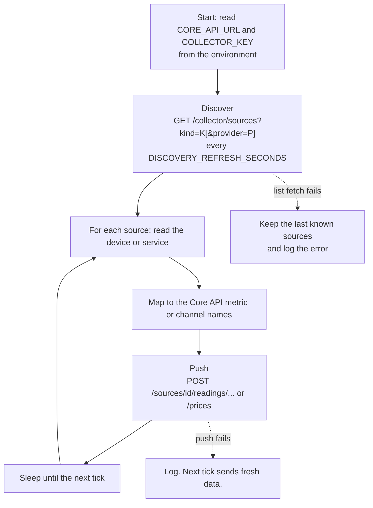
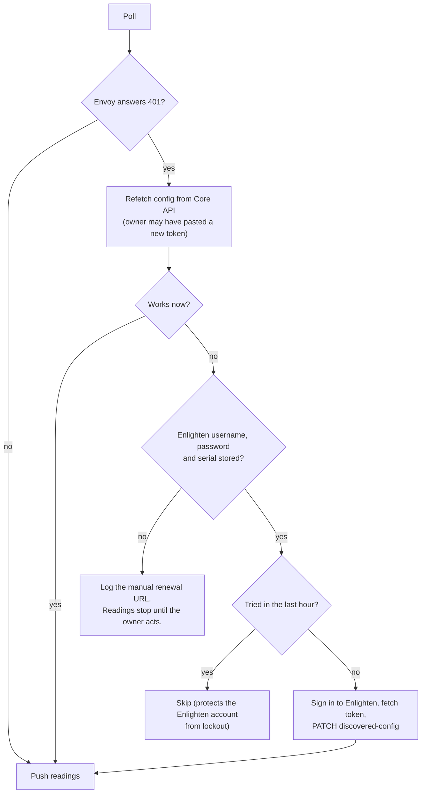

# Collectors

A collector is a small Python program that reads one kind of thing and pushes it to Core API. There are four. They share a contract, so a fifth is mostly a copy of an existing one (see [Adding a provider](adding-a-provider.md)).

| Collector | Source kind and provider | Reads | Cadence | Key |
|---|---|---|---|---|
| [`envoy-collector`](../envoy-collector) | `energy` / `envoy` | Enphase Envoy on the LAN | Every 60 s | `ENVOY_COLLECTOR_KEY` |
| [`weatherlink-local-collector`](../weatherlink-local-collector) | `weather` / `weatherlink_live` | Davis WeatherLink Live on the LAN | Every 60 s | `WEATHER_COLLECTOR_KEY` |
| [`amber-pricing-collector`](../amber-pricing-collector) | `pricing` / `amber` | Amber's public API | 5 min live, 1 min recent, 12 h backfill | `PRICING_COLLECTOR_KEY` |
| [`local-pricing-collector`](../local-pricing-collector) | `pricing` / `local` | Core API only (no outside device) | Every minute check; daily push at 23:59 | `PRICING_COLLECTOR_KEY` |

## The shared contract

Every collector does the same four things.

Rules every collector follows:

- **Stateless where possible.** Config comes from Core API on each refresh. The only memory is small and per process (Envoy renewal timers, the weather collector's rain baseline, the local collector's per-source "done today" record). A restart is always safe.
- **One failure never stops the rest.** A source that errors is logged and skipped, and the loop continues with the others.
- **Configuration is environment variables.** `CORE_API_URL` and `COLLECTOR_KEY` are required; the rest have defaults. The Envoy and WeatherLink collectors also read `POLL_INTERVAL_SECONDS` (default 60) and `DISCOVERY_REFRESH_SECONDS` (default 300). The Envoy collector also reads `LIVE_SAMPLE_SECONDS` (default 3), `LIVE_STALE_SECONDS` (default 30) and `LIVE_BATTERY_SOURCE` (default `ensemble`); see [Live-data sampling](#live-data-sampling).
- **The key identifies the kind, not the source.** Adding another home needs no new key.
- **Pricing collectors send `X-Collector-Provider`**, and ask for `provider=amber` or `provider=local` during discovery, so each sees only its own sources.
- **Writes are idempotent.** The same reading or price can be sent twice.

## Envoy collector

[`envoy_collector/main.py`](../envoy-collector/envoy_collector/main.py) is the largest collector because the Envoy needs three safety mechanisms.

### Pinned TLS certificate

The Envoy presents a self-signed certificate. The collector uses trust-on-first-use:

1. On first sight of a source it fetches the certificate and stores its SHA-256 fingerprint, expiry and serial in the source config (through `discovered-config`).
2. It sends the access token only to a host that has been pinned.
3. If the Envoy later presents a different certificate, the collector re-pins only when all three hold: the pinned certificate is within 100 days of expiry (the Envoy renews then), the source has a stored serial number, and the device reports that same serial. Otherwise it refuses and logs why.

Changing the **Host** in the web app clears the pin, because the pin belongs to the old device.

### Token renewal

Envoy tokens last about a year. If the owner stored Enlighten credentials, the collector renews automatically:

The refresh loop also renews proactively when the token has fewer than 14 days left.

### Live-data sampling

A background sampler per source reads the gateway's `/ivp/livedata/status` every `LIVE_SAMPLE_SECONDS` (default 3). Each minute the collector averages those samples into that minute's readings. If the feed has had no new reading for `LIVE_STALE_SECONDS` (default 30), or returns nothing, that minute uses single-sample polls of `/production.json` and `/ivp/ensemble/power` instead.

`LIVE_BATTERY_SOURCE` picks where a live minute's battery figures come from. With `ensemble` (the default) the collector reads `/ivp/ensemble/power` once a minute and takes battery power, state of charge and the battery term in `consumption_w` from it; if that call fails, the minute has no battery rows and battery power counts as 0. With `livedata` it uses the feed's per-phase storage power and `soc` instead. The default stays `ensemble` until the battery sign check in the [design spec](superpowers/specs/2026-10-24-envoy-live-data-design.md#pending-live-verification) passes. Any other value stops the collector at startup.

If the feed freezes while the calls still succeed, the sampler POSTs `{"enable": 1}` to `/ivp/livedata/stream`, at most once per `LIVE_STALE_SECONDS`.

Samples live in memory only. A restart loses at most the current minute's samples, and that minute falls back to a single reading.

Once a minute the collector also reads `/ivp/meters/readings` and stores the metrics listed under [Metrics](data-model.md#metrics) (lifetime counters, grid voltage, relay state).

Deploy Core API before the collector. Core API accepts the new metrics through an Alembic migration, and it rejects them until that migration has run. Rolling back works the other way: roll the collector back first. If Core API's migration is downgraded while the new collector is still running, every push from it fails with 422, because each batch carries metric names Core API no longer accepts.

`LIVE_SAMPLE_SECONDS` must be at least 1, and `LIVE_STALE_SECONDS` must be at least `LIVE_SAMPLE_SECONDS`; otherwise the collector stops at startup with an error naming the variable.

Repeated failures of the live feed, the keepalive or the meter reads log one error with a traceback, then at most one warning every 10 minutes with the number of failures since the last line. A success ends the streak.

### Battery and sign handling

See [How it works, section 1](how-it-works.md#1-a-meter-reading-reaches-the-dashboard). A failed battery fetch costs only that cycle's battery data. An authentication failure is the exception: it bubbles up to trigger the token logic above.

## WeatherLink collector

[`weatherlink_local_collector/`](../weatherlink-local-collector/weatherlink_local_collector). The WeatherLink Live local API is plain HTTP on the LAN with no authentication, so there is no token and no pin.

| Device field | Metric | Conversion |
|---|---|---|
| `temp` (°F) | `temp_c` | (F − 32) × 5/9 |
| `hum` | `humidity_pct` | none |
| `wind_speed_avg_last_1_min` (mph) | `wind_speed_kph` | × 1.609344 |
| `wind_dir_scalar_avg_last_1_min` | `wind_direction_deg` | none |
| `solar_rad` | `solar_radiation_wm2` | none. Skipped if the sensor is absent. |
| `rainfall_daily` (clicks) | `rain_mm` | Clicks × rain-cup size, then **minus the previous poll's total** |
| `bar_sea_level` (inHg) | `barometric_pressure_hpa` | × 33.8639 |

Every value is rounded to one decimal place after conversion. The readings are for people to read, not for modelling.

Rain is the one stateful field. The device reports rain since midnight, so the collector keeps the last total (rounded to 0.1 mm) and sends the difference. Rounding the total, not each click, keeps the sum of the differences equal to the day's total on gauges with 0.254 mm clicks. The first poll after a start sends no rain reading. If a push fails, the baseline rolls back so the rain is reported next time instead of lost. A null field is skipped alone, because Core API rejects a whole batch that contains a null.

## Amber pricing collector

[`amber_pricing_collector/`](../amber-pricing-collector/amber_pricing_collector). `main.py` starts three loops in separate OS processes and keeps its own process single-threaded, because forking a multi-threaded process can inherit locked locks and deadlock.

| Loop | File | Cadence | Fetches | Purpose |
|---|---|---|---|---|
| Live | `live_poll.py` | Every 5 min, aligned to Amber's publish time | 1 closed interval and 300 forecast intervals | Current price and the rest of the day's forecast for the chart. Forecast intervals use Amber's `advancedPrice.predicted` as the price and also store its `low` and `high` |
| Recent | `live_poll.py` | Every minute (2 s buffer) | Last 3 closed intervals | Amber sometimes revises a price after an interval closes. This picks up the revision within a minute. |
| Backfill | `backfill.py` | 1 minute after startup, then every 12 hours | History in 7-day chunks | Fill days missing since the site's first data. A day counts as missing when it holds under 95% of its 5-minute intervals, so a day with only forecast rows is refilled. Records a gap marker for days Amber has none. |

Each tick starts a short-lived child process per source, so one slow source cannot delay another. There is no retry loop inside a child: the next tick is the retry.

`mapping.py` maps Amber's `general`, `feedIn` and `controlledLoad` channel types to `buy`, `sell` and `controlled_load`, and sends the price as a string to avoid float rounding.

## Local pricing collector

[`local_pricing_collector/`](../local-pricing-collector/local_pricing_collector). Process flow is in [How it works, section 3](how-it-works.md#3-prices-from-a-fixed-tariff-local-provider). File roles:

| File | Role |
|---|---|
| `poll.py` | The tick loop. Starts one child process per due source, reaps finished or overrun children (2 hour limit), records success. |
| `triggers.py` | Decides what is due: catch-up, the 23:59 scheduled push (retried until 02:00), or a reprice. Pure functions, easy to test. |
| `plan.py` | Turns triggers and existing coverage into date ranges to price. Splits long ranges into chunks. History is filled newest first. |
| `rates.py` | Expands rate windows into minute-accurate price intervals in the site's time zone. Start is included and end excluded. An end before the start wraps past midnight, and equal times mean all day. |
| `models.py` | Typed views of the source config and reprice marker. |
| `scheduling.py` | Tick alignment. |
| `core_api_client.py` | HTTP calls. |

## Failure behaviour at a glance

| Situation | What you see | Recovery |
|---|---|---|
| Core API down | Collectors log errors every cycle. Data for that period is lost for energy and weather. Pricing catches up later through backfill and catch-up. | Automatic when Core API returns. |
| Envoy unreachable | Log lines for the source. A gap in the dashboard. | Automatic. |
| Envoy token expired, no stored credentials | Log line with the renewal URL. Readings stop. | Owner pastes a new token. |
| Envoy certificate changed outside the renewal window | Source keeps failing. Logged with the reason. | Confirm the device is the same, then clear the pin (change the Host or edit the config). |
| Amber API key wrong | Pricing log errors. No new prices. | Owner updates the key under Account settings. |
| Rate window left uncovered | Minutes without a price are left out of cost totals. The web app names the first uncovered time. | Owner adds a window. |

Read logs with `docker compose logs -f <service>`. See [Operations](operations.md#reading-logs).
