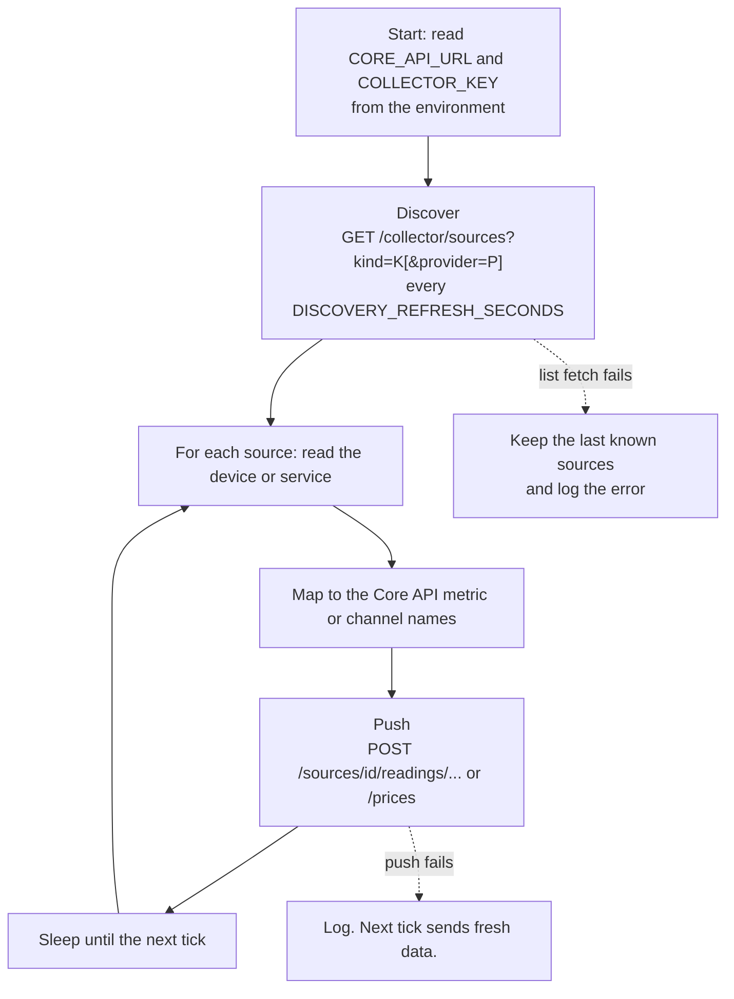
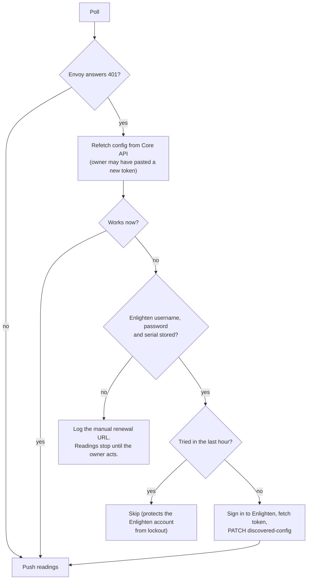

# Collectors

A collector is a small Python program that reads one kind of thing and pushes it to Core API. There are four. They share a contract, so a fifth is mostly a copy of an existing one (see [Adding a provider](adding-a-provider.md)). Programs that send commands to a device instead of reading from one are [actors](actors.md).

| Collector | Source kind and provider | Reads | Cadence | Key |
|---|---|---|---|---|
| [`envoy-collector`](../envoy-collector) | `energy` / `envoy` | Enphase Envoy on the LAN | Every 60 s | `ENVOY_COLLECTOR_KEY` |
| [`weatherlink-local-collector`](../weatherlink-local-collector) | `weather` / `weatherlink_live` | Davis WeatherLink Live on the LAN | Every 60 s | `WEATHER_COLLECTOR_KEY` |
| [`amber-pricing-collector`](../amber-pricing-collector) | `pricing` / `amber` | Amber's public API | 5 min live, 1 min recent, 12 h backfill | `PRICING_COLLECTOR_KEY` |
| [`local-pricing-collector`](../local-pricing-collector) | `pricing` / `local` | Core API only (no outside device) | Every minute check; daily push at 23:59 | `PRICING_COLLECTOR_KEY` |

## The shared contract

Every collector does the same four things.

Rules every collector follows:

- **Stateless where possible.** Config comes from Core API on each refresh. The only memory is small and per process (Envoy renewal timers, the weather collector's rain baseline, the local collector's per-source "done today" record). A restart is always safe.
- **One failure never stops the rest.** A source that errors is logged and skipped, and the loop continues with the others.
- **Configuration is environment variables.** `CORE_API_URL` and `COLLECTOR_KEY` are required; the rest have defaults. The Envoy and WeatherLink collectors also read `POLL_INTERVAL_SECONDS` (default 60) and `DISCOVERY_REFRESH_SECONDS` (default 300). The Envoy collector also reads `LIVE_SAMPLE_SECONDS` (default 3), `LIVE_STALE_SECONDS` (default 30) and `LIVE_BATTERY_SOURCE` (default `livedata`); see [Live-data sampling](#live-data-sampling).
- **The key identifies the kind, not the source.** Adding another home needs no new key.
- **Pricing collectors send `X-Collector-Provider`**, and ask for `provider=amber` or `provider=local` during discovery, so each sees only its own sources.
- **Each collector reports its build commit.** At start and every 60 seconds, `service_report.py` posts `{service, commit}` to `POST /api/v1/services/report` with `X-Collector-Key` on a daemon thread. A failed report is logged once per streak and retried. The commit is the first 7 characters of the `GIT_COMMIT` build arg, or `unknown`. The Amber and local pricing collectors fork worker processes, so each runs the reporter in its own small process instead. See [Service status](core-api.md#service-status).
- **Writes are idempotent.** The same reading or price can be sent twice.
- **A disabled site looks like an empty list.** `GET /collector/sources` leaves out every source on a disabled site, so the collector stops polling it at the next discovery refresh. A collector holding an older list gets 403 `site_disabled` on push. The Envoy and WeatherLink collectors then drop that batch, including any readings they were holding to resend, and log one warning until a push succeeds again. They treat 403 `source_disabled` and `source_expired` the same way. Other push failures (network errors, 5xx) still keep the readings for the next cycle. The pricing collectors hold nothing between ticks, so a refused push is lost and the next discovery refresh stops them asking. Re-enabling the site restores the source at the next refresh. Nothing backfills the gap.

## Envoy collector

[`envoy_collector/main.py`](../envoy-collector/envoy_collector/main.py) is the largest collector because the Envoy needs three safety mechanisms.

### Pinned TLS certificate

The Envoy presents a self-signed certificate. The collector uses trust-on-first-use:

1. On first sight of a source it fetches the certificate and stores its SHA-256 fingerprint, expiry and serial in the source config (through `discovered-config`).
2. It sends the access token only to a host that has been pinned.
3. If the Envoy later presents a different certificate, the collector fetches `/info.xml` from it without sending the token. It re-pins only when the source has a stored serial number, the device reports that same serial, and either the firmware (`<software>` in `/info.xml`) differs from the stored `firmware` or the pinned certificate is within 100 days of expiry. A re-pin logs a warning with the reason, clears the `cert` alert and raises a sticky `repinned` notice (see Alerts).
4. Otherwise it refuses, logs an error and raises the `cert` alert through `PUT /sources/{id}/alerts/cert`. The alert is one short line. The log says whether the firmware is unchanged or no stored firmware existed to compare.

The collector stores the firmware in the source config as `firmware` through `discovered-config`. A source whose firmware was never stored cannot be recognised as upgraded. Clear `cert_fingerprint` once; the next discovery stores the firmware.

Changing the **Host** in the web app clears the pin, because the pin belongs to the old device.

### Token renewal

Envoy tokens last about a year. If the owner stored Enlighten credentials, the collector renews automatically:

The refresh loop also renews proactively when the token has fewer than 14 days left.

### Live-data sampling

A background sampler per source reads the gateway's `/ivp/livedata/status` every `LIVE_SAMPLE_SECONDS` (default 3). Each minute the collector averages those samples into that minute's readings. A poll that returns the gateway's previous reading counts that reading again, so the average weights each reading by how long it lasted. Repeats stop counting once the feed has been stale for `LIVE_STALE_SECONDS`. If the feed has had no new reading for `LIVE_STALE_SECONDS` (default 30), or returns nothing, that minute uses single-sample polls of `/ivp/meters/readings` (the production and net-consumption meters' `activePower`) and `/ivp/ensemble/power` instead.

`LIVE_BATTERY_SOURCE` picks where a live minute's battery figures come from. With `livedata` (the default) it uses the feed's per-phase storage power and `soc`. With `ensemble` the collector reads `/ivp/ensemble/power` once a minute and takes battery power, state of charge and the battery term in `consumption_w` from it; if that call fails, the minute has no battery rows and battery power counts as 0. The `livedata` figures have not yet passed the battery sign check in the [design spec](superpowers/specs/2026-10-24-envoy-live-data-design.md#pending-live-verification); if charge and discharge look swapped or the numbers disagree with the Enphase app, set `LIVE_BATTERY_SOURCE=ensemble`. Any other value stops the collector at startup.

If the feed freezes while the calls still succeed, the sampler POSTs `{"enable": 1}` to `/ivp/livedata/stream`, at most once per `LIVE_STALE_SECONDS`.

Samples live in memory only. A restart loses at most the current minute's samples, and that minute falls back to a single reading.

Every sample added, repeats included, is also pushed to Core API as a live sample (`POST /sources/{id}/live/energy`), so the dashboard tiles update every few seconds. `map_live_sample_values` in `mapping.py` builds the values with the same sign and `invert_consumption_ct` rules as the stored readings. `consumption_w` is floored at 0, since the gateway's PV, grid and storage meters update at slightly different instants and the sum can dip below zero for a sample. A push has a 2 second timeout. A failed push is logged and dropped, without a retry, and never stops sampling; failures are rate-limited like the other live-feed errors. Live samples are not stored, so a Core API outage loses only the tile updates.

Once a minute the collector also reads `/ivp/meters/readings` and stores the metrics listed under [Metrics](data-model.md#metrics) (lifetime counters, grid voltage, relay state).

Deploy Core API before the collector. Core API accepts the new metrics through an Alembic migration, and it rejects them until that migration has run. Rolling back works the other way: roll the collector back first. If Core API's migration is downgraded while the new collector is still running, every push from it fails with 422, because each batch carries metric names Core API no longer accepts.

`LIVE_SAMPLE_SECONDS` must be at least 1, and `LIVE_STALE_SECONDS` must be at least `LIVE_SAMPLE_SECONDS`; otherwise the collector stops at startup with an error naming the variable.

Repeated failures of the live feed, the keepalive or the meter reads log one error with a traceback, then at most one warning every 10 minutes with the number of failures since the last line. A success ends the streak.

### Battery and sign handling

See [How it works, section 1](how-it-works.md#1-a-meter-reading-reaches-the-dashboard). A failed battery fetch costs only that cycle's battery data. An authentication failure is the exception: it bubbles up to trigger the token logic above.

## WeatherLink collector

[`weatherlink_local_collector/`](../weatherlink-local-collector/weatherlink_local_collector). The WeatherLink Live local API is plain HTTP on the LAN with no authentication, so there is no token and no pin.

| Device field | Metric | Conversion |
|---|---|---|
| `temp` (°F) | `temp_c` | (F − 32) × 5/9 |
| `hum` | `humidity_pct` | none |
| `wind_speed_avg_last_1_min` (mph) | `wind_speed_kph` | × 1.609344 |
| `wind_dir_scalar_avg_last_1_min` | `wind_direction_deg` | none |
| `solar_rad` | `solar_radiation_wm2` | none. Skipped if the sensor is absent. |
| `rainfall_daily` (clicks) | `rain_mm` | Clicks × rain-cup size, then **minus the previous poll's total** |
| `bar_sea_level` (inHg) | `barometric_pressure_hpa` | × 33.8639 |

Every value is rounded to one decimal place after conversion. The readings are for people to read, not for modelling.

Rain is the one stateful field. The device reports rain since midnight, so the collector keeps the last total (rounded to 0.1 mm) and sends the difference. Rounding the total, not each click, keeps the sum of the differences equal to the day's total on gauges with 0.254 mm clicks. The first poll after a start sends no rain reading. If a push fails, the baseline rolls back so the rain is reported next time instead of lost. A null field is skipped alone, because Core API rejects a whole batch that contains a null.

### Live push

Besides the 60 second stored poll, the collector runs a live loop (`run_live_loop` in `main.py`). Every `LIVE_POLL_SECONDS` (default 10, minimum 2) it reads each source's current conditions and pushes them to `POST /sources/{id}/live/weather`. A value below 2 stops the collector at startup. The live loop skips `rain_mm`, does not touch the rain baseline or the pending queue, and stores nothing. A failed poll or push is logged and dropped; only the first failure of a streak and the recovery are logged, so an unreachable station does not log every 10 seconds.

## Amber pricing collector

[`amber_pricing_collector/`](../amber-pricing-collector/amber_pricing_collector). `main.py` starts three loops in separate OS processes and keeps its own process single-threaded, because forking a multi-threaded process can inherit locked locks and deadlock.

| Loop | File | Cadence | Fetches | Purpose |
|---|---|---|---|---|
| Live | `live_poll.py` | Every 5 min, aligned to Amber's publish time | 1 closed interval and 300 forecast intervals | Current price and the rest of the day's forecast for the chart. Forecast intervals use Amber's `advancedPrice.predicted` as the price and also store its `low` and `high` |
| Recent | `live_poll.py` | Every minute (2 s buffer) | Last 3 closed intervals | Amber sometimes revises a price after an interval closes. This picks up the revision within a minute. |
| Backfill | `backfill.py` | 1 minute after startup, then every 12 hours | History in 7-day chunks | Fill days missing since the site's first data. A day counts as missing when it holds under 95% of its 5-minute intervals, so a day with only forecast rows is refilled. Records a gap marker for days Amber has none. |

Each tick starts a short-lived child process per source, so one slow source cannot delay another. There is no retry loop inside a child: the next tick is the retry.

`mapping.py` maps Amber's `general`, `feedIn` and `controlledLoad` channel types to `buy`, `sell` and `controlled_load`, and sends the price as a string to avoid float rounding.

## Local pricing collector

[`local_pricing_collector/`](../local-pricing-collector/local_pricing_collector). Process flow is in [How it works, section 3](how-it-works.md#3-prices-from-a-fixed-tariff-local-provider). File roles:

| File | Role |
|---|---|
| `poll.py` | The tick loop. Starts one child process per due source, reaps finished or overrun children (2 hour limit), records success. |
| `triggers.py` | Decides what is due: catch-up, the 23:59 scheduled push (retried until 02:00), or a reprice. Pure functions, easy to test. |
| `plan.py` | Turns triggers and existing coverage into date ranges to price. Splits long ranges into chunks. History is filled newest first. |
| `rates.py` | Expands rate windows into minute-accurate price intervals in the site's time zone. Start is included and end excluded. An end before the start wraps past midnight, and equal times mean all day. |
| `models.py` | Typed views of the source config and reprice marker. |
| `scheduling.py` | Tick alignment. |
| `core_api_client.py` | HTTP calls. |

## Alerts

Each collector reports problems the owner has to fix as alerts, which the Dashboard log shows. A collector calls `PUT /sources/{id}/alerts/{code}` with `{message, severity, sticky}` and `DELETE` on the same path when the cause goes away. Each service has its own `alerts.py`, the same convention as `service_report.py`. The state is in memory. After a restart the first success sends one `DELETE` per code, which clears alerts left from before.

`severity` is `failure` (red, the default), `partial` (amber) or `notice`. `sticky` (default false) keeps the alert on the Dashboard after the cause clears, until the owner dismisses it. A raise with a different severity than the last one sent is sent again even when the message is the same. The WeatherLink `iss` and `barometer` alerts are `partial` because the station still reports other readings. The Envoy `meters` alert is `partial` because power readings still flow. The Envoy `repinned` and `firmware` alerts are sticky notices. Every other alert is a `failure`. Messages are one short line with no IP address and no advice, and the Dashboard row adds the source name. Detail goes in the collector log, including the Enlighten renewal URL when the Envoy token is rejected.

A sticky notice is sent every time it is raised, skipping the duplicate check. If Core API is down, the collector keeps it and resends at the start of each poll until a PUT succeeds.

A problem that might be a blip raises its alert after 5 failures in a row (`ALERT_AFTER_FAILURES`). A problem that needs the owner raises at once.

| Service | Code | Raised when | Cleared when |
|---|---|---|---|
| envoy-collector | `cert` | The TLS certificate changed and was not re-pinned | The collector pins it |
| envoy-collector | `token` (`Envoy token rejected` when the token is still rejected, `Cannot renew the Envoy token` when renewal fails) | Enlighten rejected the renewal at once, or renewal keeps failing, or the token is still rejected | A poll succeeds |
| envoy-collector | `unreachable` (`Cannot connect to the Envoy`) | 5 failed polls | A poll succeeds |
| envoy-collector | `meters` (`Meter readings unavailable`), `partial` | 5 failed meter reads | A meter read succeeds |
| envoy-collector | `refused` (`Core API is refusing readings`) | Core API answered 403: the source or site is disabled or expired | Core API accepts readings |
| envoy-collector | `repinned`, sticky | A changed certificate was re-pinned. `failure` when the firmware changed (`Firmware updated X to Y, certificate re-pinned`), `notice` when the old certificate was near expiry (`Certificate re-pinned before it expired`). The firmware rule wins when both apply | The owner dismisses it |
| envoy-collector | `firmware`, `notice`, sticky | Discovery reads a firmware version that differs from the stored one while the certificate is unchanged (`Firmware updated X to Y`). The first read raises nothing | The owner dismisses it |
| weatherlink-local-collector | `unreachable` (`Cannot connect to the weather station`) | 5 failures in a row | The condition passes |
| weatherlink-local-collector | `iss` (`Not reporting outdoor (ISS) data`), `barometer` (`Not reporting barometer data`), both `partial` | 5 failures in a row each | The condition passes |
| weatherlink-local-collector | `refused` (`Core API is refusing readings`) | Core API answered 403 | Core API accepts readings |
| amber-pricing-collector | `amber_key` (`Amber rejected the API key`) | Amber answered 401 or 403 (at once) | A poll succeeds |
| amber-pricing-collector | `amber` (`Cannot get prices from Amber`) | 5 failed polls, or a child killed for running too long | A poll succeeds |
| local-pricing-collector | `pricing` (`Rates are not being priced`) | 5 failed or too-long runs | A run succeeds |
| local-pricing-collector | `timezone` (`Site time zone is not valid`) | The site time zone is invalid | The time zone is valid |
| local-pricing-collector | `reprice_marker` (`Reprice request is malformed`) | A reprice request is malformed | The marker is valid or cleared |
| actron-neo-actor | `tick` (`Cannot connect to Actron`) | 5 failed ticks for an instance, such as Actron being unreachable | A tick succeeds |

The Amber and local pricing polls run in child processes, so a child reports through its exit code and the parent loop raises or clears the alerts. An Amber child exits with `OK` 0, `CONFIG_FAILED` 10, `AMBER_REJECTED` 11, `AMBER_FAILED` 12 or `PUSH_FAILED` 13. A local pricing child exits 0 on success and 1 otherwise. Config and push failures change no Amber alert.

The actor reports through `PUT|DELETE /actor/instances/{id}/alerts/{code}` with its own key. Core API also keeps a site-level `notify_email` alert. See [Data model](data-model.md#alerts).

These problems are logged only and raise no alert:

- Skipped malformed Amber price intervals and malformed local rate windows.
- Envoy battery stream parse failures. A site without a battery fails that read every cycle by design.
- "No sources discovered yet".
- A failed refresh of the source list from Core API.
- Failures of core-api scheduled jobs.

## Failure behaviour at a glance

| Situation | What you see | Recovery |
|---|---|---|
| Core API down | Collectors log errors every cycle. Data for that period is lost for energy and weather. Pricing catches up later through backfill and catch-up. | Automatic when Core API returns. |
| Envoy unreachable | Log lines for the source. A gap in the dashboard. | Automatic. |
| Envoy token expired, no stored credentials | Log line with the renewal URL. Readings stop. | Owner pastes a new token. |
| Envoy certificate changed without a firmware change or an expiry within 100 days | Source keeps failing. Logged as an error and shown as a `cert` alert on the Dashboard. | Confirm the device is the same, then clear the pin (change the Host or edit the config). |
| Amber API key wrong | Pricing log errors. No new prices. | Owner updates the key under Account settings. |
| Rate window left uncovered | Minutes without a price are left out of cost totals. The web app names the first uncovered time. | Owner adds a window. |

Read logs with `docker compose logs -f <service>`. See [Operations](operations.md#reading-logs).
