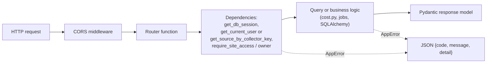

# Core API

FastAPI application in [`core-api/`](../core-api). It is the only service that reads or writes the database. Interactive API docs are served at `/docs` on a running instance (for example <http://localhost:8000/docs>), and that page is the authoritative endpoint reference. This page explains the structure and the rules behind it.

## Module map

| Module | Responsibility |
|---|---|
| `main.py` | `create_app()`. Builds the engine eagerly (so plain `TestClient` works without running the lifespan), mounts every router under `/api/v1`, adds CORS for `FRONTEND_BASE_URL`, exposes `GET /health`. |
| `config.py` | `get_settings()` reads environment variables. Missing required values raise at startup. |
| `db.py` | Engine and session factory. Turns on `PRAGMA foreign_keys=ON` for SQLite. |
| `bootstrap.py` | `python -m core_api.bootstrap` runs Alembic to `head`. Safe to repeat. |
| `admin_user.py` | Creates the first user on an empty database and writes the one-time password file. |
| `deps.py` | FastAPI dependencies: current user, setup and MFA tokens, site access, collector-key checks. |
| `security.py` | bcrypt, JWT creation and decoding, TOTP, token hashing, keyed recovery-code hashing. |
| `encrypted_types.py` | `EncryptedString` and `EncryptedJSON` column types. Fernet encryption on write, decryption on read. |
| `attempt_tracker.py`, `login_attempts.py`, `mfa_attempts.py` | In-memory sliding-window lockouts (5 failures in 15 minutes). |
| `errors.py` | `AppError` and handlers. Every error returns `{code, message, detail}`. |
| `schemas.py` | Pydantic request and response models, including `UtcDatetime`. |
| `models/` | SQLAlchemy tables. See [Data model](data-model.md). |
| `routers/` | One file per resource area. |
| `cost.py` | The cost calculation. The largest module. See [How it works](how-it-works.md#4-how-cost-is-calculated). |
| `local_rates.py`, `local_reprice.py` | Validation of rate windows and creation of reprice markers. |
| `pricing_gaps.py`, `readings_query.py`, `time_utils.py`, `timing.py` | Gap detection, raw-or-rollup reading queries, UTC and time zone helpers. |
| `email_sender.py` | `SmtpEmailSender` for production, `FakeEmailSender` for tests. |
| `scheduler.py` | Builds the APScheduler instance. |
| `jobs/` | The three background jobs and their helpers. |

## Request lifecycle



Authorization is in the dependencies, not in the function bodies. A router function that asks for `require_site_owner` can assume the caller owns the site. This is the main thing to preserve when adding endpoints: pick the dependency first.

| Dependency | Passes when | Failure |
|---|---|---|
| `get_current_user` | A valid access JWT whose user still exists | 401 `missing_token` or `invalid_token` |
| `require_setup_token` | A valid `totp_setup` scoped token | 401 |
| `require_mfa_token` | A valid `mfa` scoped token and the user is not locked out | 401 `too_many_attempts` |
| `require_site_access` | Owner or `site_access` row | 404 `not_found` (also for sites the caller cannot access) |
| `require_site_owner` | Owner only | 404 `not_found` if the caller has no access, 403 `forbidden` for a viewer |
| `get_source_by_collector_key` | Correct key for the source's kind, matching provider header if sent, source enabled and within its effective dates | 401 `invalid_collector_key`, 403 `source_disabled` / `source_expired` |
| `require_source_kind(kind)` | The above, and the source is that kind | 403 `wrong_source_kind` |

## Endpoints

All paths are under `/api/v1`. "Owner" means `require_site_owner`, "Viewer" means `require_site_access` (owner or viewer).

### People

| Area | Endpoints | Who |
|---|---|---|
| Sign-up and sign-in | `POST /auth/register`, `/auth/register/confirm`, `/auth/login` | Anyone |
| Two-factor | `POST /auth/totp/setup/start`, `/setup/confirm`, `/verify` | Scoped tokens |
| Password reset | `POST /auth/password-reset/request`, `/confirm` | Anyone |
| Account | `GET/PATCH /users/me`, `PATCH /users/me/profile`, `POST/GET/DELETE /users/me/avatar`, `POST /users/me/password`, `POST /users/me/email/change/request` and `/confirm`, `POST /users/me/totp/reenroll/start` and `/confirm` | Logged-in user. Password, email and TOTP changes require a current password or code. |
| Sites | `POST/GET /sites`, `GET/PATCH /sites/{id}`, `POST/GET /sites/{id}/access`, `DELETE /sites/{id}/access/{user_id}` | Owner for writes |

### Site configuration

| Area | Endpoints | Who |
|---|---|---|
| Sources | `POST/GET /sites/{id}/sources`, `GET/PATCH/DELETE /sites/{id}/sources/{sid}` | Owner for writes. Viewers get a copy with device credentials removed. |
| Rate windows | `POST/GET /sites/{id}/sources/{sid}/rate-windows`, `PATCH/DELETE .../{window_id}` | Owner for writes |
| Tariffs | `POST/GET /sites/{id}/tariffs`, `PATCH .../tariffs/{tid}` | Owner for writes |
| Tariff windows | `POST/GET /sites/{id}/tariffs/{tid}/demand-windows`, `/export-adjustments`, `/conditional-credits`, `/monthly-fee-discounts` | Owner for writes |
| Billing cycle | `POST/GET /sites/{id}/billing-cycle`, `PATCH .../billing-cycle/{cid}` | Owner for writes |

### Reading data (web app)

| Endpoint | Returns |
|---|---|
| `GET /sites/{id}/readings/energy`, `/readings/weather`, `/prices` | Time series for a range. Reads raw rows for the last 365 days and rollups before that. |
| `GET /sites/{id}/cost?start&end&method=net\|gross[&prorate_fees]` | Total cost in cents, import and export kWh, minutes missing a price |
| `GET /sites/{id}/cost/billing-period?method=` | Running cost for the current billing period, plus monthly fee discounts. 404 `no_active_billing_cycle` when none. |
| `GET /sites/{id}/billing-period` | Start and end of the current billing period. 404 `no_active_billing_cycle` when none. |
| `GET /sites/{id}/cost/series?start&end&method&bucket=5min\|15min\|hour\|6hour` | Cost per bucket for charts |
| `GET /sites/{id}/demand-charges` | One row per billing period |
| `GET /sites/{id}/demand-window/active` | The window active now, or 404 `no_active_demand_window` |

### Collectors

All collector endpoints send `X-Collector-Key`. Per-source endpoints may also send `X-Collector-Provider`.

| Endpoint | Purpose |
|---|---|
| `GET /collector/sources?kind=&provider=` | List enabled, in-date sources of a kind with their resolved config |
| `GET /sources/{id}/config` | One source's resolved config |
| `PATCH /sources/{id}/discovered-config` | Merge facts the collector learned (serial number, certificate pin, renewed token) into the stored config |
| `POST /sources/{id}/readings/energy`, `/readings/weather` | Batch upsert of readings |
| `POST /sources/{id}/prices` | Batch upsert of price intervals, with minute fan-out |
| `GET /sources/{id}/prices/coverage`, `/prices/gaps?since=` | What is already priced, which days are missing |
| `POST /sources/{id}/prices/gap-markers` | Record a day the provider has no data for |
| `POST /sources/{id}/prices/reprice-marker/clear` | Clear a reprice marker if its version still matches |
| `GET /sources/{id}/site-data-floor` | Earliest reading on the site, so backfills know where to stop |

**Config resolution.** `resolve_source_config()` in `routers/collector_config.py` is what a collector receives. For `local` sources it ignores the stored config and builds `{timezone, rate_windows, reprice}` from the rate window tables. For `amber` it adds the site owner's API key. Everything else is the stored config as is.

## Errors

Every error has the same JSON body:

```json
{ "code": "source_has_readings", "message": "This source has existing readings and cannot be deleted. Disable it instead.", "detail": null }
```

Validation failures use code `validation_error` and HTTP 422. The `code` is stable and meant for programs. The `message` is for people and may change. Codes the web app depends on specially: `missing_token` and `invalid_token` log the user out; other 401 codes (wrong password, wrong TOTP code) are shown as form errors.

## Background jobs

[`scheduler.py`](../core-api/core_api/scheduler.py) starts one `BackgroundScheduler` inside the process. Each job opens its own session, runs for every site, commits, and uses `coalesce=True, max_instances=1` so a slow run never overlaps itself. Disable all jobs with `SCHEDULER_ENABLED=false`. The tests never start them, because `TestClient` is used without running the app lifespan, where the scheduler is created.

| Job | Schedule | What it does | Idempotent because |
|---|---|---|---|
| `demand_interval` | Every 5 minutes | Derives `demand_intervals` for each 5-minute slot | Upsert on (site, interval_start). Recomputes the last 3 hours. |
| `demand_charge` | Daily 00:10 | Computes `demand_charges` for each billing period | Finalized rows are skipped. Estimated rows are recomputed. |
| `retention_rollup` | Daily 00:20 | Moves readings older than 365 days into 5-minute rollups and deletes the raw rows | Upsert into rollups, delete after. Cutoff is floored to a bucket boundary. |

Times use the container's clock (UTC in the image).

## Configuration

| Variable | Required | Default | Purpose |
|---|---|---|---|
| `JWT_SECRET` | yes | none | Signs access and scoped tokens. Changing it logs everyone out. |
| `SECRETS_ENCRYPTION_KEY` | yes | none | A Fernet key (`openssl rand -base64 32 \| tr '+/' '-_'`). Encrypts stored credentials and keys the recovery-code hash. Losing it makes those values unreadable. |
| `ENVOY_COLLECTOR_KEY` | yes | none | Shared secret for `energy` collectors |
| `WEATHER_COLLECTOR_KEY` | yes | none | Shared secret for `weather` collectors |
| `PRICING_COLLECTOR_KEY` | yes | none | Shared secret for `pricing` collectors (Amber and local) |
| `DATABASE_URL` | no | `sqlite:///./core_api.db` | Compose sets `sqlite:////data/core_api.db` |
| `AVATAR_STORAGE_DIR` | no | `./data/avatars` | Compose sets `/data/avatars` |
| `JWT_EXPIRY_HOURS` | no | `24` | Access token lifetime |
| `FRONTEND_BASE_URL` | no | `http://localhost:5173` | CORS origin and the base of links in emails |
| `SMTP_HOST`, `SMTP_PORT` | no | `mail-relay`, `25` | Outbound mail |
| `SMTP_FROM` | no | `noreply@localhost` | Sender address |
| `SMTP_USER`, `SMTP_PASSWORD` | no | unset | Only if the relay needs authentication |
| `SCHEDULER_ENABLED` | no | `true` | `false`, `0` or `no` turns the jobs off |
| `ADMIN_EMAIL` | no | `admin@example.com` | Email of the first user, created on an empty database |

## Where secrets are stored

The rule, from the Storing Secrets section of [`CLAUDE.md`](../CLAUDE.md): never store a secret in plain text, and choose the storage by whether the app needs the value back.

| Kind of value | Storage | Why |
|---|---|---|
| Passwords | bcrypt hash (`hash_password`) | The app only checks them |
| Password-reset, email-confirmation and email-change tokens | SHA-256 (`hash_token`) | 256-bit random values cannot be brute-forced, so a plain hash is enough |
| TOTP recovery codes | Keyed HMAC-SHA256 (`hash_recovery_code`), 16 hex characters | Short enough that a plain hash could be guessed offline from a leaked database. The HMAC key is derived from `SECRETS_ENCRYPTION_KEY`. |
| `sources.config` (Envoy token, Enlighten login, and the rest), `users.amber_api_key`, `users.totp_secret`, `users.pending_totp_secret` | Fernet encryption (`EncryptedJSON`, `EncryptedString` in `encrypted_types.py`) | The app has to send these on, so a hash would be useless |

Consequences to know about:

- **A stolen database file is not enough** to read device credentials or the Amber key. The attacker also needs `SECRETS_ENCRYPTION_KEY`, which lives in the environment, not the database.
- **Lose the key and those values are gone.** Source configs, Amber keys and authenticator secrets cannot be decrypted. Keep a copy somewhere other than the server.
- **Changing the key has no migration path.** Nothing in the repository re-encrypts existing rows under a new key, so treat the key as permanent. Changing it also invalidates every recovery code.
- **Encrypted columns cannot be filtered or compared in SQL.** Each encryption uses a random IV, so the same value gives different ciphertext. Load the row and compare in Python, or test `IS NOT NULL`.
- **Reading a row decrypts it.** A wrong or missing key makes reads of those rows fail rather than return blanks.
- The `EncryptedString` column is 1024 characters wide because a Fernet token is about 1.4 times the plaintext plus 100 bytes.

Two migrations introduced this. `c5d8f1a3b6e2` encrypts existing plaintext rows in place and skips rows already encrypted, so a rerun after a failure is safe. `d3a7b9c1e4f8` deletes every existing recovery code, because the old unkeyed hashes cannot be converted. After upgrading, users with two-factor enabled have no recovery codes until they use **Replace authenticator** in Account settings, which issues a new set.

## Conventions in the code

- Request bodies and responses are Pydantic models. Routers do not return ORM objects with sensitive columns unless the model hides them.
- Upserts use SQLite's `insert ... on conflict do update`. They live in `routers/ingestion.py` and `jobs/`.
- Enums are stored as lowercase strings with a database `CHECK` constraint (`str_enum` and `enum_check` in `models/base.py`).
- Comments explain why. Many modules open with the reason a decision was taken, often citing the spec in [`docs/superpowers/specs`](superpowers/specs).
