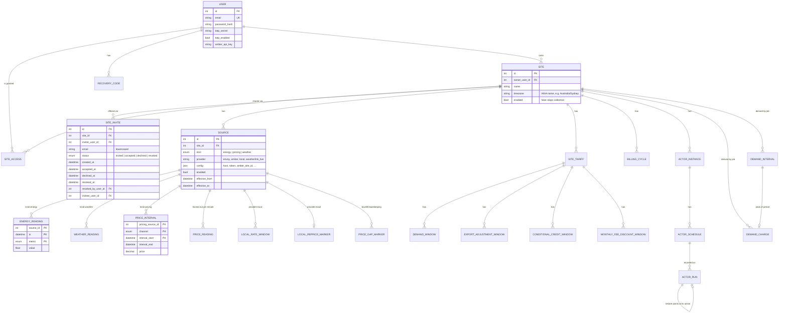
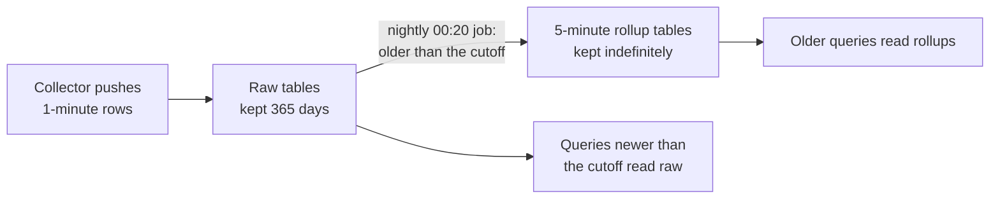

# Data model

The schema is defined in [`core-api/core_api/models/`](../core-api/core_api/models) and built by the Alembic migrations in [`core-api/alembic/versions/`](../core-api/alembic/versions). When this page and the models disagree, the models are right.

## Entity map



## Users and access

| Table | Purpose |
|---|---|
| `users` | Email, bcrypt password hash, TOTP secret, optional Amber API key. The Amber key belongs to the user, not a site. The TOTP secrets and the Amber key are encrypted at rest. |
| `sites` | A property. Has one owner and an IANA time zone that all local-time rules use. `enabled` (default true) switches collection off; see [Disabled sites](#disabled-sites). |
| `site_access` | Extra read-only grants. The only role today is `viewer`. Ownership is `sites.owner_user_id` and nowhere else. Permission checks read this table. It is written by accepting an invite and deleted by revoking one. |
| `site_invites` | Emailed invitations to view a site. Append-only record, see [Invitations](#invitations). |
| `recovery_codes` | One-time TOTP recovery codes, stored as a keyed HMAC (not reversible, and useless without `SECRETS_ENCRYPTION_KEY`). Ten 16-character codes are issued at enrolment. |
| `password_reset_tokens`, `email_confirmation_tokens`, `email_change_tokens` | Single-use, expiring tokens. Only the SHA-256 hash is stored. The raw token exists in the email and nowhere else. |

Columns holding credentials are stored as Fernet tokens (`gAAAA...` text) and decrypted by the ORM on read: `users.amber_api_key`, `users.totp_secret`, `users.pending_totp_secret`, `sources.config` and `actor_instances.config`. They cannot be filtered in SQL. See [Core API](core-api.md#where-secrets-are-stored).

### Invitations

`site_invites` holds one row per invitation: the site, the inviting owner, the lowercased `email`, a `status` and one timestamp per transition (`accepted_at`, `declined_at`, `revoked_at`). `invitee_user_id` is set when the recipient accepts or declines. `revoked_by_user_id` is set on revoke. A check constraint limits `status` to `invited`, `accepted`, `declined` and `revoked`.

Rows are append-only. No code path deletes one, and the only update is a forward status change with its timestamp. Inviting an address again after a decline or revoke adds a new row. No token is stored: the recipient matches by confirmed email address, so the table holds no secret.

The migration `e5a7b9c2d4f6` turns each existing `site_access` row into an `accepted` invite from the site owner, using the viewer's email.

### Disabled sites

`sites.enabled` is a non-null boolean that defaults to true, and the migration `d4f6a8b1c3e5` leaves every existing site enabled. A disabled site keeps all its rows. Collector discovery skips its sources, and `get_source_by_collector_key` returns 403 `site_disabled` for writes. Reads, the demand-charge job and the rollup jobs are unchanged, because they only work from stored data.

## Sources

A **source** ties a site to one device or service.

| Kind | Providers in use | `config` holds |
|---|---|---|
| `energy` | `envoy` | `host`, `token`, `username`, `password` (Enlighten), `serial_num`, `invert_consumption_ct`, plus `cert_fingerprint`, `cert_expires_at`, `cert_serial`, `firmware` written by the collector |
| `pricing` | `amber` | `amber_site_id` |
| `pricing` | `local` | Nothing. Rates live in `local_rate_windows`. Core API builds the config the collector sees. |
| `weather` | `weatherlink_live` | `host` |

The whole `config` value is encrypted at rest, whatever the provider.

`alert_message` and `alert_since` (nullable, migration `f6b2d8a4c1e7`) hold a problem the collector reported through `PUT /sources/{id}/alert`. Both are null when there is no alert. They are plain text, not credentials.

Rules the code enforces:

- At most one **pricing** source is active per site at a time. The check is in application code (`routers/sources.py`) because SQLite has no range-exclusion constraint.
- At most one **weather** source per site, through a partial unique index.
- A source with readings cannot be deleted, only disabled. A disabled pricing source still occupies the site's pricing place. Retiring one means setting `effective_to` through the API.
- `provider` is free text. Only `local` has special validation (it must be a pricing source and needs a tariff name).

## Time series

All time-series tables use the same shape: the key is the source, the timestamp and a metric (or channel). Writes are upserts, so a collector can resend a batch safely.

| Table | Key | Value | Notes |
|---|---|---|---|
| `energy_readings` | source, ts, metric | float | Raw, one row per metric per minute |
| `weather_readings` | source, ts, metric | float | Raw |
| `price_intervals` | source, channel, interval_start | decimal(12,4) | What the provider published, with `interval_end` |
| `price_readings` | source, ts, channel | decimal(12,4) | One row per minute, derived from `price_intervals` when they are ingested |
| `*_rollup_5m` | as above | as above | 5-minute summaries of data older than 365 days |

### Metrics

| Energy metric | Unit | Meaning |
|---|---|---|
| `production_w` | W | Solar generation, from the Envoy's CT-metered reading |
| `consumption_w` | W | Whole-home use. On a battery site the collector adds the battery term back so this is the true household figure. |
| `grid_import_w` | W | Power drawn from the grid. Written only while importing. |
| `grid_export_w` | W | Power sent to the grid. Written only while exporting. |
| `battery_charge_w` | W | Written only while charging, as a positive number |
| `battery_discharge_w` | W | Written only while discharging, as a positive number |
| `battery_soc_pct` | % | State of charge, averaged across battery units |
| `production_wh_lifetime` | Wh | Lifetime counter from the production meter. Stored unmodified and not validated. No chart uses it yet. |
| `grid_import_wh_lifetime` | Wh | Lifetime import counter from the grid meter. Stored unmodified and not validated. No chart uses it yet. |
| `grid_export_wh_lifetime` | Wh | Lifetime export counter from the grid meter. Stored unmodified and not validated. No chart uses it yet. |
| `grid_voltage_ph_a_v`, `grid_voltage_ph_b_v`, `grid_voltage_ph_c_v` | V | Grid voltage per phase. One row per phase the grid meter reports. |
| `grid_relay_state` | 0 or 1 | Main relay state from the live feed. Written on each minute the live feed supplies the readings, not on fallback minutes. |

The collector rounds every weather value to one decimal place before storing it.

| Weather metric | Unit |
|---|---|
| `temp_c` | °C |
| `humidity_pct` | % |
| `wind_speed_kph` | km/h (1-minute average) |
| `wind_direction_deg` | degrees (1-minute average) |
| `rain_mm` | mm since the previous reading. The deltas add up to the day's total, which the dashboard sums from local midnight |
| `solar_radiation_wm2` | W/m² |
| `barometric_pressure_hpa` | hPa |

| Price channel | Meaning |
|---|---|
| `buy` | Price paid per kWh imported |
| `sell` | Price per kWh exported. **Stored negative when you are paid.** |
| `controlled_load` | Price on a separate controlled-load circuit |
| `demand` | Defined in the enum. No collector or calculation uses it today, and local tariffs cannot use it. |

## Time and units

- **Timestamps are UTC.** The API converts any offset it receives to UTC and treats a timestamp with no offset as already UTC. Always send an explicit offset or `Z`. SQLite drops time zone information on storage, so the code calls `as_utc()` (`core_api/time_utils.py`) after reading. Forgetting that gives comparison errors between naive and aware values.
- **Local time appears in rules only.** Tariff windows, billing-cycle anchor days, the daily service charge and the Today view are all defined in the site's time zone. Conversion uses `zoneinfo`, so daylight saving days are 23 or 25 hours long.
- **Minute alignment.** Collectors stamp readings at the start of the minute (`second=0`). Providers stagger price intervals by a second (Amber publishes `23:55:01Z`), so ingestion floors each derived `price_readings` minute. Cost is an exact-timestamp join, and a `:01` price would never match a `:00` reading.
- **Money.** Prices are cents per kWh. Tariff fees are cents per day, or cents per month for the monthly fee. Demand rates are cents per kW per day. Costs are `Decimal`, never `float`.
- **Energy.** A reading of N watts held for one minute is N / 60 000 kWh.

### Sign conventions

| Quantity | Convention |
|---|---|
| Sell price | Negative when you are paid. Amber sends it that way. The `local` collector flips the sign of the positive rate you typed in. Positive only during a negative feed-in event. |
| Local rate windows | Stored positive for every channel. |
| Export adjustment | Positive is an incentive (more revenue), negative a disincentive. It is subtracted from the sell price, so a positive value pushes the price further negative. |
| Conditional credit | Applied as negative cents (a reduction in cost). |
| Cost | Positive is money owed, negative is money earned. |
| Battery | Charge and discharge are separate metrics, both positive. Inside the collector, net battery power is positive when discharging. |
| Envoy CT clamp | `invert_consumption_ct` flips consumption and net-consumption signs for a physically reversed clamp. Symptom: importing shows as negative. |

## Billing tables

| Table | Purpose |
|---|---|
| `site_tariffs` | Effective-dated. Holds the service charge (c/day) and an optional monthly fee. A later tariff does not rewrite history. |
| `demand_windows` | Months, days of week, time range, rate (c/kW/day) and the measurement interval (default 30 min). First matching window wins. Has `effective_from` and `effective_to`, like the next two tables. |
| `export_adjustment_windows` | Same pattern. Matching windows stack (their values add). |
| `conditional_credit_windows` | A flat credit for each day whose average grid import over the window is below a limit. Windows stack. Computed on request, never stored per day. |
| `monthly_fee_discount_windows` | A dated span that replaces the monthly fee. First match wins. |
| `billing_cycles` | Cycle length in months and an anchor day (1 to 31). Effective-dated. |
| `demand_intervals` | Derived every 5 minutes: a rolling sum of grid import for demand-window slots. |
| `demand_charges` | One row per site per billing period. `is_estimated` is true until the period has closed and every 5-minute slot has readings. |

The three tariff windows with a pattern (`demand_windows`, `export_adjustment_windows`, `conditional_credit_windows`) have their own `effective_from` (required) and `effective_to`, a half-open span like `site_tariffs`. A window applies only at instants inside its span. A user enters a start date and an end date (the last day applied); `effective_to` is stored as 00:00 local on the day after. Tariffs and billing cycles of one site may not overlap. When dates change, `demand_charges` and `demand_intervals` from the earliest changed instant onward are deleted and rebuilt by the demand jobs.

Window patterns (`months`, `days_of_week`, `start_time`, `end_time`) share one rule set. Days are `0` for Monday to `6` for Sunday and months are `1` to `12`. Start is included and end is excluded. For local rate windows only, equal start and end times mean the whole day and an end before the start runs past midnight.

## Local pricing tables

| Table | Purpose |
|---|---|
| `local_rate_windows` | One rate (c/kWh) on one channel for a recurring pattern, with `effective_from` and `effective_to`. Overlap on the same channel is refused. |
| `local_reprice_markers` | At most one per source: the earliest instant whose price may have changed because a window was added, edited or deleted. `version` increases on every change so a collector clearing an old marker does not erase a newer edit. |
| `price_gap_markers` | Days a provider confirmed it has no data for, so backfill stops asking. |

## Service status

`service_status` holds the latest report from each service, one row per service. The migration is `a1b2c3d4e5f6`.

| Column | Type | Meaning |
|---|---|---|
| `service` | string(64), primary key | Service name, such as `core-api` or `envoy-collector` |
| `commit` | string(40) | The commit the service reported |
| `reported_at` | timestamp with time zone | When Core API stored the report |

The table holds no secrets. `GET /services` adds the `reporting` flag at read time; it is not stored. See [Service status](core-api.md#service-status).

## Actor tables

Three tables hold the [actors](actors.md) feature. The migrations are `895863e431c6` and `e5a7c9b1d3f2` (multi-action schedules). The downgrade of `e5a7c9b1d3f2` maps `partial` runs to `failed`. A downgrade while a `partial` run holds the unit needs a manual restore, because the old code treats the run as `failed` and cannot read the list-form snapshot.

| Table | Purpose |
|---|---|
| `actor_instances` | One signed-in device account at a site. Columns: `site_id`, `provider` (free text, `actron_neo` today), `name`, `enabled`, `config` (`EncryptedJSON`, holds the refresh token), `auth_state` (`EncryptedJSON`, holds the sign-in code and link), `capabilities`, `capabilities_updated_at`, `latest_readings`, `last_seen_at` (set when the actor reports readings). |
| `actor_schedules` | One schedule on one instance, with 1 to 8 actions: `instance_id`, `name`, `enabled`, `trigger`, `conditions`, `actions`, `restore`, `retry`, `notify_email` (default false), `created_at`. |
| `actor_runs` | One row per attempt: `schedule_id`, `kind`, `trigger_at`, `started_at`, `finished_at`, `outcome`, `message`, `attempts`, `steps`, `parent_run_id`, `snapshot`, `watchdog_notified_at`. |

`kind` is `action`, `restore` or `test`. `outcome` is `pending`, `running`, `ok`, `skipped`, `partial`, `failed` or `overridden`. Both are text with a `CHECK` constraint. A unique constraint on (`schedule_id`, `kind`, `trigger_at`) stops a restart or a second actor process from running the same trigger twice. `parent_run_id` is set on restore rows only, is indexed, and points at the action run that holds the snapshot. Deleting a schedule or instance deletes its runs; the API does this because the foreign keys have no cascade.

`config` and `auth_state` are encrypted. Anyone holding the sign-in code could approve it for their own Actron account, so it is treated as a secret. `capabilities` and `latest_readings` are plain JSON and hold no secret: `latest_readings` is the unit's state without the raw status. The owner API never returns `config`, and returns the sign-in code and link to the site owner only.

### JSON shapes

Core API validates these on write with the models in [`actor_schemas.py`](../core-api/core_api/actor_schemas.py) and rejects unknown keys. Times are `HH:MM` in the site time zone.

`trigger` has a `type`:

```json
{ "type": "window_start", "window_id": 12 }
{ "type": "window_end", "window_id": 12 }
{ "type": "time", "time": "16:00", "days_of_week": [0, 1, 2, 3, 4] }
{ "type": "price_above", "c_per_kwh": 60.0 }
```

`days_of_week` defaults to all seven days (0 is Monday) and needs at least one. `window_id` must be a demand window of the site's tariffs.

`conditions` is a list. `restore.only_if` and `restore.early_if` use the same item shape:

```json
{ "reading": "indoor_temp_c", "op": "gt", "value": 27.0, "target": null, "enabled": true }
```

`op` is `gt` or `lt`. `target` names one of a reading's declared targets, such as a zone. `enabled` defaults to true; a row saved before the field existed counts as enabled. A row with `enabled: false` is kept and ignored.

`actions` is a list of 1 to 8 entries. Each entry names a declared action and gives every one of its params. The actor runs them in list order:

```json
[
  { "id": "set_zones", "params": { "zones": ["Study"], "enabled": false } },
  { "id": "set_zone_temperature", "params": { "zone": "Family", "temperature_c": 23.0 } }
]
```

The column was `action` (one entry) before the multi-action change, and the migration wrapped each stored value in a list of one. For one release, API responses also return `action`, equal to the first entry. Requests accept only `actions`. Deploy Core API first, then the actor, then the web app. The actor must not go first: an old Core API refuses the `steps` and `partial` the new actor sends with 422, so the run stays `running` and the unit stays held with no restore until Core API is upgraded. While Core API is new and the actor is still old, the old actor reads `action` (the first entry), so a multi-action schedule runs only its first action and reports `ok`, and its single-entry snapshot restores through the new code. The web app goes last because an old Core API rejects `actions` and the page reads `schedule.actions`.

`restore` (the values below are the defaults where a default exists):

```json
{ "enabled": true, "when": "window_end", "minutes": null, "time": null, "only_if": [], "early_if": [] }
```

`when` is `window_end`, `after_minutes`, `at_time` or `conditions_only`. `minutes` (at least 1) is required for `after_minutes`, and `time` for `at_time`. `window_end` needs a `window_start` trigger when restore is on.

`retry`:

```json
{ "max_attempts": 3, "interval_seconds": 30, "give_up_minutes": 15 }
```

The minimums are 1, 5 and 1.

`capabilities` is what the actor declared:

```json
{
  "version": 1,
  "actions": [
    {
      "id": "set_fan_mode", "label": "Set fan speed", "restorable": true,
      "params": [
        { "name": "fan_mode", "label": "Fan speed", "type": "choice",
          "options": [{ "value": "AUTO", "label": "Auto" }] }
      ]
    }
  ],
  "readings": [
    { "id": "zone_temp_c", "label": "Zone temperature", "unit": "C", "type": "number",
      "target_options": [{ "value": "Study", "label": "Study" }] }
  ]
}
```

A param `type` is `number` (with optional `min`, `max`, `unit`), `choice`, `bool` or `multi_choice` (both choice types use `options`).

`auth_state` is `{ "user_code", "verification_uri", "expires_at" }` while the actor waits for approval, `{ "needs_sign_in": true }` after Actron rejects the stored token, and `null` otherwise. The owner API gives a viewer `{ "signing_in": true }` in place of the code shape, so a viewer never receives the code, the link or the expiry. That shape is never stored.

`latest_readings` is the unit's state exactly as the actor sent it: `is_on`, `mode`, `fan_mode`, `cool_setpoint_c`, `heat_setpoint_c`, `enabled_zones` (zone name to boolean), `indoor_temp_c`, `outdoor_temp_c`, `humidity_pct`, `zone_temps_c`, `zone_setpoints_c` (zone name to setpoint), `zone_ranges_c` (zone name to `[min, max]`), `setpoint_min_c`, `setpoint_max_c` and `updated_at` (UTC).

`steps` on an action run is a list with one entry per action, in list order. It is written when the run finishes. After a restart the actor re-derives progress from the unit's state:

```json
{ "index": 1, "action_id": "set_zone_temperature", "params": { "zone": "Study", "temperature_c": 28.0 },
  "outcome": "failed", "message": "Study 28°C is outside 20.0–24.0°C (the unit is set to 22.0°C)", "attempts": 1 }
```

A step `outcome` is `ok` or `failed`. The run `outcome` follows from the steps: all `ok` gives `ok`, some of each gives `partial`, all `failed` gives `failed`. `ok` and `partial` runs owe a restore.

`snapshot` on an action run is the actor's record of what it set and what it saved. The actor defines it, and Core API stores it as opaque JSON. The Actron actor builds it for all actions from the unit's state before it sends any command, and writes `{ "actions": [{ "action", "applied", "saved" }, ...] }`, one entry per action. Runs made before the upgrade hold the single-entry shape `{ "action", "applied", "saved" }`, and restore still accepts it.

## Retention



The rollup job averages each 5-minute bucket, with two exceptions: `battery_soc_pct` keeps the last value, and `wind_direction_deg` uses a circular mean (350° and 10° average to 0°, not 180°). The cutoff is floored to a 5-minute boundary so a bucket is never split. A query that spans the cutoff reads both tables.

Cost calculations read raw minutes, so cost for a range older than a year is not available at minute resolution.
