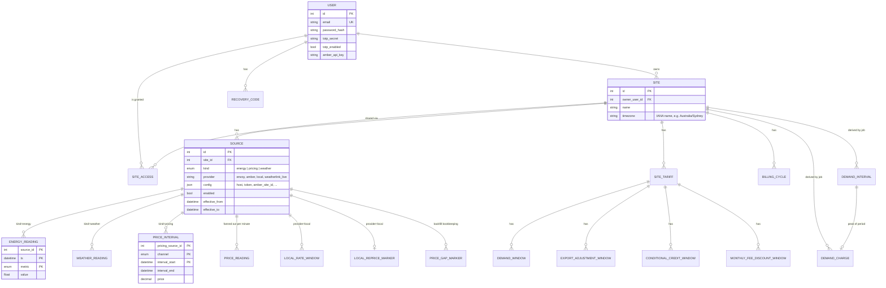
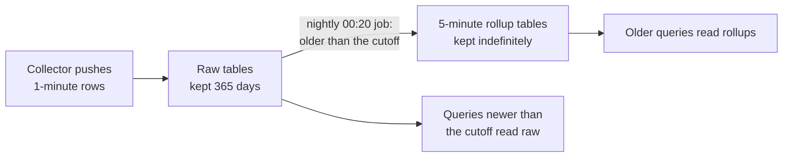

# Data model

The schema is defined in [`core-api/core_api/models/`](../core-api/core_api/models) and built by the Alembic migrations in [`core-api/alembic/versions/`](../core-api/alembic/versions). When this page and the models disagree, the models are right.

## Entity map

## Users and access

| Table | Purpose |
|---|---|
| `users` | Email, bcrypt password hash, TOTP secret, optional Amber API key. The Amber key belongs to the user, not a site. The TOTP secrets and the Amber key are encrypted at rest. |
| `sites` | A property. Has one owner and an IANA time zone that all local-time rules use. |
| `site_access` | Extra read-only grants. The only role today is `viewer`. Ownership is `sites.owner_user_id` and nowhere else. |
| `recovery_codes` | One-time TOTP recovery codes, stored as a keyed HMAC (not reversible, and useless without `SECRETS_ENCRYPTION_KEY`). Ten 16-character codes are issued at enrolment. |
| `password_reset_tokens`, `email_confirmation_tokens`, `email_change_tokens` | Single-use, expiring tokens. Only the SHA-256 hash is stored. The raw token exists in the email and nowhere else. |

Columns holding credentials are stored as Fernet tokens (`gAAAA...` text) and decrypted by the ORM on read: `users.amber_api_key`, `users.totp_secret`, `users.pending_totp_secret` and `sources.config`. They cannot be filtered in SQL. See [Core API](core-api.md#where-secrets-are-stored).

## Sources

A **source** ties a site to one device or service.

| Kind | Providers in use | `config` holds |
|---|---|---|
| `energy` | `envoy` | `host`, `token`, `username`, `password` (Enlighten), `serial_num`, `invert_consumption_ct`, plus `cert_fingerprint`, `cert_expires_at`, `cert_serial` written by the collector |
| `pricing` | `amber` | `amber_site_id` |
| `pricing` | `local` | Nothing. Rates live in `local_rate_windows`. Core API builds the config the collector sees. |
| `weather` | `weatherlink_live` | `host` |

The whole `config` value is encrypted at rest, whatever the provider.

Rules the code enforces:

- At most one **pricing** source is active per site at a time. The check is in application code (`routers/sources.py`) because SQLite has no range-exclusion constraint.
- At most one **weather** source per site, through a partial unique index.
- A source with readings cannot be deleted, only disabled. A disabled pricing source still occupies the site's pricing place. Retiring one means setting `effective_to` through the API.
- `provider` is free text. Only `local` has special validation (it must be a pricing source and needs a tariff name).

## Time series

All time-series tables use the same shape: the key is the source, the timestamp and a metric (or channel). Writes are upserts, so a collector can resend a batch safely.

| Table | Key | Value | Notes |
|---|---|---|---|
| `energy_readings` | source, ts, metric | float | Raw, one row per metric per minute |
| `weather_readings` | source, ts, metric | float | Raw |
| `price_intervals` | source, channel, interval_start | decimal(12,4) | What the provider published, with `interval_end` |
| `price_readings` | source, ts, channel | decimal(12,4) | One row per minute, derived from `price_intervals` when they are ingested |
| `*_rollup_5m` | as above | as above | 5-minute summaries of data older than 365 days |

### Metrics

| Energy metric | Unit | Meaning |
|---|---|---|
| `production_w` | W | Solar generation, from the Envoy's CT-metered reading |
| `consumption_w` | W | Whole-home use. On a battery site the collector adds the battery term back so this is the true household figure. |
| `grid_import_w` | W | Power drawn from the grid. Written only while importing. |
| `grid_export_w` | W | Power sent to the grid. Written only while exporting. |
| `battery_charge_w` | W | Written only while charging, as a positive number |
| `battery_discharge_w` | W | Written only while discharging, as a positive number |
| `battery_soc_pct` | % | State of charge, averaged across battery units |
| `production_wh_lifetime` | Wh | Lifetime counter from the production meter. Stored unmodified and not validated. No chart uses it yet. |
| `grid_import_wh_lifetime` | Wh | Lifetime import counter from the grid meter. Stored unmodified and not validated. No chart uses it yet. |
| `grid_export_wh_lifetime` | Wh | Lifetime export counter from the grid meter. Stored unmodified and not validated. No chart uses it yet. |
| `grid_voltage_ph_a_v`, `grid_voltage_ph_b_v`, `grid_voltage_ph_c_v` | V | Grid voltage per phase. One row per phase the grid meter reports. |
| `grid_relay_state` | 0 or 1 | Main relay state from the live feed. Written every minute. |

The collector rounds every weather value to one decimal place before storing it.

| Weather metric | Unit |
|---|---|
| `temp_c` | °C |
| `humidity_pct` | % |
| `wind_speed_kph` | km/h (1-minute average) |
| `wind_direction_deg` | degrees (1-minute average) |
| `rain_mm` | mm since the previous reading. The deltas add up to the day's total, which the dashboard sums from local midnight |
| `solar_radiation_wm2` | W/m² |
| `barometric_pressure_hpa` | hPa |

| Price channel | Meaning |
|---|---|
| `buy` | Price paid per kWh imported |
| `sell` | Price per kWh exported. **Stored negative when you are paid.** |
| `controlled_load` | Price on a separate controlled-load circuit |
| `demand` | Defined in the enum. No collector or calculation uses it today, and local tariffs cannot use it. |

## Time and units

- **Timestamps are UTC.** The API converts any offset it receives to UTC and treats a timestamp with no offset as already UTC. Always send an explicit offset or `Z`. SQLite drops time zone information on storage, so the code calls `as_utc()` (`core_api/time_utils.py`) after reading. Forgetting that gives comparison errors between naive and aware values.
- **Local time appears in rules only.** Tariff windows, billing-cycle anchor days, the daily service charge and the Today view are all defined in the site's time zone. Conversion uses `zoneinfo`, so daylight saving days are 23 or 25 hours long.
- **Minute alignment.** Collectors stamp readings at the start of the minute (`second=0`). Providers stagger price intervals by a second (Amber publishes `23:55:01Z`), so ingestion floors each derived `price_readings` minute. Cost is an exact-timestamp join, and a `:01` price would never match a `:00` reading.
- **Money.** Prices are cents per kWh. Tariff fees are cents per day, or cents per month for the monthly fee. Demand rates are cents per kW per day. Costs are `Decimal`, never `float`.
- **Energy.** A reading of N watts held for one minute is N / 60 000 kWh.

### Sign conventions

| Quantity | Convention |
|---|---|
| Sell price | Negative when you are paid. Amber sends it that way. The `local` collector flips the sign of the positive rate you typed in. Positive only during a negative feed-in event. |
| Local rate windows | Stored positive for every channel. |
| Export adjustment | Positive is an incentive (more revenue), negative a disincentive. It is subtracted from the sell price, so a positive value pushes the price further negative. |
| Conditional credit | Applied as negative cents (a reduction in cost). |
| Cost | Positive is money owed, negative is money earned. |
| Battery | Charge and discharge are separate metrics, both positive. Inside the collector, net battery power is positive when discharging. |
| Envoy CT clamp | `invert_consumption_ct` flips consumption and net-consumption signs for a physically reversed clamp. Symptom: importing shows as negative. |

## Billing tables

| Table | Purpose |
|---|---|
| `site_tariffs` | Effective-dated. Holds the service charge (c/day) and an optional monthly fee. A later tariff does not rewrite history. |
| `demand_windows` | Months, days of week, time range, rate (c/kW/day) and the measurement interval (default 30 min). First matching window wins. Has `effective_from` and `effective_to`, like the next two tables. |
| `export_adjustment_windows` | Same pattern. Matching windows stack (their values add). |
| `conditional_credit_windows` | A flat credit for each day whose average grid import over the window is below a limit. Windows stack. Computed on request, never stored per day. |
| `monthly_fee_discount_windows` | A dated span that replaces the monthly fee. First match wins. |
| `billing_cycles` | Cycle length in months and an anchor day (1 to 31). Effective-dated. |
| `demand_intervals` | Derived every 5 minutes: a rolling sum of grid import for demand-window slots. |
| `demand_charges` | One row per site per billing period. `is_estimated` is true until the period has closed and every 5-minute slot has readings. |

The three tariff windows with a pattern (`demand_windows`, `export_adjustment_windows`, `conditional_credit_windows`) have their own `effective_from` (required) and `effective_to`, a half-open span like `site_tariffs`. A window applies only at instants inside its span. A user enters a start date and an end date (the last day applied); `effective_to` is stored as 00:00 local on the day after. Tariffs and billing cycles of one site may not overlap. When dates change, `demand_charges` and `demand_intervals` from the earliest changed instant onward are deleted and rebuilt by the demand jobs.

Window patterns (`months`, `days_of_week`, `start_time`, `end_time`) share one rule set. Days are `0` for Monday to `6` for Sunday and months are `1` to `12`. Start is included and end is excluded. For local rate windows only, equal start and end times mean the whole day and an end before the start runs past midnight.

## Local pricing tables

| Table | Purpose |
|---|---|
| `local_rate_windows` | One rate (c/kWh) on one channel for a recurring pattern, with `effective_from` and `effective_to`. Overlap on the same channel is refused. |
| `local_reprice_markers` | At most one per source: the earliest instant whose price may have changed because a window was added, edited or deleted. `version` increases on every change so a collector clearing an old marker does not erase a newer edit. |
| `price_gap_markers` | Days a provider confirmed it has no data for, so backfill stops asking. |

## Retention

The rollup job averages each 5-minute bucket, with two exceptions: `battery_soc_pct` keeps the last value, and `wind_direction_deg` uses a circular mean (350° and 10° average to 0°, not 180°). The cutoff is floored to a 5-minute boundary so a bucket is never split. A query that spans the cutoff reads both tables.

Cost calculations read raw minutes, so cost for a range older than a year is not available at minute resolution.
