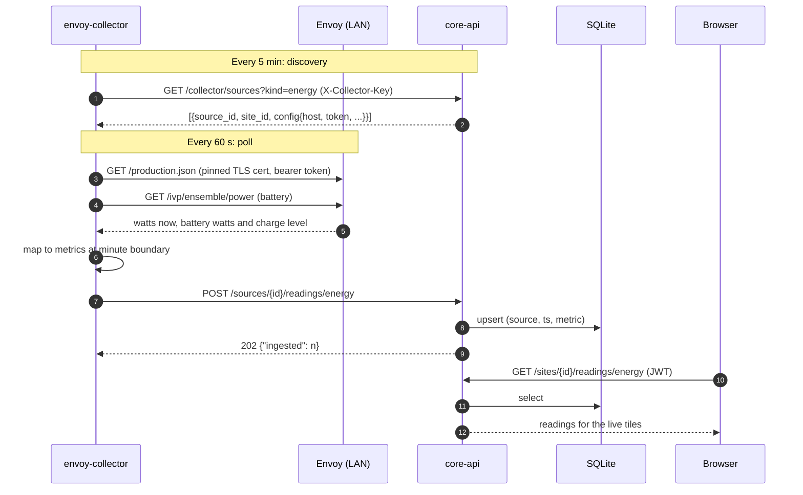
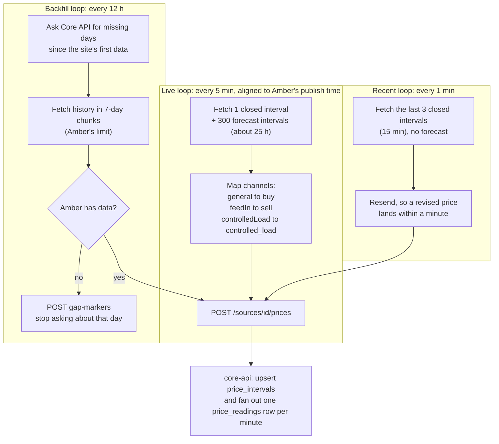
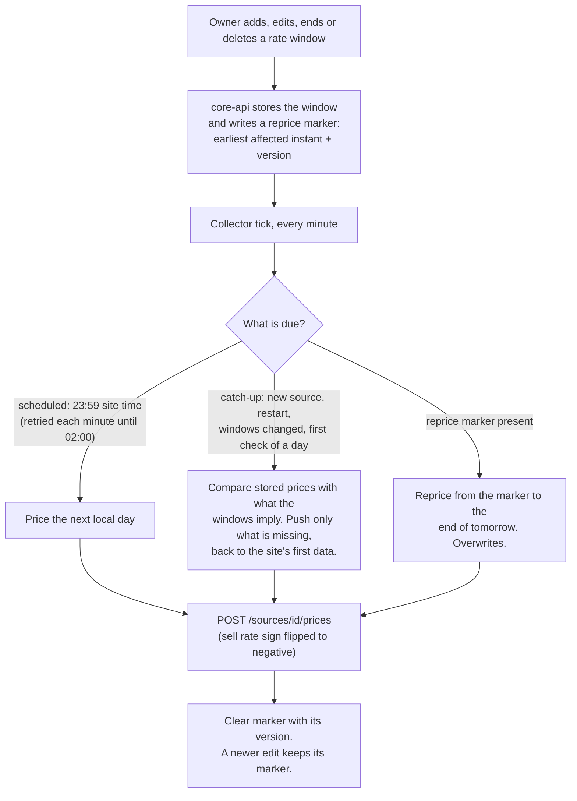
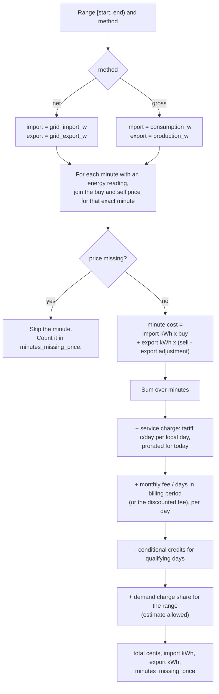
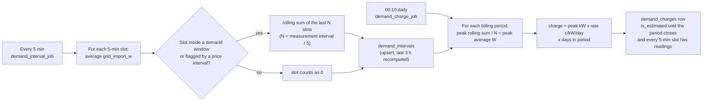
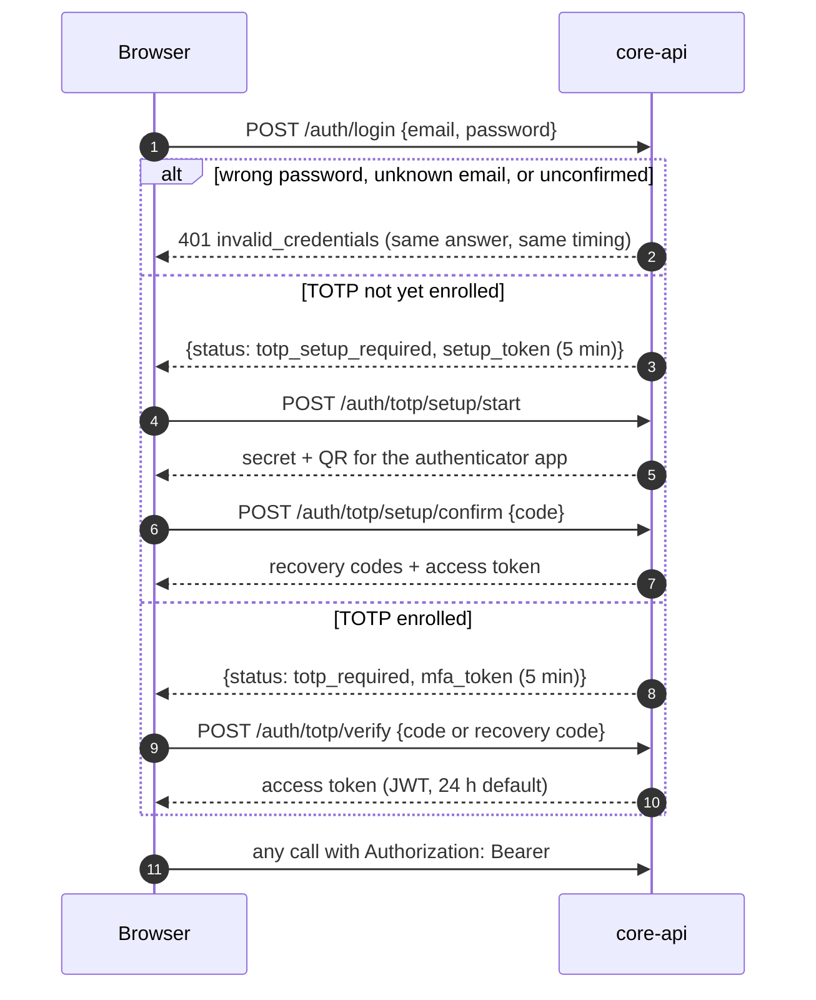
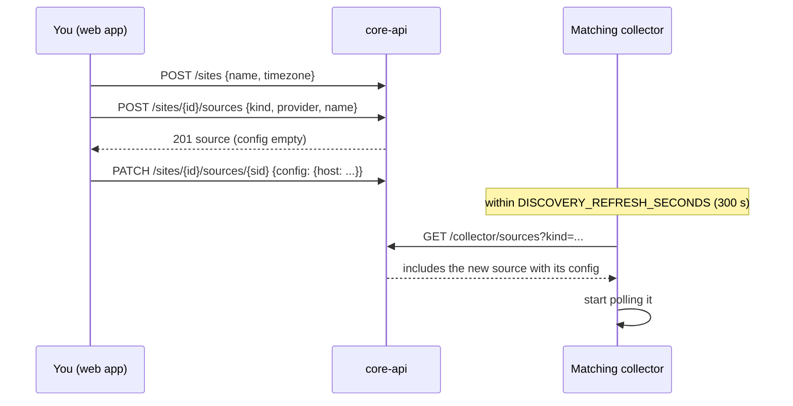

# How it works

Each section follows one process from start to finish. The code paths named in each section are the places to start reading.

## 1. A meter reading reaches the dashboard

Every 60 seconds the Envoy collector reads the solar system and sends the result to Core API.



What the collector does to the raw numbers ([`envoy_collector/mapping.py`](../envoy-collector/envoy_collector/mapping.py)):

- `production_w` comes from the CT-metered (`eim`) entry, never the inverter sum. The two disagree in practice.
- The sign of the net-consumption figure decides which of `grid_import_w` or `grid_export_w` is written. Only one is written per minute.
- On a site with a battery the Envoy's own consumption figure omits the battery. The collector adds net battery power back in to recover true household use.
- A battery that is charging writes `battery_charge_w`. One that is discharging writes `battery_discharge_w`.

Failures are local. If the Envoy does not answer, that cycle is skipped and logged. If Core API does not answer, the cycle's readings are dropped. There is no queue, because the next cycle carries fresh data and the demand logic tolerates gaps.

## 2. Prices from Amber

Amber prices arrive as 5-minute intervals. Three loops run in separate processes, because Amber revises prices after an interval closes.



Amber's API key is not on the source. Core API reads it from the site owner's user record and adds it to the config it hands the collector.

## 3. Prices from a fixed tariff (`local` provider)

A fixed or time-of-use tariff has no API to poll. The owner types **rate windows** in the web app. The local pricing collector expands them into price intervals and pushes them as if a provider had published them. Everything downstream (the minute fan-out, cost) is identical to Amber.



Details worth knowing:

- Each source is handled in its own child process with a two-hour limit, so a slow source cannot block the others.
- The collector remembers nothing between restarts. After a restart every source does a catch-up, which is safe because a catch-up only writes what is missing.
- The marker `version` is an optimistic-lock counter. Core API reads the marker before the windows. If the owner edits between the two reads, the collector gets new windows with the old version, its clear is ignored, and the next run reprices again. The reverse order could lose an edit.
- Minutes covered by no window have no price and are left out of cost totals. The web app warns about the first uncovered time it finds.

Code: [`local_pricing_collector/poll.py`](../local-pricing-collector/local_pricing_collector/poll.py), [`triggers.py`](../local-pricing-collector/local_pricing_collector/triggers.py), [`plan.py`](../local-pricing-collector/local_pricing_collector/plan.py), [`rates.py`](../local-pricing-collector/local_pricing_collector/rates.py).

## 4. How cost is calculated

Cost is not stored. `GET /sites/{id}/cost` runs [`core_api/cost.py`](../core-api/core_api/cost.py) over the requested range.



**Net and gross.** Net costs what actually crossed the meter: grid import, less grid export. Gross pretends the home has no solar: all consumption at the buy price, all production at the sell price. The difference is what the solar system saves.

**Sell price sign.** Sell is stored negative when you are paid, so the formula adds `export kWh × sell`, and a normal export minute reduces the total. The export adjustment is subtracted from the sell price, so a positive adjustment (an incentive) makes the price more negative and increases revenue.

**Worked example.** One minute, importing 1200 W with a buy price of 30 c/kWh:

```text
import kWh = 1200 / 60000 = 0.02
cost      = 0.02 x 30     = 0.6 cents
```

One minute exporting 3000 W with a sell price of -8 c/kWh and a +2 c/kWh adjustment:

```text
export kWh = 3000 / 60000     = 0.05
cost       = 0.05 x (-8 - 2)  = -0.5 cents   (revenue)
```

**Flat daily items.** The service charge and monthly fee are added per local calendar day. For the current day they are prorated by the share of the day that has passed, unless the caller sends `prorate_fees=false` (the dashboard's live tiles do, so they show the committed daily amount). The monthly fee is divided by the length of that day's billing period.

**Conditional credits.** A matching day earns a credit only after its window has ended and only if grid readings cover every minute of the window. If the average grid import is strictly below the limit, the credit is subtracted. A missing minute means no credit, so an outage never looks like a quiet evening. Minutes spent exporting count as 0 W of import.

**What the chart leaves out.** `GET /cost/series` uses the same per-minute maths but omits the daily charges, so a flat fee does not spike one bucket. It includes demand charges only after a billing period closes.

## 5. Demand charges

Some tariffs charge for the highest sustained grid draw inside peak windows.



The last three hours are recomputed on every run, so a late or backfilled reading lands in the right slot. A finalized charge is never rewritten. An estimated one is recalculated each night. Billing periods come from the site's [billing cycle](data-model.md#billing-tables): a cycle length in months and an anchor day. The period before the first anchor day is a partial period.

## 6. Signing in

Passwords are never enough. Every account needs a second factor.




Protections in place, and where they live ([`security.py`](../core-api/core_api/security.py), [`deps.py`](../core-api/core_api/deps.py), [`routers/auth.py`](../core-api/core_api/routers/auth.py), [`routers/totp.py`](../core-api/core_api/routers/totp.py)):

| Threat | Protection |
|---|---|
| Guessing passwords | After 5 failures in 15 minutes an email is locked, whether or not the account exists. |
| Learning which emails have accounts | An unknown email still runs a full bcrypt comparison. Registration returns the same message for new and existing addresses and pads its response time to at least 0.3 s. |
| Guessing the TOTP code | The attempt cap is keyed on the user, not the token, so logging in again does not reset it. |
| Replaying an observed TOTP code | The last accepted 30-second step is stored. An older or equal step is refused. |
| Stolen token for another purpose | Setup and MFA tokens carry a scope and expire in 5 minutes. They cannot call the normal API. |
| Copied database or backup | Device credentials, the Amber key and authenticator secrets are Fernet-encrypted. Recovery codes are keyed hashes. Both need `SECRETS_ENCRYPTION_KEY`, which is not in the database. |
| Leaked reset or confirmation link | Only hashes are stored, links are single-use, and issuing a new link burns the old ones. |

First boot: with an empty `users` table, Core API creates `admin@example.com` (or `ADMIN_EMAIL`) with a random password written to `initial-admin-password.txt` beside the database. See [Operations](operations.md#first-login).

## 7. Adding a site and a source

This is the flow that makes "no restart" work.




When the collector learns something about a device, it reports it back with `PATCH /sources/{id}/discovered-config`. The Envoy collector does this for the serial number, the pinned certificate fingerprint and expiry, and renewed tokens. The web app then shows them on the source's settings form.
