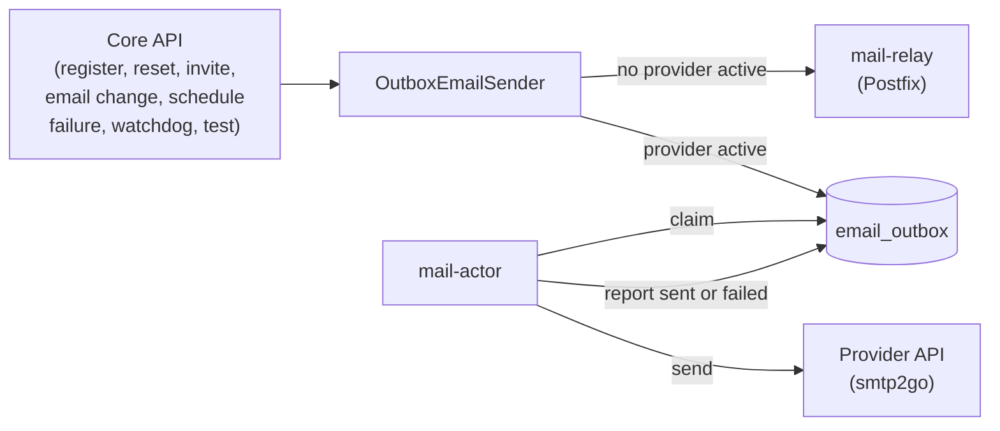

# Mail

WattWise sends email for registration, password reset, invitations, email changes and schedule failures. Two paths carry it, and an administrator picks between them on the **Email** tab of Admin Settings.

| Path | When | How it sends |
|---|---|---|
| Built-in relay | No mail provider is active | Core API opens SMTP to `SMTP_HOST` (default `mail-relay`, a Postfix container that forwards to your SMTP account), with a 20 second timeout (`SMTP_TIMEOUT_SECONDS` in [`email_sender.py`](../core-api/core_api/email_sender.py)). See [Architecture](architecture.md#how-the-services-connect). |
| Mail provider | A provider is active | Core API writes the message to the `email_outbox` table. The `mail-actor` container takes it from there and sends it through the provider's HTTP API. |

The user guide chapter for administrators is [Admin email](../webapp/src/docs/13-admin-email.md).

## How a message travels

`OutboxEmailSender` in [`email_sender.py`](../core-api/core_api/email_sender.py) wraps the SMTP sender that `create_app` receives. Every email goes through it, so no caller chooses a path. It checks for an active provider on each send and writes through its own short session, so a request handler and a scheduler job use it the same way. SQLite allows one writer at a time, so a caller commits its own writes before it sends.

Two rules follow from the design:

- **Queued mail waits for the actor while a provider is active.** With the actor stopped, mail piles up as `pending` and goes out when the actor returns. Queued mail goes to the relay only when an administrator deactivates the last active provider (see [Deactivate](#deactivate)).
- **A failed queue write sends that email through the relay.** The write is rolled back and one warning is logged with fixed text and the exception class name only, since a database error's text can hold the address and subject. If the relay send fails too, the email is lost: the log message has fixed text followed by the relay exception's traceback, which can include the address (an SMTP refusal names the recipient). The request carries on, as an SMTP failure did before. The schedule-failure email raises its `notify_email` alert (see [Alerts](collectors.md#alerts)) in that case.

## Tables

Both tables are in [`models/mail.py`](../core-api/core_api/models/mail.py). Their columns are in the [Data model](data-model.md#mail-tables).

- `mail_providers` has one row per provider the actor has declared. `settings` is `EncryptedJSON`. A partial unique index allows one row with `is_active` true.
- `email_outbox` has one row per queued message. `body` is `EncryptedText`, because bodies hold password-reset and confirmation links.

## Delivery

Constants are in [`outbox.py`](../core-api/core_api/outbox.py).

| Rule | Behaviour |
|---|---|
| Claim | `POST /actor/mail/outbox/claim` marks due rows `sending`, sets `claimed_at` and adds 1 to `attempts`. Each row is taken by its own conditional update, so two actors never get the same row. |
| Claim lifetime | 2 minutes. A `sending` row older than that is claimable again while `attempts` is below 5. |
| Expired last claim | A `sending` row with 5 attempts and an expired claim becomes `failed` with `last_error` "claim expired". A message that crashes the actor therefore cannot loop. |
| Failure report | `failed` puts the row back to `pending` and delays the next attempt by 30, 60, 120 and 240 seconds after attempts 1 to 4. The fifth failure ends the row `failed`. |
| Success report | `sent` ends the row. |
| Body | `sent` and the final `failed` set `body` to an empty string. |
| Unreadable body | A body that cannot be decrypted ends that row `failed` with "undecryptable body". The rest of the claim is unaffected. |
| Error text | `last_error` keeps the first 500 characters of what the actor reported. |
| Retention | The daily job `mail_outbox_cleanup` (00:30) deletes `sent` and `failed` rows whose `finished_at` is more than 30 days old, and `pending` and `sending` rows whose `created_at` is more than 7 days old. The second rule covers an active provider that the actor does not implement, whose mail no one claims. See [Background jobs](core-api.md#background-jobs). |

Delivery is at-least-once. The actor tries the `sent` report three times. If all three fail, Core API still sees the row as `sending` and the message goes out again after the claim expires. A person can then receive the same email twice.

## Actor routes

The mail actor sends its own key, `MAIL_ACTOR_KEY`, in `X-Actor-Key`, with the header `X-Actor-Provider: mail`. A missing or wrong key or header gets 401 `invalid_actor_key`, the same answer for each. The device actors' `ACTOR_KEY` gets that 401 too, and `MAIL_ACTOR_KEY` opens no device actor route.

Whoever holds `MAIL_ACTOR_KEY` can read the active provider's settings, such as the smtp2go API key, and every queued message, including password-reset links. They can also claim a message and report it sent so it is never delivered. Make it a long random secret (`openssl rand -hex 32`), different from `ACTOR_KEY`, and give it only to `core-api` and `mail-actor`. The routes have no instance id. They are in [`routers/actor_mail.py`](../core-api/core_api/routers/actor_mail.py), and they are not covered by the fixtures in [`contracts/actor-api/`](../contracts/actor-api/README.md).

| Route | Purpose |
|---|---|
| `PUT /actor/mail/providers` | Declares the providers the actor implements: a list of `provider`, `label` and `fields` (each `name`, `label`, `secret`, `required`). Returns 204. An existing row keeps its settings and active flag. A provider the actor stops listing stays in the table, and its `declared_at` falls behind. Names match `^[a-z0-9_]{1,40}$`. A list has at most 20 providers and a provider at most 30 fields, without duplicates. Anything else is 422. |
| `GET /actor/mail/active` | Returns `{provider, settings}` for the active provider, or 204 when none is active. This is the only route that returns decrypted settings. |
| `POST /actor/mail/outbox/claim?limit=` | Claims up to `limit` messages (1 to 50, required). Returns `id`, `to_address`, `subject` and `body` for each. |
| `PATCH /actor/mail/outbox/{id}` | Body `{"outcome": "sent" or "failed", "error": text or null}`. Returns 204. 404 `not_found` for an unknown id and 409 `not_sending` when the row is not being sent. |

## Admin routes

Every route under `/admin/mail` needs an administrator (403 `admin_required` otherwise). Each write logs one line with the admin's id and the action (`save_mail_settings`, `activate_mail_provider`, `deactivate_mail_provider` or `send_test_email`), and no values. The code is in [`admin_mail.py`](../core-api/core_api/admin_mail.py) and [`routers/admin_mail.py`](../core-api/core_api/routers/admin_mail.py).

| Route | Behaviour |
|---|---|
| `GET /admin/mail/providers` | Lists the declared providers. Each has `provider`, `label`, `available`, `is_active` and `fields`. A field has `name`, `label`, `secret`, `required`, `value` and `is_set`. `value` is null for a secret field, so a stored secret never leaves the server. `available` is true when the provider was in the actor's latest declaration. |
| `PUT /admin/mail/providers/{provider}` | Body `{"settings": {name: text}}`, each value at most 500 characters. A blank secret keeps the stored one. A blank plain value removes it. 422 `unknown_field` for a name the provider did not declare, 422 `field_required` when a required field would be empty, 404 `not_found` for an unknown provider. Returns the provider. |
| `POST /admin/mail/providers/{provider}/activate` | Makes the provider the active one and turns off the other. 409 `provider_unavailable` when it was not in the actor's latest declaration. 409 `settings_incomplete` when a required setting is missing. Activating the active provider changes nothing. |
| `POST /admin/mail/providers/{provider}/deactivate` | Turns the provider off, so new email goes through the relay. Returns the provider. When no provider is left active, queued mail goes to the relay too; see [Deactivate](#deactivate). |
| `POST /admin/mail/test` | Queues a test email to the administrator's own address. 202 `{"queued": true}`. 409 `no_active_provider` when none is active. 429 `too_many_tests` after 5 test emails to that address in 10 minutes. |
| `GET /admin/mail/outbox/summary` | `pending` (pending and sending), `sent_24h`, `failed_24h` and `last_error`. `last_error` is the error of the newest message that has one, or null. |

A 202 from `/test` means the message is queued. It does not show delivery.

### Deactivate

When a deactivation leaves no provider active, Core API commits it and then sends the oldest 200 queued rows through the relay, one at a time, before it answers (`relay_queued` in [`outbox.py`](../core-api/core_api/outbox.py)). It takes `pending` rows and `sending` rows whose claim has expired (see Claim lifetime under [Delivery](#delivery)). A `sending` row with a live claim is left to whoever holds it: the actor, which caches the provider for 30 seconds and can still finish its batch, or another drain.

Before it sends a row, the drain claims it with a conditional update that matches the `status` and `claimed_at` it read, stamps `claimed_at` with the time of that claim, and commits. A row the actor or another drain claimed, or the cleanup job deleted, after the drain read it is skipped. This holds across any number of Core API processes. A fresh stamp per row means a drain that runs longer than the claim lifetime never writes a claim that is already expired. The finish matches the drain's own stamp, so a row someone else has claimed since keeps their state. Each claimed row then ends, with its body cleared:

| Result | Row |
|---|---|
| The relay accepts it | `sent` |
| The relay send raises | `failed`, `last_error` "relay send failed". The log line names the row id and the exception class. |
| The body cannot be decrypted | `failed`, `last_error` "undecryptable body" |
| A database error | The row is rolled back and skipped, and the drain goes on to the next one. The log line names the row id and the exception class. |

No error in the drain changes the answer: Deactivate returns the provider, because the deactivation is already committed. Rows past the first 200 stay queued, and so do rows the actor hands back as `pending` after the drain read the queue, including while the drain is still running (it reports "no usable mail provider" once the provider is gone). They go out when a provider is active again, or the cleanup job deletes them after 7 days (see Retention under [Delivery](#delivery)). An actor that is still sending a row after its claim expired can race the drain, so that recipient can get the email twice. The actor's report on such a row is checked only for `status` `sending`, not for who holds the claim (`finish_outbox`). If the drain finishes first, the report gets 409 `not_sending`. If the report arrives first, it is accepted: `sent` leaves the row `sent`, and `failed` with fewer than 5 attempts puts the row back to `pending`, so it is sent again once a provider is active.

## The mail actor

[`mail-actor/`](../mail-actor) is a Python container on the `app` network only. Its settings are `CORE_API_URL` and `MAIL_ACTOR_KEY`, and it fails at start without them. It never talks to `mail-relay`: the `mail` network trusts every host in it to relay unauthenticated, so the actor reaches the provider over the internet instead. It is not a device actor: it has no instances, schedules or runs, so [Actors](actors.md) does not describe it.

| Behaviour | Value |
|---|---|
| Start | Declares its providers with `PUT /actor/mail/providers`, retrying every 5 seconds until Core API accepts. |
| Poll | Every 5 seconds it claims up to 10 messages and sends each one in turn. |
| Active provider | Cached for 30 seconds. A 401 or 403 from the provider drops the cache and the next message refetches the settings. If they are unchanged, the rest of that batch fails without a send. |
| No usable provider | When the provider went away mid-batch, or the settings fetch fails, the message is reported `failed` with "no usable mail provider", so Core API puts it back to `pending` with the normal retry delay (30, 60, 120 or 240 seconds, by attempt). The report counts as an attempt. |
| Active provider it does not implement | Logs one warning a minute and claims nothing. Queued mail waits until an administrator deactivates the provider (see [Deactivate](#deactivate)) or the cleanup job deletes it after 7 days. |
| Send fails | Reported `failed` once. Core API schedules the retry. |
| Stop | Handles SIGTERM and SIGINT, and stops between messages. Messages it had claimed but not started are reclaimed when their claim expires. |
| Commit report | Posts its commit to `/services/report` as `mail-actor`, like the other services. See [Service status](core-api.md#service-status). |

Error text reported to Core API is a fixed prefix plus an HTTP status or an exception class name, such as `smtp2go send failed: HTTP 401`. Any settings value in it is replaced with `[redacted]` first, and it never reaches the log. The log does name the recipient and subject, as described under [Reading the mail actor log](#reading-the-mail-actor-log).

### Reading the mail actor log

The actor logs one line per message, as a mail server's log does. `docker compose logs mail-actor` shows them.

| Outcome | Line |
|---|---|
| Sent | `Sent outbox message 12 via smtp2go: to user@example.com, subject "Reset your password", 0.4 s, provider id <id>` |
| Failed | `Outbox message 12 failed via smtp2go: to user@example.com, subject "...": smtp2go send failed: HTTP 503` |
| No provider | `Outbox message 12 not sent: no usable mail provider: to user@example.com, subject "..."` |

- **Provider id.** For smtp2go this is `data.email_id` from the Send Email response. Search for it on smtp2go's Activity page to match a line to a message. It reads `none` when the provider gives no id or the id is not a plain token (letters, digits and `. _ : -`, up to 100 characters).
- **Time.** The seconds are the time the provider took to answer.
- **Escaping.** Control characters in the address and subject become spaces, and text over 200 characters is cut, so a subject cannot split or forge a log line.
- **Never logged.** The message body, the API key and any settings value.

The code is in [`worker.py`](../mail-actor/mail_actor/worker.py).

## smtp2go

[`providers/smtp2go.py`](../mail-actor/mail_actor/providers/smtp2go.py) is the one provider.

| Field | Secret | Required |
|---|---|---|
| `api_key` | yes | yes |
| `from_address` | no | yes |

It posts JSON to `https://api.smtp2go.com/v3/email/send` with the key in the `X-Smtp2go-Api-Key` header, a 20 second timeout, and `text_body` set to the message body. smtp2go can answer 200 for a message it did not accept, so success also needs `data.succeeded` to equal 1.

## Adding a provider

A new provider is one module and one list entry, in the actor only. The form on the Email tab is drawn from the declared fields, so Core API and the webapp need no change.

1. Copy [`providers/smtp2go.py`](../mail-actor/mail_actor/providers/smtp2go.py) to `providers/<name>.py`.
2. Set `KEY` (lowercase letters, digits and underscores, up to 40), `LABEL` and `FIELDS`. Each `Field` has `name`, `label`, `secret` and `required`. Mark every credential `secret=True`.
3. Write `send(settings, message, http)`. Return the provider's own id for the message, or `None` when it gives none. The worker writes the id in the "Sent" log line (see [Reading the mail actor log](#reading-the-mail-actor-log)) so an operator can find the message on the provider's activity page, so return only a plain token. Raise `SendError(reason, retryable=..., status=...)` otherwise. Build `reason` from an HTTP status or an exception class name, never from a response body or a settings value. Pass `status` so a 401 or 403 makes the worker refetch the settings.
4. Add the module to `PROVIDERS` in [`providers/__init__.py`](../mail-actor/mail_actor/providers/__init__.py).
5. Add tests next to `tests/test_smtp2go.py`, then restart the actor. It declares the new provider at start, and the Email tab lists it once Core API has stored the declaration.

## Operations

Running, updating, publishing and stopping the container are in [Operations](operations.md#email-and-the-mail-actor).

- **Secrets.** Provider settings and message bodies are encrypted with `SECRETS_ENCRYPTION_KEY`, like the other stored credentials. See [Where secrets are stored](core-api.md#where-secrets-are-stored). The actor holds a provider's settings in memory only.
- **Logs.** Treat core-api log retention as sensitive, because of the traceback described under [How a message travels](#how-a-message-travels). Also treat mail actor logs as personal data: they hold each recipient's address and the subject (see [Reading the mail actor log](#reading-the-mail-actor-log)). Core API's own logs carry neither.
- **Limits.** Run one actor container. The compose file starts one, and nothing is tested with two.

For what an administrator sees when mail does not arrive, see [Admin email](../webapp/src/docs/13-admin-email.md#when-email-does-not-arrive).
