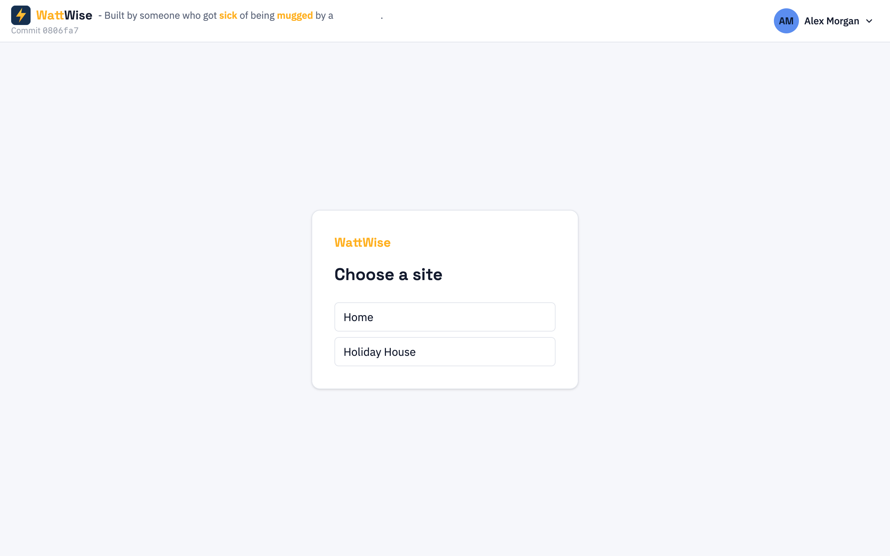
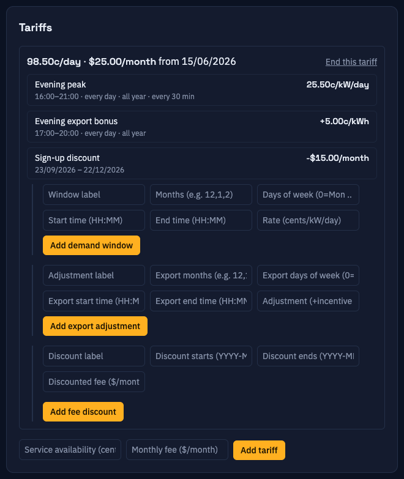

# Web app

Single-page app in [`webapp/`](../webapp). It is built to static files and served by nginx. It holds no state of its own beyond a login token: every number on screen is fetched from Core API.

| Tool | Use |
|---|---|
| React 19 and TypeScript | UI |
| Vite 8 | Dev server and build |
| Tailwind CSS 4 | Styling |
| TanStack Query 5 | Fetching, caching, polling |
| React Router 7 | Routes |
| Recharts 3 | Charts |
| `react-markdown` with `remark-gfm` | The in-app help |
| Vitest and Testing Library | Tests |
| Oxlint | Linting |

## Screens and routes

Defined in [`src/App.tsx`](../webapp/src/App.tsx). Routes under `ProtectedRoute` redirect to `/login` when there is no token.

| Route | Page | Purpose |
|---|---|---|
| `/login`, `/register`, `/confirm-registration` | Auth pages | Sign in, sign up, confirm the email link |
| `/totp-setup`, `/totp-verify` | Two-factor | Enrol an authenticator app, enter a code |
| `/forgot-password`, `/reset-password` | Reset | Request and use a reset link |
| `/confirm-email-change` | Email change | Confirm the new address |
| `/`, `/sites` | `SitePickerPage` | Choose an enabled site, and accept or decline pending invitations. Redirects to `/settings` when every site is disabled. |
| `/sites/new` | `AddSitePage` | Create a site and pick its time zone |
| `/account` | `AccountPage` | Name, photo, password, email, authenticator, Amber key |
| `/help/:slug?` | `HelpPage` | The user guide |
| `/sites/:siteId` | `DashboardPage` | Live tiles, pricing chart, history chart |
| `/sites/:siteId/reporting` | `ReportingPage` | Longer-range charts |
| `/settings`, `/settings/sites/:siteId/:tab` | `SettingsPage` | Site chips and a tab rail. `:tab` is `general`, `collectors`, `tariffs`, `billing` or `sharing`. An unknown site or tab redirects to the first enabled site's `general` tab. |
| `/sites/:siteId/sources`, `/sites/:siteId/billing` | Redirects | Go to the `collectors` and `billing` settings tabs |

<table>
<tr>
<td></td>
<td></td>
</tr>
<tr>
<td></td>
<td></td>
</tr>
</table>

More screenshots, with the explanation of every tile and field, are in the [user guide](../webapp/src/docs/index.md).

## Source layout

| Folder | Contents |
|---|---|
| `src/api/` | `client.ts` (fetch wrapper, `ApiError`), `config.ts` (API base URL, `toWebSocketUrl`) |
| `src/auth/` | `AuthContext` (token in `localStorage` under `access_token`), `ProtectedRoute` |
| `src/layout/` | Header, site sidebar, site switcher, avatar |
| `src/pages/` | One component per route, with its test beside it |
| `src/dashboard/` | Hooks for live readings and history, and pure helpers for charts (`historyChart.ts`, `priceChart.ts`, `compass.ts`) |
| `src/billing/` | `useBilling.ts` (all tariff and cycle calls), `ConditionalCredits.tsx`, `tariffHeading.ts` |
| `src/sources/` | `useSources.ts`, `useRateWindows.ts`, the rate window panel and form, `rateCoverage.ts` (finds uncovered times) |
| `src/settings/` | The Settings page: `SettingsPage` (route and redirects), `SettingsShell`, `SiteChips`, `GeneralTab`, `SharingTab`, `tabs.ts`. The Collectors, Tariffs and Billing tabs reuse `CollectorsTab` in `pages/SourcesPage.tsx` and `TariffsTab` and `BillingTab` in `pages/BillingPage.tsx`. |
| `src/sites/`, `src/account/` | Site, invitation and account hooks and forms. `useEnabledSites` filters `GET /sites` to enabled sites for the picker and switcher. |
| `src/help/` | The help viewer |
| `src/docs/` | The user guide as Markdown, plus `images/` |

Convention: a feature folder has a `use*.ts` hook per resource that wraps TanStack Query, and pure functions for anything worth testing without React.

## Talking to Core API

[`src/api/client.ts`](../webapp/src/api/client.ts) adds the `Authorization: Bearer` header and turns error bodies into an `ApiError` with `status`, `code`, `message` and `detail`.

A failed request logs the user out only when the code says the session itself is dead: `missing_token`, `invalid_token`, or `unknown_error` (a 401 with no body, usually from a proxy). Other 401s, such as a wrong current password on the account page, stay on screen as form errors.

Live data polls every 60 seconds (`LIVE_POLL_MS` in `src/dashboard/useLiveReadings.ts`), which matches the collectors' stored-reading cadence.

### Live tiles and the WebSocket

`useLiveStream` (`src/dashboard/useLiveStream.ts`) opens `/api/v1/sites/{siteId}/live` on the dashboard and sends the access token as its first message. The URL is `API_BASE_URL` with the scheme changed to `ws` or `wss` (`toWebSocketUrl` in `src/api/config.ts`). `LiveTiles` in `DashboardPage.tsx` overlays the streamed values on the polled ones, per metric.

- **Freshness.** A streamed value counts for 15 seconds (`LIVE_FRESH_MS` in `src/dashboard/liveStream.ts`). After that the tile shows the polled value again. Streamed values are shown as received; the averaging in `liveAverages.ts` applies only to the polled fallback.
- **Back-off.** After a close, the hook reconnects after 1 second, doubling each attempt up to 30 seconds. A received message resets the count.
- **Fallback.** Polling keeps running. If the socket never connects, the tiles behave as before.
- **Rain today** comes from stored data only, because Core API does not accept `rain_mm` as a live value.
- **Auth close.** On close code 1008 the hook does not reconnect. The page tries again only when the dashboard remounts, for example after a reload or a site change.
- **Expired token.** Core API checks the token once, at connect, so a socket stays open after its token expires.

## Runtime configuration

The API address is not compiled in. `public/config.js` sets `window.__APP_CONFIG__.apiBaseUrl`, and `src/api/config.ts` reads it (falling back to `http://localhost:8000`). In the container, [`docker-entrypoint.sh`](../webapp/docker-entrypoint.sh) rewrites `config.js` from the `API_BASE_URL` environment variable each time it starts. So one image works for any deployment, and changing the address needs a restart, not a rebuild.

`nginx.conf` serves `index.html` for every unknown path so that browser refreshes on client-side routes work.

The entrypoint also writes `/etc/nginx/security-headers.conf`, which `nginx.conf` includes. It sets a Content-Security-Policy (with `connect-src` limited to `API_BASE_URL` and the same address with `ws://` or `wss://`), `X-Frame-Options: DENY`, `X-Content-Type-Options: nosniff`, `Referrer-Policy` and `Permissions-Policy`. A new third-party script, style or image host needs adding to the CSP in `docker-entrypoint.sh`.

## The in-app help is this repository's user guide

[`src/help/content.ts`](../webapp/src/help/content.ts) bundles every Markdown file in `src/docs/` and every image in `src/docs/images/` at build time. `HelpPage` renders them with GitHub-flavoured Markdown. The same files read correctly on GitHub, which is why this documentation links to them instead of copying them.

Tests protect the guide: `docs.test.ts` and `links.test.ts` fail when a chapter link or image does not resolve. When you change a screen, update the matching chapter and screenshot in the same change.

## Where to change things

| To change... | Edit |
|---|---|
| The providers offered when adding a source | `PROVIDERS_BY_KIND` in `src/pages/SourcesPage.tsx` |
| The settings form for a provider | `CONFIG_FORMS` in the same file. A provider without a form gets a raw JSON editor. |
| A dashboard tile | `src/pages/DashboardPage.tsx` and `src/dashboard/` |
| How a chart is shaped | `historyChart.ts` or `priceChart.ts`, which have unit tests |
| Tariff and billing forms | `src/pages/BillingPage.tsx` and `src/billing/` |
| Help text | `src/docs/*.md` |
