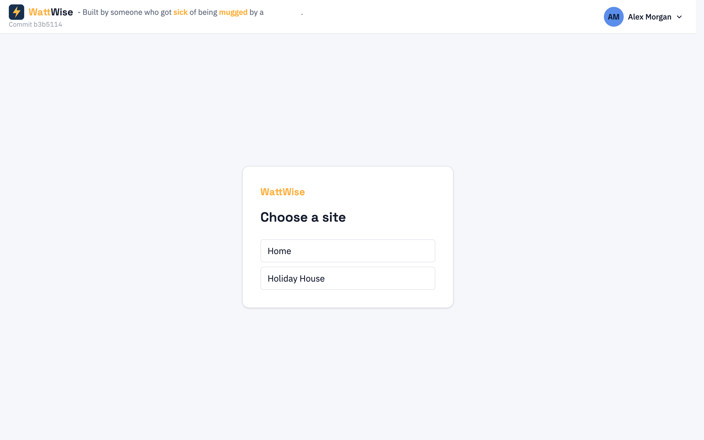
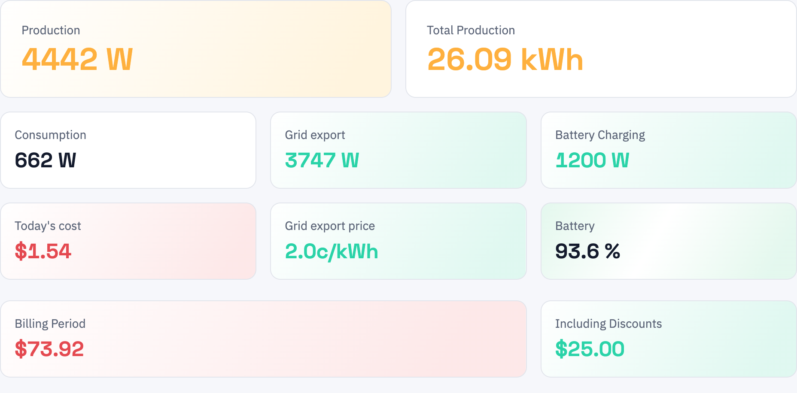
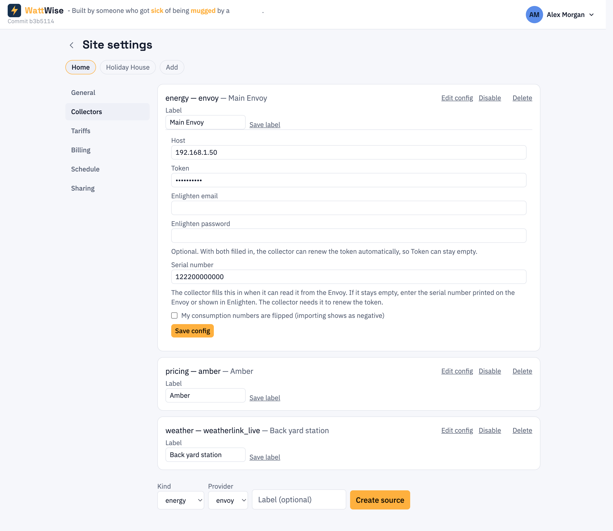
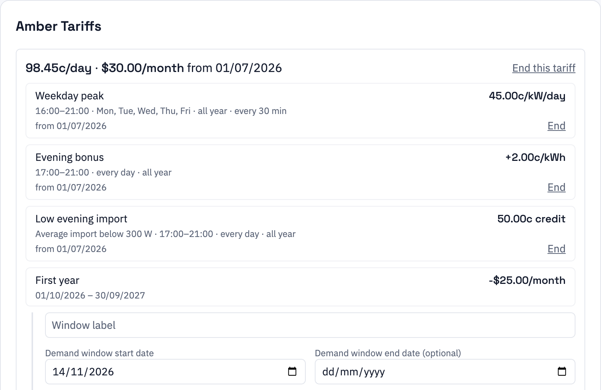

# Web app

Single-page app in [`webapp/`](../webapp). It is built to static files and served by nginx. It holds no state of its own beyond a login token: every number on screen is fetched from Core API.

| Tool | Use |
|---|---|
| React 19 and TypeScript | UI |
| Vite 8 | Dev server and build |
| Tailwind CSS 4 | Styling |
| TanStack Query 5 | Fetching, caching, polling |
| React Router 7 | Routes |
| Recharts 3 | Charts |
| `react-markdown` with `remark-gfm` | The in-app help |
| Vitest and Testing Library | Tests |
| Oxlint | Linting |

## Screens and routes

Defined in [`src/App.tsx`](../webapp/src/App.tsx). Routes under `ProtectedRoute` redirect to `/login` when there is no token.

| Route | Page | Purpose |
|---|---|---|
| `/login`, `/register`, `/confirm-registration` | Auth pages | Sign in, sign up, confirm the email link |
| `/totp-setup`, `/totp-verify` | Two-factor | Enrol an authenticator app, enter a code |
| `/forgot-password`, `/reset-password` | Reset | Request and use a reset link |
| `/confirm-email-change` | Email change | Confirm the new address |
| `/`, `/sites` | `SitePickerPage` | Choose an enabled site, and accept or decline pending invitations. Redirects to `/settings` when every site is disabled. |
| `/sites/new` | `AddSitePage` | Create a site and pick its time zone |
| `/account` | `AccountPage` | Name, photo, password, email, authenticator, Amber key |
| `/help/:slug?` | `HelpPage` | The user guide |
| `/sites/:siteId` | `DashboardPage` | Live tiles, pricing, grid and battery charts, and the **Needs attention** tile (`FailuresTile`) when the site has an air conditioner set up |
| `/sites/:siteId/reporting` | `ReportingPage` | Month picker, Net/Gross option, a chart (`TotalsChart`) and a sortable totals table (`TotalsTable`) with a total row (`totalsSummary.ts`) at the bottom. Clicking a day, on the chart or in the table, lists its hours, and clicking an hour lists its minutes. While totals load, a spinner shows, over the dimmed previous rows when the level stays the same. The level is in the URL as `?month=&day=&hour=` (see `reportingView.ts`), so the browser back button works. |
| `/settings`, `/settings/sites/:siteId`, `/settings/sites/:siteId/:tab` | `SettingsPage` | Site chips and a tab rail. `:tab` is `general`, `collectors`, `tariffs`, `billing`, `schedule` or `sharing`. The `schedule` tab (`ScheduleTab`) adds an air conditioner, builds schedules, tests them and shows the run history. See [The Schedule tab](#the-schedule-tab). `/settings` goes to the first enabled site's `general` tab. An unknown site goes to the first enabled site and keeps a valid tab. An unknown or missing tab keeps the site and goes to `general`. Viewers see every tab read-only. If a background refresh of the sites fails, the page stays and shows a **Retry** alert. |
| `/sites/:siteId/sources`, `/sites/:siteId/billing`, `/sites/:siteId/schedule` | Redirects | Go to the `collectors`, `billing` and `schedule` settings tabs |

<table>
<tr>
<td></td>
<td></td>
</tr>
<tr>
<td></td>
<td></td>
</tr>
</table>

More screenshots, with the explanation of every tile and field, are in the [user guide](../webapp/src/docs/index.md).

## Source layout

| Folder | Contents |
|---|---|
| `src/api/` | `client.ts` (fetch wrapper, `ApiError`), `config.ts` (API base URL, `toWebSocketUrl`) |
| `src/auth/` | `AuthContext` (token in `localStorage` under `access_token`), `ProtectedRoute` |
| `src/layout/` | Header, site chips and side rail, avatar |
| `src/pages/` | One component per route, with its test beside it |
| `src/dashboard/` | Hooks for live readings and history, and pure helpers for charts (`historyChart.ts`, `priceChart.ts`, `compass.ts`) |
| `src/actors/` | The Schedule tab's parts and hooks. `useActors.ts` has the TanStack Query hooks. `scheduleForm.ts` turns a schedule into form state and back (and holds the client-side checks that mirror Core API). `runFormat.ts` formats run times and outcomes. `types.ts` mirrors the API shapes. |
| `src/billing/` | `useBilling.ts` (all tariff and cycle calls), `ConditionalCredits.tsx`, `tariffHeading.ts` |
| `src/sources/` | `useSources.ts`, `useRateWindows.ts`, the rate window panel and form, `rateCoverage.ts` (finds uncovered times) |
| `src/settings/` | The Settings page: `SettingsPage` (route and redirects), `SettingsShell`, `GeneralTab`, `SharingTab`, `tabs.ts`. The Collectors, Tariffs and Billing tabs reuse `CollectorsTab` in `pages/SourcesPage.tsx` and `TariffsTab` and `BillingTab` in `pages/BillingPage.tsx`. |
| `src/sites/`, `src/account/` | Site, invitation and account hooks and forms. `useEnabledSites` filters `GET /sites` to enabled sites for the picker. The switcher shows enabled sites plus the current site when it is disabled. |
| `src/about/` | The About dialog: `AboutDialog.tsx` (tabs, Escape and focus handling), `ContainersTab.tsx` and `useServices.ts` (`GET /services`), `LicencesTab.tsx` and `useLicences.ts` (`/licences.json`) |
| `src/help/` | The help viewer |
| `src/docs/` | The user guide as Markdown, plus `images/` |

Convention: a feature folder has a `use*.ts` hook per resource that wraps TanStack Query, and pure functions for anything worth testing without React.

## Talking to Core API

[`src/api/client.ts`](../webapp/src/api/client.ts) adds the `Authorization: Bearer` header and turns error bodies into an `ApiError` with `status`, `code`, `message` and `detail`.

A failed request logs the user out only when the code says the session itself is dead: `missing_token`, `invalid_token`, or `unknown_error` (a 401 with no body, usually from a proxy). Other 401s, such as a wrong current password on the account page, stay on screen as form errors.

Live data polls every 60 seconds (`LIVE_POLL_MS` in `src/dashboard/useLiveReadings.ts`), which matches the collectors' stored-reading cadence.

### Live tiles and the WebSocket

`useLiveStream` (`src/dashboard/useLiveStream.ts`) opens `/api/v1/sites/{siteId}/live` on the dashboard and sends the access token as its first message. The URL is `API_BASE_URL` with the scheme changed to `ws` or `wss` (`toWebSocketUrl` in `src/api/config.ts`). `LiveTiles` in `DashboardPage.tsx` overlays the streamed values on the polled ones, per metric.

- **Freshness.** A streamed value counts for 15 seconds (`LIVE_FRESH_MS` in `src/dashboard/liveStream.ts`). After that the tile shows the polled value again. Streamed values are shown as received; the averaging in `liveAverages.ts` applies only to the polled fallback.
- **Back-off.** After a close, the hook reconnects after 1 second, doubling each attempt up to 30 seconds. A received message resets the count.
- **Fallback.** Polling keeps running. If the socket never connects, the tiles behave as before.
- **Rain today** comes from stored data only, because Core API does not accept `rain_mm` as a live value.
- **Auth close.** On close code 1008 the hook does not reconnect. The page tries again only when the dashboard remounts, for example after a reload or a site change.
- **Expired token.** Core API checks the token once, at connect, so a socket stays open after its token expires.

## The Schedule tab

[`ScheduleTab`](../webapp/src/pages/SchedulePage.tsx) is the `Schedule` tab in Site settings ([`SettingsShell.tsx`](../webapp/src/settings/SettingsShell.tsx)). It draws everything from the instance's declared capabilities, so a new actor needs no change here. [Actors](actors.md) describes the feature.

| Component | Shows |
|---|---|
| `AddInstanceForm` | The empty state. The owner names the air conditioner (provider `actron_neo`). A viewer sees "No device is set up for this site yet." |
| `SignInPanel` | The Actron code, its link and the expiry while the actor waits for approval, for the site owner only. A viewer gets `auth_state` as `{signing_in: true}` from Core API and sees "The owner is signing the air conditioner in to Actron." The page polls every 10 seconds (`INSTANCES_SIGN_IN_POLL_MS`) while either shape is present. |
| `NeedsSignInNotice` | "The Actron account needs to sign in again." with **Sign in again**, which calls `POST .../instances/{id}/sign-in/reset`. A 409 `unit_held_off` shows as the error. |
| `DisabledNotice` | Shown when the instance is disabled, with **Turn on** |
| `ScheduleList` | The schedules per instance with an On or Off pill and the last run. **New schedule**. |
| `ScheduleDetail` | The editor, **Test now**, the unit state and the run history for the selected schedule |
| `ScheduleEditor` | The numbered form: `ActorStep`, `WhenStep`, the "Only if" step with `ConditionsEditor`, `ActionStep`, `RestoreStep` ("When it ends") and `RetryStep` ("If it fails", with **Email me if it still fails**). `DeleteSchedule` confirms a delete. |
| `UnitStatePanel` | Read-only power, mode, setpoints, readings and each zone, with the update time. Shows **Not updating** when `last_seen_at` is more than 2 minutes old (`STALE_MS`). |
| `TestNow` | **Test now**. Shows "Test queued" after the request. |
| `ScheduleRunHistory` (`RunHistory.tsx`) | The newest 50 runs with a pill: OK, Skipped, Failed, "You took over" (`overridden`), Queued, Running |

Only the site owner can change anything on the page. A viewer sees the same panels with the form read-only and no buttons. The run lists poll every 5 seconds while a run is queued or running.

`scheduleForm.ts` shows only restore times that fit the trigger: "When the window ends" appears for a window-start trigger, and the others are "After a set number of minutes", "At a set time" and "Only when a condition below is met". A condition row has a tick box; unticked rows are kept but ignored.

The editor counts as changed while its form differs from the schedule as last saved, or from the empty form for a new schedule (`isDirty` in `scheduleDirty.ts`). Numbers compare by value, so "30" and "30.0" match, text is compared without surrounding spaces, and the order of ticked days or zones does not count. While the owner has changes, picking another schedule, **New schedule**, any in-app link (side rail, site chips, header menu, logo, help) and browser back or forward open "Discard unsaved changes?" (`UnsavedChangesDialog`). **Keep editing**, Escape or a click outside leaves the form as it was; **Discard changes** carries on. Closing or reloading the tab gets the browser's own prompt. A save, create or delete clears the changes, and a viewer is never asked. While a new schedule is saving, the form is locked, and it unlocks with the edits kept if the save fails. If the edited schedule disappears while the dialog is open, the dialog closes. Signing out does not ask about unsaved edits. Holding navigation needs `useBlocker`, so `main.tsx` uses `createBrowserRouter` with one catch-all route; `useLeaveGuard` (`hooks/useLeaveGuard.ts`) holds navigation only under such a data router, so under `MemoryRouter` in tests it guards the tab alone.

### The Dashboard tile

[`FailuresTile`](../webapp/src/actors/FailuresTile.tsx) sits above the other tiles in `DashboardPage.tsx`. It reads `GET .../actors/failures` every 15 seconds (`FAILURES_POLL_MS`).

- No air conditioner set up: nothing is shown.
- No failures: "All schedules OK" and a link to the Schedule tab.
- Failures and alerts: **Needs attention (N)**, where N counts unresolved rows. The heading has no count when only cleared rows remain. The tile glows red (`danger-glow`), amber (`partial-glow`) or blue (`notice-glow`) by the worst unresolved bulb, and has no glow when every row is cleared.
- Each row is one line: a `Bulb`, the time (`YYYY-MM-DD HH:MM` in the site's time zone), `Source - message`, and one button on the right. The source is the alert's `subject` or the schedule name. The button is **Dismiss** for a `sticky` alert (it calls `DELETE /api/v1/sites/{id}/actors/alerts/{alert_id}`, stays disabled while the request runs, and the row stays if the request fails), else **Open Collectors** for an alert, else **Open Schedule**.
- `orderFailures` (`alertTone.ts`) sorts the rows: unresolved first, red then amber then blue, newest first within a colour, cleared rows last. The tile shows the first five and links "and N more". A `needs_sign_in` row shows no time, because Core API has none to give.
- If the request fails, "Schedule status unavailable".

## Runtime configuration

The API address is not compiled in. `public/config.js` sets `window.__APP_CONFIG__.apiBaseUrl`, and `src/api/config.ts` reads it (falling back to `http://localhost:8000`). In the container, [`docker-entrypoint.sh`](../webapp/docker-entrypoint.sh) rewrites `config.js` from the `API_BASE_URL` environment variable each time it starts. So one image works for any deployment, and changing the address needs a restart, not a rebuild.

`nginx.conf` serves `/version` as JSON (see [The About dialog](#the-about-dialog)) and `index.html` for every other unknown path so that browser refreshes on client-side routes work.

The entrypoint also writes `/etc/nginx/security-headers.conf`, which `nginx.conf` includes. It sets a Content-Security-Policy (with `connect-src` limited to `API_BASE_URL` and the same address with `ws://` or `wss://`), `X-Frame-Options: DENY`, `X-Content-Type-Options: nosniff`, `Referrer-Policy` and `Permissions-Policy`. A new third-party script, style or image host needs adding to the CSP in `docker-entrypoint.sh`.

## The About dialog

**About** sits in the account menu above **Log off** (`src/layout/Header.tsx`). It opens a dialog with two tabs.

- **Containers** lists the 7 services from `GET /api/v1/services`. A reporting service shows its commit as a link to the GitHub commit page. A service that is not reporting shows "not reporting" and either its last-reported time or "never reported". See [Service status](core-api.md#service-status) for how the data arrives.
- **Licences** is a filterable list of npm and Python packages. Selecting a package shows its licence name and licence text. The data is the static file `public/licences.json`, served by nginx. The page makes no registry calls.

Commits show as 7 characters. The webapp's own commit comes from `GET /version`, which returns `{"commit": "<7 characters or unknown>"}`. [`write-version.sh`](../webapp/write-version.sh) writes that file from `GIT_COMMIT` each time the container starts (the entrypoint calls it), and nginx serves it with `Cache-Control: no-store`. The container healthcheck requests `/version`, so a container that cannot serve it is unhealthy. Core API fetches the same URL to fill the webapp's row.

### Regenerating the licence list

[`scripts/generate_licences.py`](../scripts/generate_licences.py) writes `webapp/public/licences.json`. It reads npm packages from `webapp/package-lock.json` and their licence files from `webapp/node_modules`. For each Python service it exports the locked set from `uv.lock`, installs it into a temporary directory with `uv`, reads licence files from the installed packages, and asks PyPI for the licence name. It needs network access and `uv`, and `npm ci` must have run in `webapp/` first:

```bash
cd webapp && npm ci && cd ..
python3 scripts/generate_licences.py
```

The committed `licences.json` is a snapshot. The `publish-images` workflow regenerates it for the webapp image only, so published webapp images carry current data and the workflow does not commit the file back. A package whose licence PyPI does not name shows `unknown`.

## The in-app help is this repository's user guide

[`src/help/content.ts`](../webapp/src/help/content.ts) bundles every Markdown file in `src/docs/` and every image in `src/docs/images/` at build time. `HelpPage` renders them with GitHub-flavoured Markdown. The same files read correctly on GitHub, which is why this documentation links to them instead of copying them.

Tests protect the guide: `docs.test.ts` and `links.test.ts` fail when a chapter link or image does not resolve. When you change a screen, update the matching chapter and screenshot in the same change.

## Where to change things

| To change... | Edit |
|---|---|
| The providers offered when adding a source | `PROVIDERS_BY_KIND` in `src/pages/SourcesPage.tsx` |
| The settings form for a provider | `CONFIG_FORMS` in the same file. A provider without a form gets a raw JSON editor. |
| A dashboard tile | `src/pages/DashboardPage.tsx` and `src/dashboard/` |
| The Schedule tab | `src/pages/SchedulePage.tsx` and `src/actors/` |
| How a chart is shaped | `historyChart.ts` or `priceChart.ts`, which have unit tests |
| Tariff and billing forms | `src/pages/BillingPage.tsx` and `src/billing/` |
| Help text | `src/docs/*.md` |
| The About dialog | `src/about/`. The licence data comes from `scripts/generate_licences.py`. |
