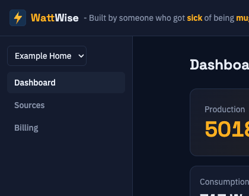
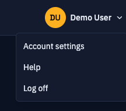

# 1. Getting started

[Contents](index.md) · Next: [Signing in and account security](02-signing-in.md)

## What WattWise does

WattWise records your home's energy flows once a minute and keeps them for a year. It combines those readings with your electricity prices to show what you are paying or earning right now, today, and for the current billing period.

It tracks:

- **Solar production**, **home consumption**, **grid import**, **grid export**, and **battery charge, discharge and level** from an Enphase Envoy.
- **Buy and sell prices**, including the forecast for the rest of the day, from Amber Electric.
- **Temperature, humidity, wind, rain, solar radiation and pressure** from a WeatherLink Live weather station.

## How the pieces fit together

Your browser talks to one service, Core API. Three small programs called **collectors** run next to it. Each collector reads one kind of device or service and sends the readings to Core API, which stores them.

| Collector | Reads from | Gives you |
|-----------|-----------|-----------|
| Envoy collector | Your Enphase Envoy, over your home network | Production, consumption, grid, battery |
| Pricing collector | Amber Electric's online service | Buy and sell prices, forecasts |
| Weather collector | Your WeatherLink Live unit, over your home network | Weather tiles |

You never talk to a collector directly. You tell WattWise *what* to collect by adding a [source](04-sources.md) in the web app, and the matching collector finds it within a few minutes. No restart or configuration file change is needed.

## Main terms

| Term | Meaning |
|------|---------|
| **Site** | One property you monitor, for example "Home". Every reading, price and bill belongs to a site. See [Sites](03-sites.md). |
| **Source** | One connection from a site to a device or service: an Envoy, an Amber account or a weather station. See [Sources](04-sources.md). |
| **Tariff** | The fixed charges and special rates your electricity retailer applies. See [Billing](06-billing.md). |
| **Billing cycle** | How often your bill closes, and on which day. See [Billing cycles](06-billing.md#billing-cycles). |

The full list of terms is in the [Glossary](09-glossary.md).

## The screens

After you sign in, every screen has the header. The dashboard, Sources and Billing pages also have the sidebar:

- **Header** (top): the WattWise logo and your name and photo. Click your name to open the user menu with **Account settings**, **Help** and **Log off**.

- **Sidebar** (left, or a strip along the top on a phone): the **site switcher** and the links **Dashboard**, **Sources** and **Billing**. The Account and Add site pages show the header only.
- **Main window**: the page you picked. This guide opens here too.

## First-day checklist

Do these in order. Each step links to the chapter that explains it.

1. [Create your account](02-signing-in.md#creating-an-account) and confirm your email address.
2. [Set up two-factor authentication](02-signing-in.md#setting-up-two-factor-authentication) and store your recovery codes somewhere safe.
3. [Create your first site](03-sites.md#creating-a-site). Choose the correct time zone.
4. [Add your Envoy as an energy source](04-sources.md#connecting-an-enphase-envoy). You need its address on your home network and an access token.
5. If you use Amber: [save your Amber API key](07-account-settings.md#amber-api-key), then [add an Amber pricing source](04-sources.md#connecting-amber-electric).
6. If you have a weather station: [add a WeatherLink source](04-sources.md#connecting-a-weatherlink-live-station).
7. [Enter your tariff](06-billing.md#tariffs) and [billing cycle](06-billing.md#billing-cycles) so costs are calculated.
8. Open the [Dashboard](05-dashboard.md). Tiles appear within a few minutes of the first reading.

> **Note:** Cost figures need three things at once: energy readings, prices, and (for the service charge and billing period) a tariff and billing cycle. If one is missing, the dashboard leaves that figure out rather than guessing. See [Troubleshooting](08-troubleshooting.md#costs-look-too-low-or-are-missing).

## Next

- [Signing in and account security](02-signing-in.md)
- [Sources](04-sources.md) if you already have an account and a site
