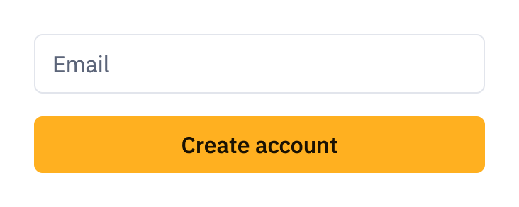
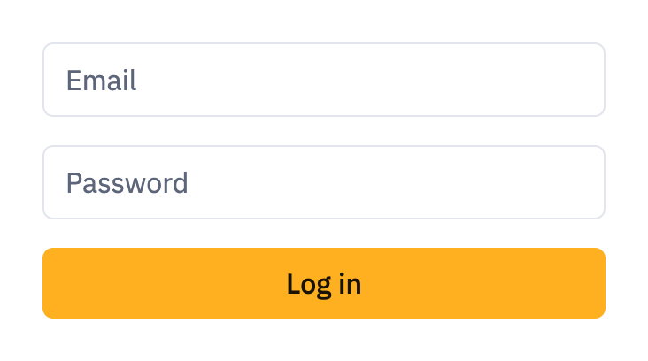
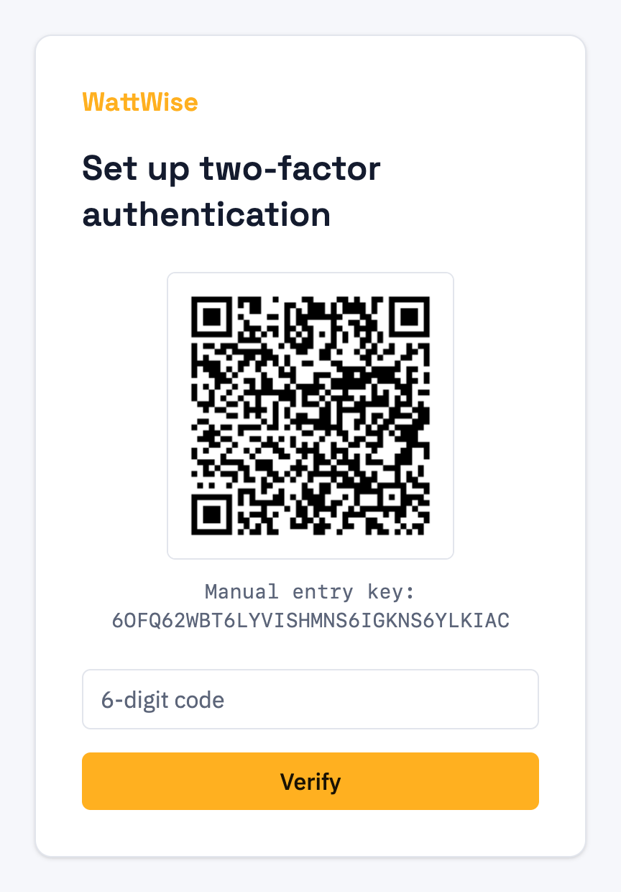
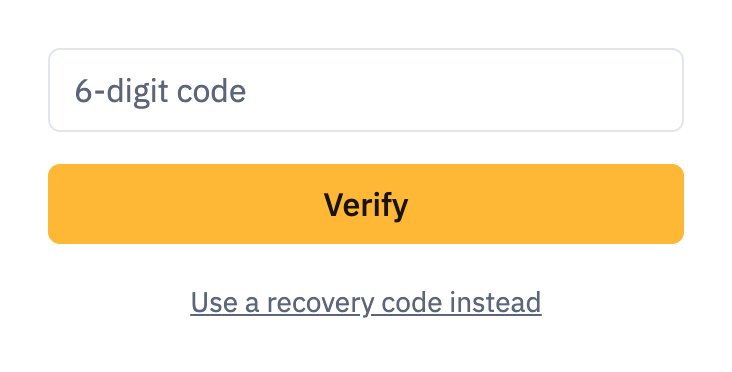
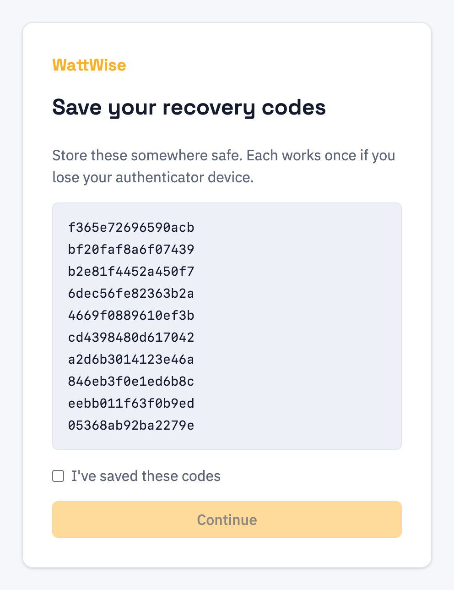
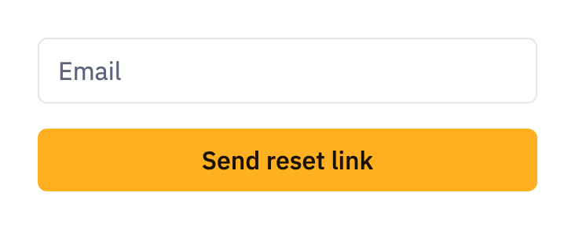

# 3. Signing in and account security

[Contents](index.md) · Previous: [Getting started](02-getting-started.md) · Next: [Sites](04-sites.md)

Every account is protected by a password and a six-digit code from an authenticator app. This chapter covers creating an account, signing in, and recovering access.

## Creating an account

1. On the login page, click **Create an account**.
2. Enter your email address and click **Create account**.
3. WattWise shows **Check your email** and sends you a confirmation link.
4. Open the link. It is valid for 24 hours and works once.
5. On **Confirm your account**, enter a password twice and click **Confirm account**. Passwords must be 8 to 72 characters long.
6. When you see **Account confirmed**, click **Go to login**.

> **Note:** Your account does not exist until you complete step 5. If the link has expired, register again with the same email address to get a new one.

## Signing in

1. Enter your email address and password and click **Log in**.
2. WattWise sends you to one of two places:
   - [Set up two-factor authentication](#setting-up-two-factor-authentication), if this is your first sign-in.
   - [Enter your authenticator code](#entering-an-authenticator-code), on every later sign-in.
3. After the code is accepted you land on your [site](04-sites.md).

Sessions last 24 hours by default. After that you sign in again. Your administrator can change this limit.

> **Warning:** After 5 failed password attempts for one email address within 15 minutes, further attempts are refused until the older failures age out of that 15-minute window. The same limit applies to wrong authenticator codes. Wait, then try again.

## Setting up two-factor authentication

You do this once, on your first sign-in.

1. Install an authenticator app on your phone (any app that supports time-based one-time passwords).
2. In the app, scan the QR code on screen. If you cannot scan, add an account manually and type the **Manual entry key** shown under the code.
3. Enter the 6-digit code the app shows and click **Verify**.
4. WattWise shows **Save your recovery codes**. See [Recovery codes](#recovery-codes). Tick the confirmation box and click **Continue**.

> **Note:** If the setup page says **Session expired**, go back to the login page and sign in again. The setup session lasts only a few minutes.

## Entering an authenticator code

Enter the current 6-digit code from your app and click **Verify**. The code changes every 30 seconds, and a code can be used only once. If the code you just used is rejected as already used, wait for the next one.

If you do not have your phone, click **Use a recovery code instead** and enter one of your [recovery codes](#recovery-codes). Click **Use authenticator code instead** to switch back.

## Recovery codes

You get 10 recovery codes when you finish setting up two-factor authentication. Each code works once, in place of an authenticator code.

- Store them somewhere other than your phone, such as a password manager or a printout in a safe place.
- You must tick the confirmation box before **Continue** (or **Done**, in Account settings) works.
- The codes are shown only once. WattWise cannot show them again.
- Replacing your authenticator creates 10 new codes and cancels all the old ones. See [Replacing your authenticator](08-account-settings.md#two-factor-authentication).

## Lost your authenticator device

1. On the login page, enter your email and password.
2. On the code page, click **Use a recovery code instead** and enter an unused recovery code.
3. Open [Account settings](08-account-settings.md#two-factor-authentication) and use **Replace authenticator**. You can type a recovery code where it asks for the authenticator code.
4. Scan the new QR code, confirm with a new 6-digit code, and save the new recovery codes.

If you have no recovery codes left, ask your WattWise administrator for help. WattWise cannot reset two-factor authentication by email.

## Forgotten password

1. On the login page, click **Forgot password?**.
2. Enter your email address and click **Send reset link**. WattWise shows a message and, if the address belongs to an account, sends a reset link. The message is the same either way, so nobody can use it to check which addresses have accounts.
3. Open the link within 1 hour. It works once.
4. Enter a new password (8 to 72 characters) and click **Reset password**. You are returned to the login page.

Requesting a new link cancels any earlier unused link.

To change your password while signed in, use [Change password](08-account-settings.md#change-password) instead.

## Signing out

Open the user menu in the top right corner and click **Log off**. See [The screens](02-getting-started.md#the-screens).

## Next

- [Sites](04-sites.md)
- [Account settings](08-account-settings.md) for changing your password, email or authenticator
- [Troubleshooting sign-in problems](09-troubleshooting.md#sign-in-problems)
