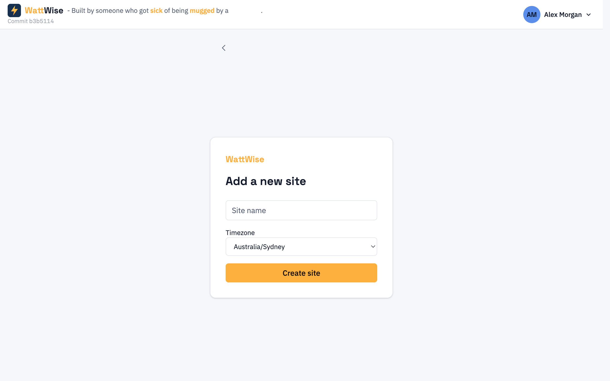
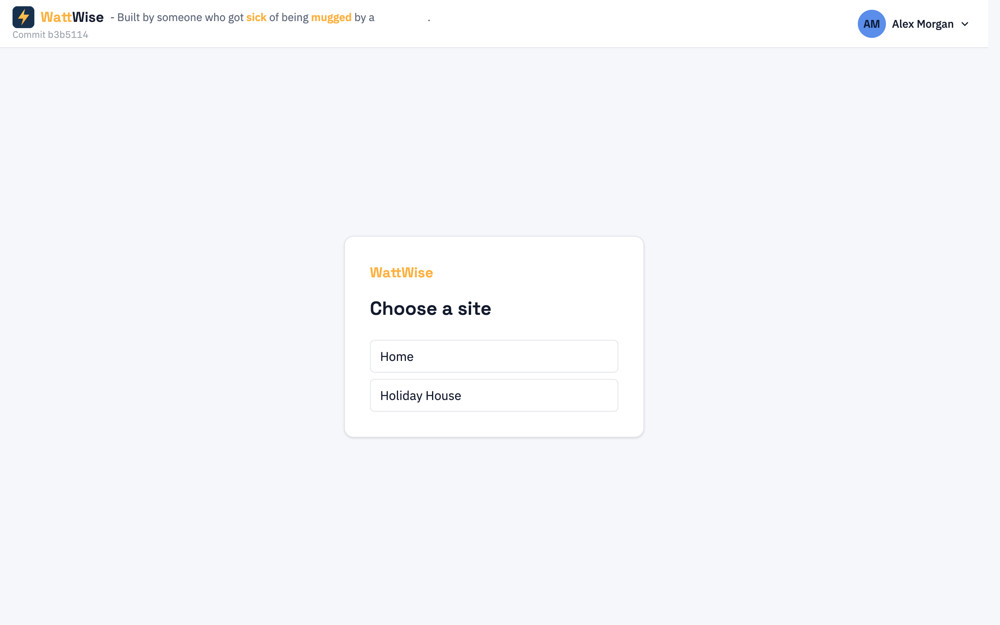
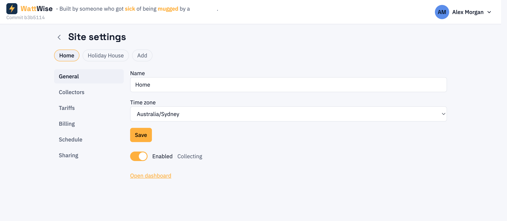
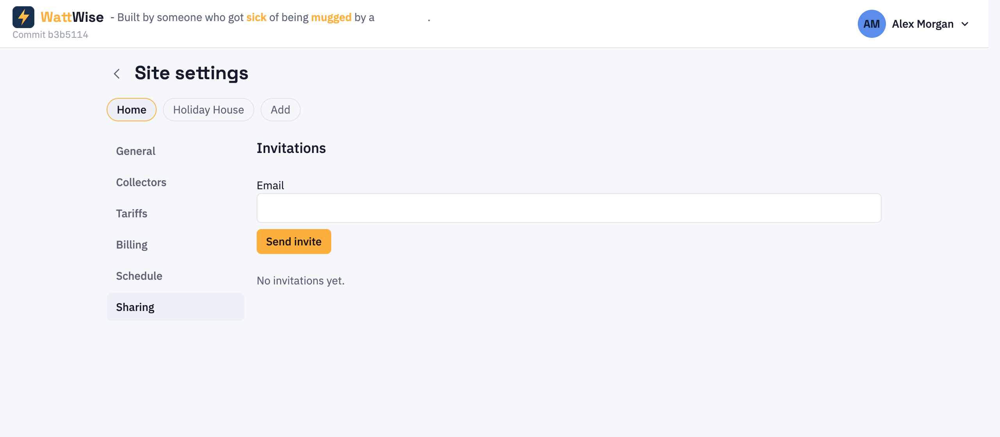

# 4. Sites

[Contents](index.md) · Previous: [Signing in and account security](03-signing-in.md) · Next: [Sources](05-sources.md)

A **site** is one property you monitor. Readings, prices, tariffs and bills all belong to a site, so you add your devices to a site and look at costs per site.

## Creating a site

If you have no sites, WattWise opens **Create your first site** straight after sign-in. To add another later, use the site switcher in the sidebar and choose **Add new site**, or click **Add** in [Site settings](#site-settings).

| Field | What to enter |
|-------|---------------|
| **Site name** | Any name you will recognise, for example `Home` or `Holiday House`. |
| **Timezone** | The property's IANA time zone name, for example `Australia/Sydney`. |

> **Warning:** Choose the time zone carefully. WattWise uses it to decide where each local day starts and ends, which tariff window applies at a given time, and when billing cycles close. A wrong time zone shifts demand windows and daily charges by hours.

After you create a site, continue with [adding sources](05-sources.md).

## Choosing a site

What you see after sign-in depends on how many sites you have:

| Sites | What happens |
|-------|--------------|
| None | **Create your first site** form |
| One enabled site | Opens that site's [dashboard](06-dashboard.md) directly |
| Two or more enabled sites | **Choose a site** list. Click a name to open its dashboard. |
| Sites, but all [disabled](#disabling-a-site) | **Choose a site** with a **Go to settings** link, or the Settings page directly when you have no pending invitations |

The list shows only enabled sites. If someone has [invited you](#sharing-a-site) to a site, a **Pending invitations** section appears above the list, and the page stays open instead of jumping to your only site.

## Switching sites

Use the site switcher at the top of the sidebar. Pick a site name to open its dashboard, or **Add new site** to create another. The switcher lists enabled sites only, plus the site you are viewing if it is disabled, marked *(disabled)*. The sidebar links **Dashboard** and **Reporting** then apply to the site you picked. Sources, tariffs and billing are in [Site settings](#site-settings).

## Site settings

Click your name in the top right corner, then **Site settings**, to open the Settings page (`/settings`). It lists every site you own or have been given access to, including disabled ones.

- **Site chips** run along the top, one per site, with **Add** at the end. A disabled site is dimmed with a dashed border.
- **Tabs** run down the left: **General**, **Collectors**, **Tariffs**, **Billing**, **Schedule** and **Sharing**. The selected site and tab are in the address, so you can bookmark a tab.

| Tab | What it holds |
|-----|---------------|
| **General** | Site name, time zone, [location](#location-and-sun-times), the **Enabled** switch, and an **Open dashboard** link |
| **Collectors** | The [sources](05-sources.md) of the site |
| **Tariffs** | The [tariff](07-billing.md#tariffs) cards |
| **Billing** | The [billing cycle](07-billing.md#billing-cycles) and [demand charges](07-billing.md#demand-charges) |
| **Schedule** | The [air conditioner and its schedules](08-schedules.md) |
| **Sharing** | [Invitations](#sharing-a-site) to view the site |

Only the owner can change a site's settings. Other people see the tabs read-only. The old `/sites/:id/sources`, `/sites/:id/billing` and `/sites/:id/schedule` addresses redirect to the **Collectors**, **Billing** and **Schedule** tabs.

## Location and sun times

A schedule can start or stop at sunrise or sunset, so WattWise needs to know where the site is. Set it on the **General** tab under **Location**:

- Type a **Latitude** (-90 to 90) and a **Longitude** (-180 to 180), for example `-33.87` and `151.21`. South and west are negative.
- Click **Use my location** to fill both boxes from your device. Your browser asks permission only when you click. The button is missing when the browser has no location support, and for people who can only view the site.
- Click the map to set the point. The map starts zoomed out over Australia and moves to the point you set.

Click **Save** to keep the change. To remove the location, clear both boxes and save. You cannot set one box without the other. Under the map, a line shows today's sunrise and sunset in the site's time zone, so you can check the point. It reads *The sun does not rise or set at this location today* in polar summer and winter.

With no point set, WattWise estimates sun times from the reference city of the site's time zone, and the line adds *(estimated from the time zone)*. The estimate is only as close as that city is to your property. The Schedule editor refuses sunrise and sunset when neither a point nor a time zone estimate is available.

> **Note:** The map is drawn from tiles that your browser downloads from `tile.openstreetmap.org`, a server run by OpenStreetMap. That server sees your browser's address and the area you view. WattWise loads the map only when you open the **General** tab. Typing the numbers works without it. The sun times use the saved latitude and longitude, never the map.

## Disabling a site

Use this when you move out of a property but want to keep its history.

1. Open **Site settings** and pick the site's chip.
2. On **General**, turn off **Enabled**. WattWise asks **Turn off collection?**. Click **Turn off**.

A disabled site:

- no longer appears in the sign-in site list or the site switcher, for you and for anyone you share it with. The switcher still shows it, marked *(disabled)*, while you are on its dashboard
- stops collecting: its collectors leave it out of their source lists, and Core API refuses any reading a collector still sends for it
- keeps all its data. Its dashboard and reporting still open from the **Open dashboard** link, with a banner saying the site is disabled and not collecting data

Turn **Enabled** back on to resume collecting. Readings and prices for the time it was off are not filled in afterwards.

## Sharing a site

Open the **Sharing** tab to give someone read-only access.

1. Type their email address under **Email** and click **Send invite**. WattWise emails them. The message and the result are the same whether or not the address already has an account.
2. The invite shows **Invited** until they answer.
3. They sign in or register with that address, and confirm it. The sites page then lists the site under **Pending invitations**, with **Accept** and **Decline**.

| Status | Meaning |
|--------|---------|
| **Invited** | Sent, not answered. You can revoke it. |
| **Accepted** | The person can view the site. You or they can revoke. |
| **Declined** | They declined. Final. |
| **Revoked** | Access ended or the invite was withdrawn. Final. |

Each row shows who sent the invite and the date its status last changed, in your own time zone. Invitations are never deleted. To invite the same address again after a decline or revoke, send a new invite.

Limits: you cannot invite your own address, an address that already has an invited or accepted invite for the site is refused (*already invited*), a site can have at most 20 pending invitations, and a site can send at most 20 invitations in any 24 hours, counting revoked and declined ones. Past that, wait and try again later. People you share with see only their own invitation on the **Sharing** tab, with a **Revoke** button.

## Next

- [Sources](05-sources.md): connect devices to your site
- [Billing](07-billing.md): enter the tariff for your site
