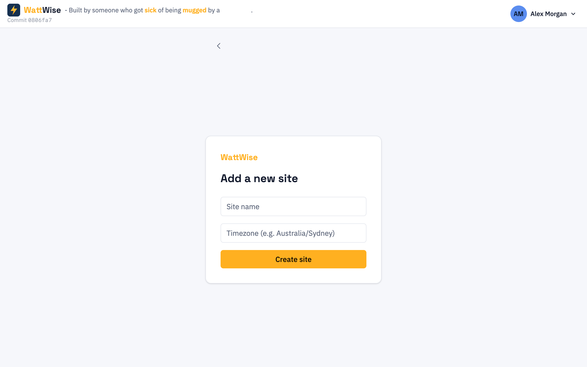

# 4. Sites

[Contents](index.md) · Previous: [Signing in and account security](03-signing-in.md) · Next: [Sources](05-sources.md)

A **site** is one property you monitor. Readings, prices, tariffs and bills all belong to a site, so you add your devices to a site and look at costs per site.

## Creating a site

If you have no sites, WattWise opens **Create your first site** straight after sign-in. To add another later, use the site switcher in the sidebar and choose **Add new site**, or click **Add** in [Site settings](#site-settings).

| Field | What to enter |
|-------|---------------|
| **Site name** | Any name you will recognise, for example `Home` or `Holiday House`. |
| **Timezone** | The property's IANA time zone name, for example `Australia/Sydney`. |

> **Warning:** Choose the time zone carefully. WattWise uses it to decide where each local day starts and ends, which tariff window applies at a given time, and when billing cycles close. A wrong time zone shifts demand windows and daily charges by hours.

After you create a site, continue with [adding sources](05-sources.md).

## Choosing a site

What you see after sign-in depends on how many sites you have:

| Sites | What happens |
|-------|--------------|
| None | **Create your first site** form |
| One enabled site | Opens that site's [dashboard](06-dashboard.md) directly |
| Two or more enabled sites | **Choose a site** list. Click a name to open its dashboard. |
| Sites, but all [disabled](#disabling-a-site) | **Choose a site** with a **Go to settings** link, or the Settings page directly when you have no pending invitations |

The list shows only enabled sites. If someone has [invited you](#sharing-a-site) to a site, a **Pending invitations** section appears under the list, and the page stays open instead of jumping to your only site.

## Switching sites

Use the site switcher at the top of the sidebar. Pick a site name to open its dashboard, or **Add new site** to create another. The switcher lists enabled sites only. The sidebar links **Dashboard** and **Reporting** then apply to the site you picked. Sources, tariffs and billing are in [Site settings](#site-settings).

## Site settings

Click your name in the top right corner, then **Site settings**, to open the Settings page (`/settings`). It lists every site you own or have been given access to, including disabled ones.

- **Site chips** run along the top, one per site, with **Add** at the end. A disabled site is dimmed with a dashed border.
- **Tabs** run down the left: **General**, **Collectors**, **Tariffs**, **Billing** and **Sharing**. The selected site and tab are in the address, so you can bookmark a tab.

| Tab | What it holds |
|-----|---------------|
| **General** | Site name, time zone, the **Enabled** switch, and an **Open dashboard** link |
| **Collectors** | The [sources](05-sources.md) of the site |
| **Tariffs** | The [tariff](07-billing.md#tariffs) cards |
| **Billing** | The [billing cycle](07-billing.md#billing-cycles) and [demand charges](07-billing.md#demand-charges) |
| **Sharing** | [Invitations](#sharing-a-site) to view the site |

Only the owner can change a site's settings. Other people see the tabs read-only. The old `/sites/:id/sources` and `/sites/:id/billing` addresses redirect to the **Collectors** and **Billing** tabs.

## Disabling a site

Use this when you move out of a property but want to keep its history.

1. Open **Site settings** and pick the site's chip.
2. On **General**, turn off **Enabled**. WattWise asks **Turn off collection?**. Click **Turn off**.

A disabled site:

- no longer appears in the sign-in site list or the site switcher, for you and for anyone you share it with
- stops collecting: its collectors leave it out of their source lists, and Core API refuses any reading a collector still sends for it
- keeps all its data. Its dashboard and reporting still open from the **Open dashboard** link, with a banner saying the site is disabled and not collecting data

Turn **Enabled** back on to resume collecting. Readings and prices for the time it was off are not filled in afterwards.

## Sharing a site

Open the **Sharing** tab to give someone read-only access.

1. Type their email address under **Email** and click **Send invite**. WattWise emails them. The message and the result are the same whether or not the address already has an account.
2. The invite shows **Invited** until they answer.
3. They sign in or register with that address, and confirm it. The sites page then lists the site under **Pending invitations**, with **Accept** and **Decline**.

| Status | Meaning |
|--------|---------|
| **Invited** | Sent, not answered. You can revoke it. |
| **Accepted** | The person can view the site. You or they can revoke. |
| **Declined** | They declined. Final. |
| **Revoked** | Access ended or the invite was withdrawn. Final. |

Each row shows the date its status last changed. Invitations are never deleted. To invite the same address again after a decline or revoke, send a new invite.

Limits: you cannot invite your own address, an address that already has an invited or accepted invite for the site is refused (*already invited*), and a site can have at most 20 pending invitations. People you share with see only their own invitation on the **Sharing** tab, with a **Revoke** button.

## Next

- [Sources](05-sources.md): connect devices to your site
- [Billing](07-billing.md): enter the tariff for your site
