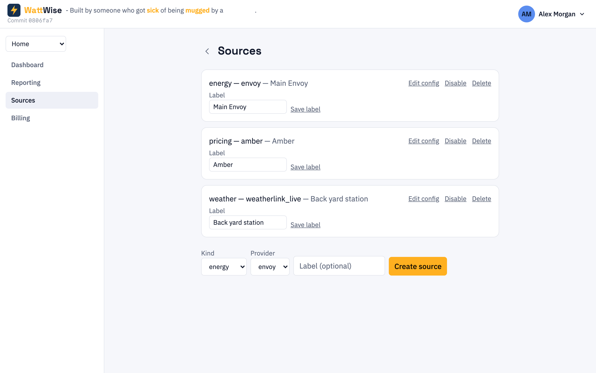
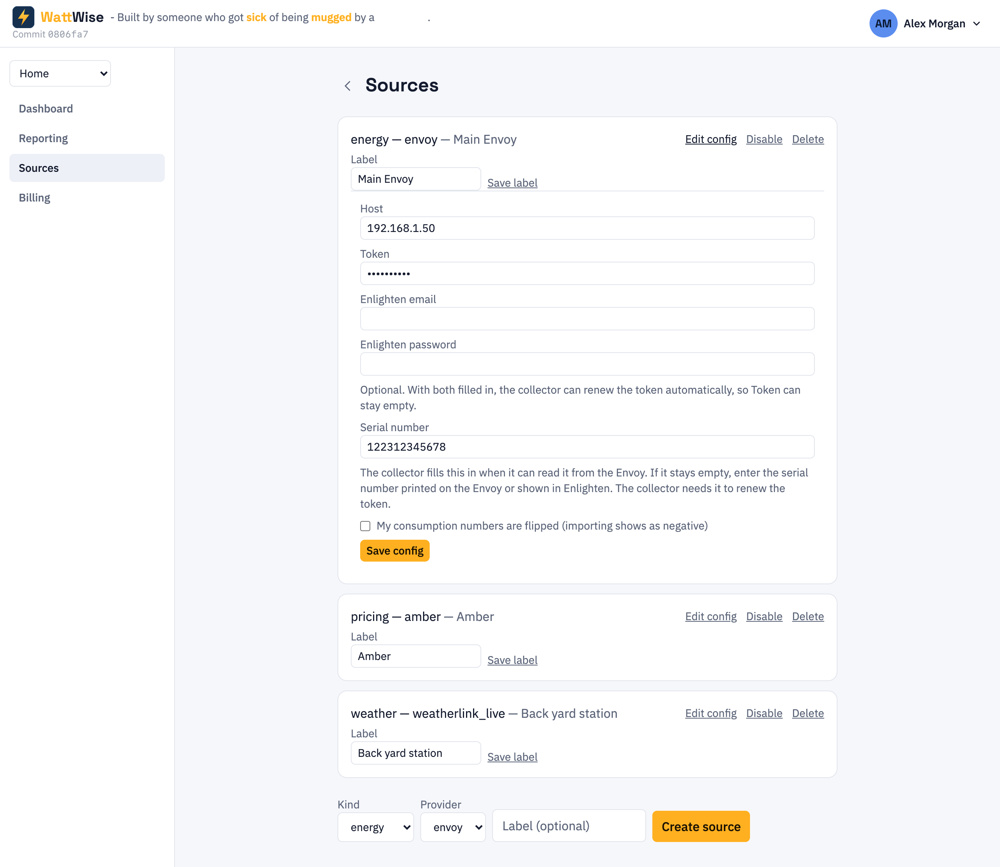

# 4. Sources

[Contents](index.md) · Previous: [Sites](03-sites.md) · Next: [The dashboard](05-dashboard.md)

A **source** connects a site to one device or service. WattWise supports three kinds:

| Kind | Provider name | What it collects | Needs |
|------|---------------|------------------|-------|
| `energy` | `envoy` | Production, consumption, grid and battery readings | The Envoy's address and an access token |
| `pricing` | `amber` | Buy and sell prices, plus the day's forecast | An Amber site ID, and your [Amber API key](07-account-settings.md#amber-api-key) |
| `weather` | `weatherlink_live` | Temperature, humidity, wind, rain, solar radiation, pressure | The WeatherLink Live unit's address |

Open the page from the sidebar with **Sources**.

## Adding a source

1. Open **Sources** in the sidebar.
2. At the bottom of the page, choose a **Kind**. The **Provider** list updates to the provider for that kind.
3. Optionally type a **Label**, for example `Garage Envoy`. Labels help when a site has more than one source of the same kind.
4. Click **Create source**.
5. WattWise confirms: *Source created — the matching collector will start collecting for it automatically within a few minutes.*
6. Click **Edit config** on the new row and fill in its settings. The sections below show what each provider needs.

Limits:

- A site can have one pricing source and one weather source. A second one is refused with an error. To change the Amber site or the weather station's address, use **Edit config** on the existing source.
- A site can have more than one energy source.

## Editing, disabling and deleting

Each source row has these actions:

| Action | What it does |
|--------|--------------|
| **Edit config** | Opens the settings form for that provider. Click **Save config** to apply. |
| **Disable** / **Enable** | Stops or restarts collection. History is kept. |
| **Delete** | Asks you to click **Confirm delete** (or **Cancel**). |
| **Label** and **Save label** | Renames the source. The label is only for you. |

> **Warning:** A source that has already stored readings cannot be deleted. WattWise tells you to disable it instead. Disabling is the normal way to retire a source.

Changes reach the collector within a few minutes. You do not restart anything.

## Connecting an Enphase Envoy

Choose kind `energy` and provider `envoy`, then open **Edit config**.

| Field | What to enter |
|-------|---------------|
| **Host** | The Envoy's address on your home network, such as `192.168.1.50` or `envoy.local`. A fixed (reserved) address is more reliable than a name. |
| **Token** | A local-access token for your Envoy. Shown as dots while you type. Optional when the two Enlighten fields below are filled in. |
| **Enlighten email** | Optional. The email you use to sign in to Enlighten (enlighten.enphaseenergy.com). |
| **Enlighten password** | Optional. Shown as dots while you type. |
| **Serial number** | The Envoy's serial number. The collector fills it in when it can read it from the Envoy; type it yourself if it stays empty. Needed to renew the token. |
| **My consumption numbers are flipped (importing shows as negative)** | Tick this only if the dashboard's consumption looks upside down. See [Troubleshooting](08-troubleshooting.md#consumption-or-grid-numbers-have-the-wrong-sign). |

### Getting the token

The simplest route is to fill in **Enlighten email** and **Enlighten password** and leave **Token** empty. The collector needs your Envoy's serial number. It fills **Serial number** in itself when it can read it from the Envoy. If that box is still empty after a few minutes, type the serial number yourself. Then the collector signs in to Enlighten and fetches a token. It renews the token the same way 14 days before it expires. Your email and password are stored in the WattWise database next to the token, and only the site owner can see them.

If you would rather not store your Enlighten password, get the token by hand:

1. Save the **Host** first and wait a few minutes. The collector contacts the Envoy and reports its **Serial number** back, which then appears in **Serial number**. If it does not appear, type the number in yourself; it is printed on the Envoy and shown in Enlighten.
2. Open this address in a browser, replacing `<serial>` with that number, and sign in with your Enphase Enlighten account:

   `https://enlighten.enphaseenergy.com/entrez-auth-token?serial_num=<serial>`

3. Copy the token it gives you into **Token** and click **Save config**.

Tokens last about a year. Without stored credentials, readings stop when one expires, and you repeat the steps above.

### Certificate pinning

The Envoy uses a self-signed certificate. The first time the collector reaches your Envoy, it records the certificate's fingerprint and checks it on every later connection. It sends your token only after this check is in place. Changing **Host** clears the stored certificate and serial number, so the collector pins the device again. If you replace or reset the Envoy and the collector stops connecting, see [Troubleshooting](08-troubleshooting.md#the-envoy-stopped-reporting-after-a-reset).

## Connecting Amber Electric

Pricing needs two things:

1. **Your Amber API key**, saved once under [Account settings](07-account-settings.md#amber-api-key). The key belongs to you, not to a site.
2. **An Amber pricing source** on the site, with the **Amber site ID** filled in.

To add the source, choose kind `pricing` and provider `amber`, open **Edit config**, enter your **Amber site ID** and click **Save config**. The site ID is the identifier Amber assigns to your property. Amber's API returns it when you list your sites with your API key.

Once prices flow, the dashboard shows [Today's Pricing](05-dashboard.md#todays-pricing) and the [grid price tile](05-dashboard.md#live-tiles), and costs can be calculated.

## Connecting a WeatherLink Live station

Choose kind `weather` and provider `weatherlink_live`, open **Edit config**, enter the **Host** (the address of your WeatherLink Live unit on your home network) and click **Save config**. Weather tiles appear on the [dashboard](05-dashboard.md#weather-tiles).

## Next

- [The dashboard](05-dashboard.md): see your data
- [Billing](06-billing.md): prices alone do not include fixed charges
- [Troubleshooting](08-troubleshooting.md#the-dashboard-is-empty) if tiles stay empty
