# 6. The dashboard

[Contents](index.md) · Previous: [Sources](05-sources.md) · Next: [Billing](07-billing.md)

The dashboard is the first page of every site. It has five parts, from top to bottom: [live tiles](#live-tiles), [weather tiles](#weather-tiles), [Today's Pricing](#todays-pricing), [today's grid and cost chart](#todays-grid-and-cost-chart) and the [battery chart](#battery-chart). A log appears above them when a collector or schedule has a problem or a notice, or an air conditioner action ran OK in the last 24 hours. The bulb colours and the buttons are in [Schedules](08-schedules.md#the-log). The [Reporting page](#reporting-page) shows the cost for a period you choose.

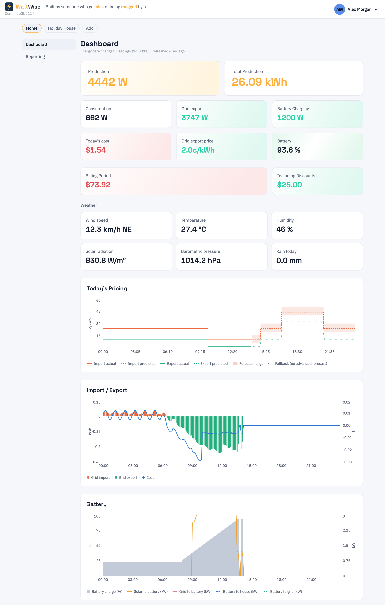

The page updates by itself. You do not need to reload. When your collectors are sending live readings, the energy and weather tiles change within a few seconds. When they are not, those tiles fall back to the reading WattWise stores once a minute. The charts, the price and cost tiles and **Rain today** refresh every 60 seconds.

Under the **Dashboard** heading, a small grey line shows `Energy data changed 3 min ago (14:32:05) · refreshed 12 sec ago`. The first part is how long ago the newest energy reading arrived in WattWise, with its clock time, so you can tell whether your energy source is still sending data. The second part is how long ago this page last fetched the stored reading, which resets about every 60 seconds.

While live data is arriving, the line changes to `Energy DB last updated 3 min ago (14:32:05) · live data received 2 sec ago`. The first part is the same stored reading. The second part is how long ago the last live value arrived. The live tiles update from the live data and stop refetching every 60 seconds. If no live value arrives for 15 seconds, the line and the 60 second refresh go back to the first form.

## Live tiles

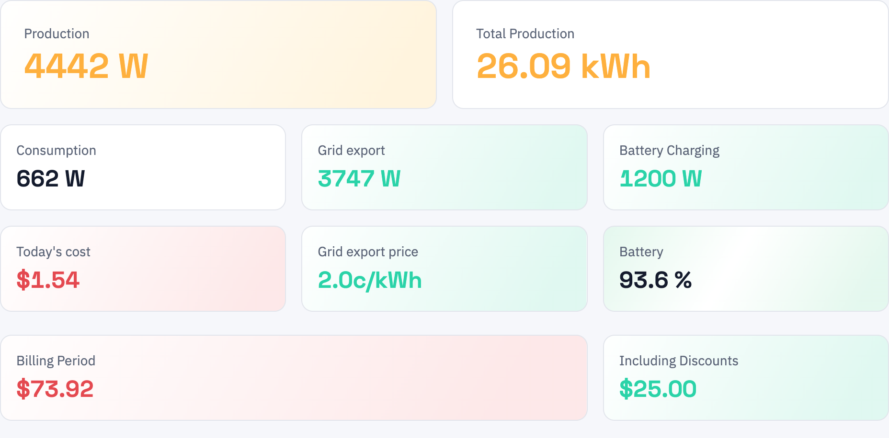

The large tile at the top is **Production**. Below it are the other tiles. A tile appears only when WattWise has a reading for it, so a site without a battery has no battery tiles.

| Tile | Meaning |
|------|---------|
| **Production** | Power your solar panels are generating now, in watts. |
| **Consumption** | Power your home is using now. |
| **Grid import** | Power you are drawing from the grid now. |
| **Grid export** | Power you are sending to the grid now. |
| **Battery charge** / **Battery discharge** | Power flowing into or out of the battery. |
| **Battery** | The battery's charge level, as a percentage. |
| **Today's cost** / **Today's credit** | What you have spent, or earned, since local midnight. |
| **Grid import price** / **Grid export price** | The price per kWh that applies right now. |
| **Billing Period** | The running total since your current billing period began. Red is a cost, green is a credit. |
| **Including Discounts** | The total of the [monthly fee discounts](07-billing.md#monthly-fee-discounts) that cover your current billing period, in full: the discounted fee itself, not the amount saved against the normal fee. Shown only when a discount covers part of the period. The Billing Period tile shrinks to half width to make room. |

### Reading the colors

Color shows the direction of the energy, not decoration.

| Color | Meaning |
|-------|---------|
| Amber | The sun is producing. |
| Green | Something that benefits you: exporting to the grid, charging the battery, or a net credit. |
| Red | Something that costs you: importing from the grid, discharging the battery, or a net cost. |

A tile glows softly while its flow is active. The glow stops when the value drops to zero.

The **Battery** tile changes its background from red through amber to green as the charge level rises. The percentage is always printed on the tile, so you never have to rely on color alone.

### Rounding and small values

- Power tiles are rounded to the nearest watt.
- Production and battery charge or discharge below 100 W show as `0 W`. Readings that small are inverter standby draw, not real activity.
- Import and export are never both shown. WattWise shows whichever was reported most recently.

### Cost and credit

**Today's cost** and **Billing Period** use one sign rule:

- A positive amount is money you owe. It shows in red and the tile says **cost**.
- A negative amount is money you earn. It shows in green and the tile says **credit**. The minus sign is dropped because the color and word already say it.

**Billing Period** appears only after you [add a billing cycle](07-billing.md#billing-cycles). Without one the tile is hidden, which is normal.

Fixed daily and monthly fees are included in proportion to how much of the day has passed, so the figure rises smoothly instead of jumping at midnight. The monthly fee needs a billing cycle. See [How the cost is calculated](07-billing.md#how-the-cost-is-calculated).

## Weather tiles

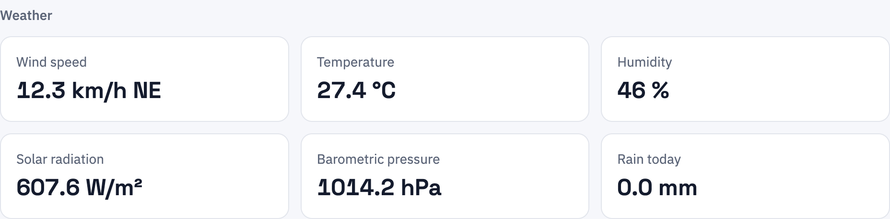

Under the live tiles, **Weather** shows the latest reading from your WeatherLink station: **Temperature** (°C), **Humidity**, **Solar radiation** (W/m²), **Barometric pressure** (hPa) and **Wind speed** with a compass direction, for example `12.3 km/h NE`. **Rain today** is the total since midnight, rounded to 0.1 mm, so it stays put after the rain stops and resets overnight. These tiles need a [weather source](05-sources.md#connecting-a-weatherlink-live-station).

## Demand window notice

When one of your [demand windows](07-billing.md#demand-windows) is in effect, the heading reads **Dashboard - DEMAND WINDOW ACTIVE** in red. While it shows, the power you import counts toward your peak-demand charge, so shifting heavy loads such as the oven, dryer or EV charger to another time lowers that charge.

## Today's Pricing

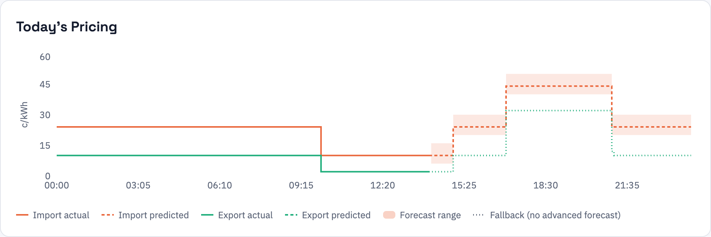

This chart shows your import and export price for every 5 minutes of today, in cents per kWh. The prices come from your pricing source: Amber's prices, or the rates in your [fixed tariff](05-sources.md#setting-up-a-fixed-tariff).

From 8pm, a Tomorrow's Pricing chart appears below it. At midnight, Today's Pricing becomes Yesterday's Pricing and Tomorrow's becomes Today's. Yesterday's chart disappears at 4am. Only Today's Pricing shares its zoom and hover with the chart below; the other two zoom on their own.

| Line | Meaning |
|------|---------|
| Red solid | **Import actual**: what buying power cost in intervals that have finished. |
| Red dashed | **Import predicted**: the price for the rest of today. With Amber this is Amber's predicted price. With a fixed tariff it is the rate your windows set. |
| Green solid | **Export actual**: what you were paid for exporting. |
| Green dashed | **Export predicted**: the export price for the rest of today, from Amber's predicted price or your fixed tariff. |
| Dotted, in the line's colour | **Fallback**: a future interval where Amber sent no predicted price, so the chart shows Amber's plain forecast instead. It appears only when this happens, and the legend then gets a "Fallback" entry. |

### Forecast range and price instability

With Amber, each predicted import price comes with a range: Amber's low and high estimate for that interval. The chart shades it behind the red dashed line, and the legend gets a "Forecast range" entry. A wide shaded band means Amber is less sure of the price. Hover over a point to see the range in cents.

The chart also tints stretches of the day where Amber has flagged a possible price spike (amber) or an actual spike (red). The legend then gets a "Price spike possible" or "Price spike" entry. A wide forecast range alone is not tinted. When there are any, a line above the chart says when, for example `Price instability expected 16:30 to 19:00`. On a normal day there is no tint and no line. This covers import prices only. It does not appear with a fixed tariff.

Drag across the chart to zoom into a stretch of the day, and press **Reset zoom** to go back. Hover over a point for the exact price. The chart always shows today and does not change with the Reporting page. It needs a pricing source, either [Amber](05-sources.md#connecting-amber-electric) or a [fixed tariff](05-sources.md#setting-up-a-fixed-tariff).

Prices are shown as plain positive rates. WattWise stores the sell price as a negative number when you are being paid, as Amber publishes it, and the chart shows its size instead.

## Today's grid and cost chart

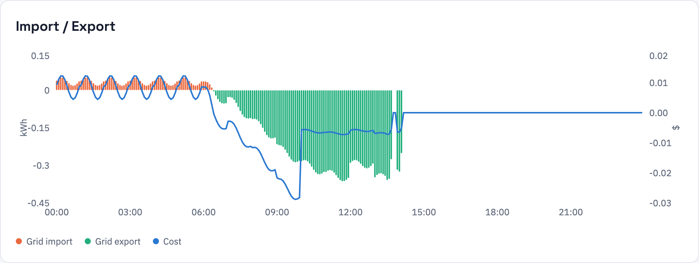

A chart of grid energy and cost for today, with no controls or totals. It always shows today in 5-minute bars, and uses the Net cost method. Red bars are import, green bars are export, and the amber line is cost.

This chart and Today's Pricing above it share one zoom. Drag across either to zoom both to that time span, then press **Reset zoom** on either to clear it.

## Battery chart

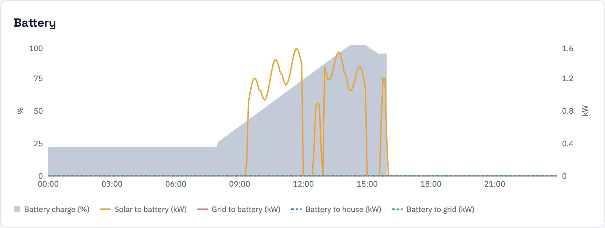

Below the grid and cost chart, the Battery chart shows today in 5-minute steps. It shares the zoom and hover position with the two charts above it. It appears only once your site has reported a battery reading today.

- **The filled area** is the battery's charge level at the end of each 5 minutes, from 0 to 100% (left axis). Its top edge is drawn as a smooth curve between readings.
- **Solid lines** are power going into the battery, in kW (right axis): solar in green and grid in salmon.
- **Dashed lines** are power coming out of the battery: to the house in blue and to the grid in green. The to-the-grid line is drawn below zero, the way grid export is on the chart above.

The collectors report total battery charge and discharge, not where the energy came from or went. WattWise estimates the split for each minute. Charging counts as solar up to the solar surplus (production minus consumption), and the rest as grid. Discharging counts as going to the grid up to that minute's export, and the rest as going to the house.

## Reporting page

Open **Reporting** in the sidebar to see a chart and a table of totals for a month or a billing period. You can drill from days into hours and from hours into minutes, by clicking either the chart or the table.

### Daily totals

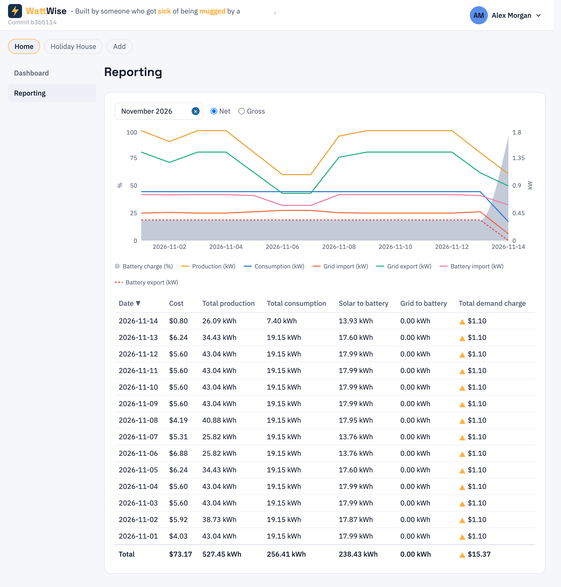

The page has a month picker and **Net** and **Gross** options. Below them is a chart, then a table with one row for each day, ending at today.

#### Choosing a period

The month picker is empty by default and shows **Current billing period**. Pick a month to list that calendar month. Clear the picker to return to the billing period. If the site has no [billing cycle](07-billing.md), the empty picker lists the current calendar month. Days start at midnight on the device you are using. The month picker shows only on the day list.

#### Reading the table

| Column | Meaning |
|--------|---------|
| **Date** | The local day |
| **Cost** | The day's cost, calculated the same way as the [billing cost](07-billing.md#how-the-cost-is-calculated), including the daily service charge, the monthly fee and the demand charge spread over the demand window |
| **Total production** | Solar energy produced, in kWh |
| **Total consumption** | Energy your home used, in kWh |
| **Solar to battery** | Battery charging estimated to come from solar, in kWh |
| **Grid to battery** | Battery charging estimated to come from the grid, in kWh |
| **Total demand charge** | The day's share of the billing period's [demand charge](07-billing.md#demand-charges) |

The last row of the table is **Total**. It adds up **Cost**, the energy columns and **Total demand charge** for every row listed. On the hour and minute views it also shows the **Avg import price** and **Avg export price** as the plain average of the rows that have a price. Rows with no price are left out of that average, and the cell shows a dash when no row has one. The average is not weighted by energy, so a quiet hour counts the same as a busy one.

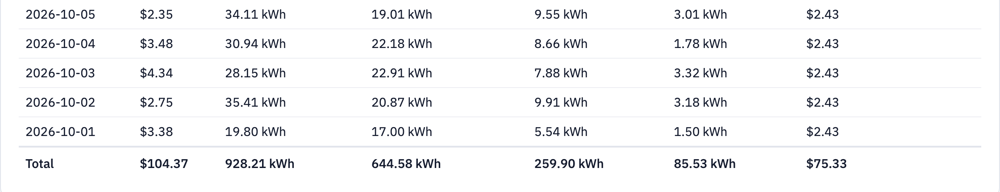

Rows start sorted by date, newest first. Click a column header to sort by it, and click again to reverse the order. The sort stays when you change the month and when you drill in.

The solar and grid split of battery charging is an estimate. For each minute, solar feeds the house first, then the battery. The rest of the charge counts as grid.

A billing period's demand charge is the peak 30-minute average import, times the daily rate, times the number of days. Each day shows the same share: the period's charge divided by its days. A yellow warning triangle next to the figure means the period is still open, so the charge is an estimate. A dash means no demand tariff applies.

### Hours and minutes

Click a day row, or click that day on the chart. The page lists that day by hour. Click an hour row, or an hour on the chart, to list it by minute. Minute rows and the minute chart do not click through.

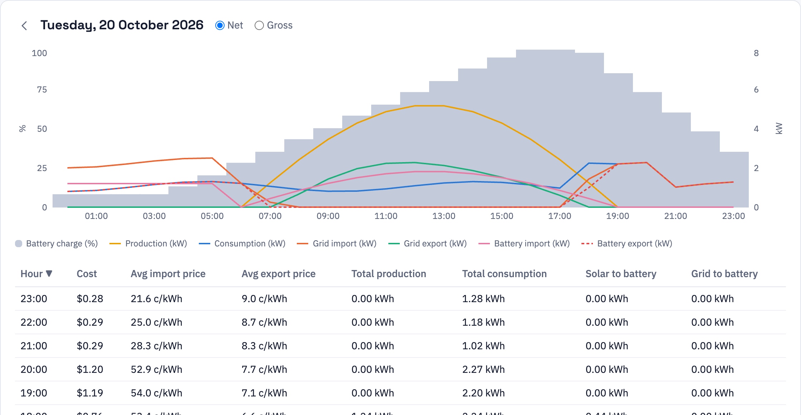

On the chart, a click opens the day or hour under the pointer, wherever it lands along the height of the chart. The pointer turns into a hand on the day and hour charts. Hours and minutes after the current hour or minute are not listed.

On the hour and minute views, a back arrow (the same `<` as on the settings pages) goes up one level and keeps the month. A heading with the date, and the hour on the minute view, replaces the month picker. The level is in the page address (`?month=&day=&hour=`), so the browser's back button also goes up a level.

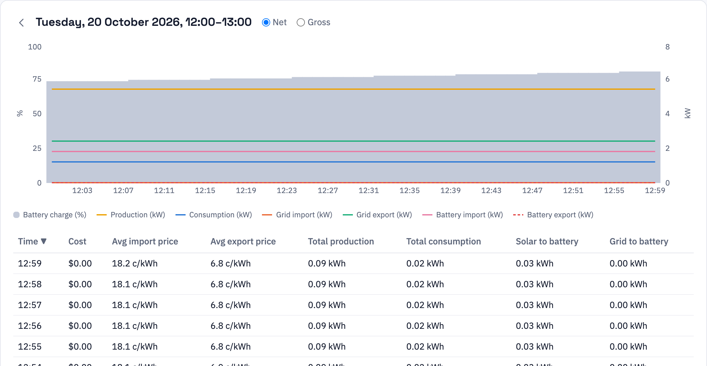

The hour and minute tables have these columns: **Hour** or **Time**, **Cost**, **Avg import price**, **Avg export price**, **Total production**, **Total consumption**, **Solar to battery** and **Grid to battery**. There is no demand charge column.

- The average prices are the Amber buy and sell prices averaged over the hour, or over the single minute. They show in c/kWh. The sell price is shown as stored, so a negative number means you are paid.
- **Cost** here is the energy cost only: buy cost minus export revenue. The daily service charge, the monthly fee and the demand charge are only in the day rows' **Cost**, so the hours of a day do not add up to that day's **Cost**.
- The sort carries across levels. If the sorted column does not exist at the next level, the table falls back to time, newest first. That happens for **Total demand charge** on the hour and minute views, and for the average prices on the day list.

### The chart

Above the table on all three levels, a chart covers the same span as the table, in days, hours or minutes. Hover over it to see the values.

- **Lines** show average power in kW over each row: Production, Consumption, Grid import, Grid export, Battery import (charge power) and Battery export (discharge power, dashed).
- **The filled area** shows the battery charge as a percentage on a 0 to 100% left axis. It has one point per row, the last reading in that row, joined by a smooth curve.

### While a report loads

The first time you open the page, a spinner with **Loading report…** shows until the numbers arrive. When you pick another month, day or hour at the same level, the previous chart and table stay on screen, dimmed, with the spinner over the chart until the new numbers arrive.

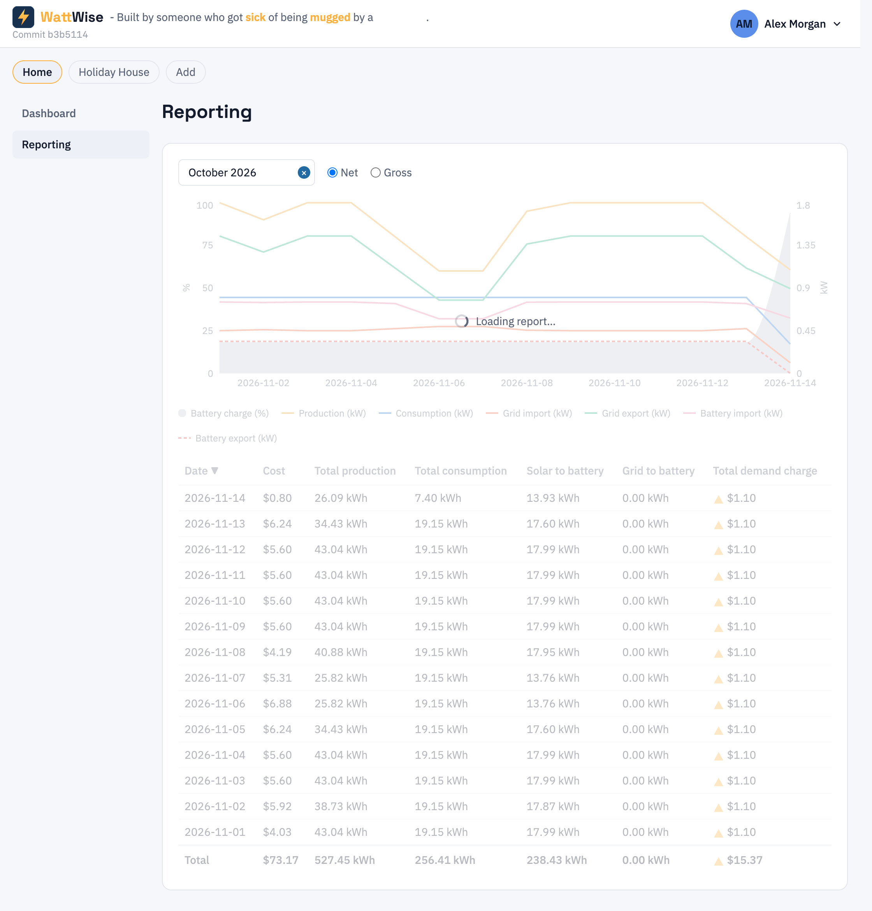

### Net and gross cost

The **Net** and **Gross** options change how the **Cost** column is calculated.

| Method | Import is priced from | Export is priced from | Use it to see |
|--------|----------------------|----------------------|---------------|
| **Net** | Energy actually drawn from the grid | Energy actually sent to the grid | What your bill will say |
| **Gross** | All the energy your home consumed | All the energy your panels produced | What the same usage would cost without solar and battery offsetting each other |

Net is the default and matches your retailer's bill. Gross is useful for comparing, for example, how much your solar saves.

### Missing prices

If a minute has energy but no price (for example, before the pricing source was added), WattWise leaves that minute out of the cost instead of guessing. Totals for such periods will be lower than your real bill. See [Troubleshooting](10-troubleshooting.md#costs-look-too-low-or-are-missing).

## Next

- [Billing](07-billing.md): tariffs and cycles that feed the cost figures
- [Troubleshooting](10-troubleshooting.md) when something looks wrong
- [Glossary](11-glossary.md) for terms such as demand window and export adjustment
