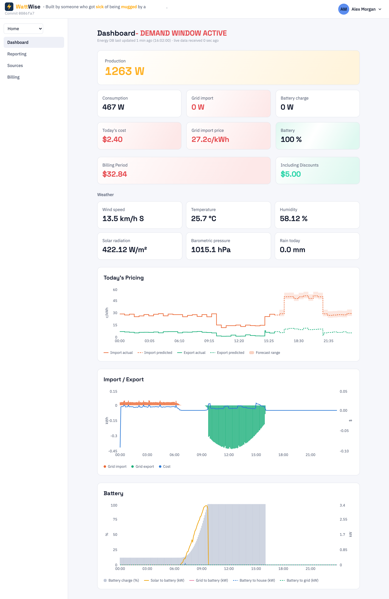
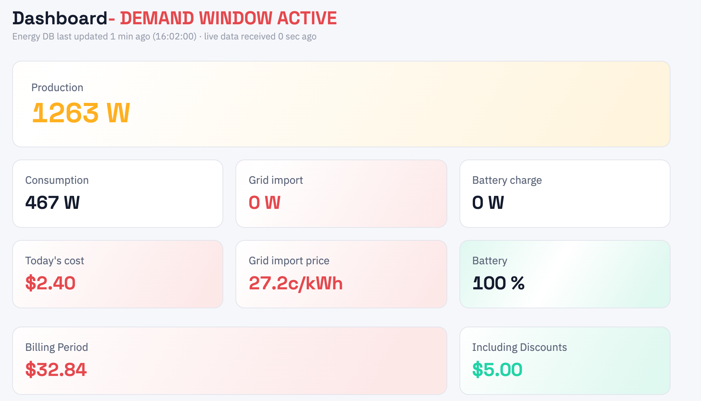
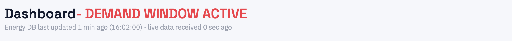
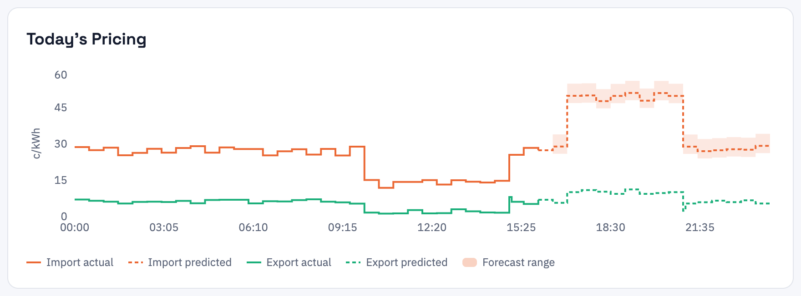
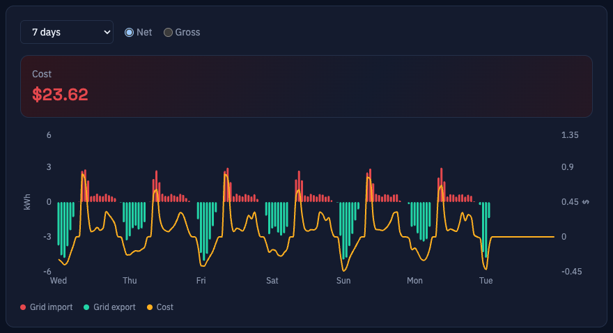

# 6. The dashboard

[Contents](index.md) · Previous: [Sources](05-sources.md) · Next: [Billing](07-billing.md)

The dashboard is the first page of every site. It has four parts, from top to bottom: [live tiles](#live-tiles), [weather tiles](#weather-tiles), [Today's Pricing](#todays-pricing) and [today's grid and cost chart](#todays-grid-and-cost-chart). The history chart is on the [Reporting page](#reporting-page).

Everything on the page refreshes by itself every 60 seconds. You do not need to reload.

Under the **Dashboard** heading, a small grey line shows `Energy data changed 3 min ago (14:32:05) · refreshed 12 sec ago`. The first part is how long ago the newest energy reading arrived in WattWise, with its clock time, so you can tell whether your energy source is still sending data. The live tiles show that reading. The second part is how long ago this page last fetched it, which resets about every 60 seconds.

## Live tiles

The large tile at the top is **Production**. Below it are the other tiles. A tile appears only when WattWise has a reading for it, so a site without a battery has no battery tiles.

| Tile | Meaning |
|------|---------|
| **Production** | Power your solar panels are generating now, in watts. |
| **Consumption** | Power your home is using now. |
| **Grid import** | Power you are drawing from the grid now. |
| **Grid export** | Power you are sending to the grid now. |
| **Battery charge** / **Battery discharge** | Power flowing into or out of the battery. |
| **Battery** | The battery's charge level, as a percentage. |
| **Today's cost** / **Today's credit** | What you have spent, or earned, since local midnight. |
| **Grid import price** / **Grid export price** | The price per kWh that applies right now. |
| **Billing Period** | The running total since your current billing period began. Red is a cost, green is a credit. |
| **Including Discounts** | The total of the [monthly fee discounts](07-billing.md#monthly-fee-discounts) that cover your current billing period, in full: the discounted fee itself, not the amount saved against the normal fee. Shown only when a discount covers part of the period. The Billing Period tile shrinks to half width to make room. |

### Reading the colors

Color shows the direction of the energy, not decoration.

| Color | Meaning |
|-------|---------|
| Amber | The sun is producing. |
| Green | Something that benefits you: exporting to the grid, charging the battery, or a net credit. |
| Red | Something that costs you: importing from the grid, discharging the battery, or a net cost. |

A tile glows softly while its flow is active. The glow stops when the value drops to zero.

The **Battery** tile changes its background from red through amber to green as the charge level rises. The percentage is always printed on the tile, so you never have to rely on color alone.

### Rounding and small values

- Power tiles are rounded to the nearest watt.
- Production and battery charge or discharge below 100 W show as `0 W`. Readings that small are inverter standby draw, not real activity.
- Import and export are never both shown. WattWise shows whichever was reported most recently.

### Cost and credit

**Today's cost**, **Billing Period** and the history chart all use one sign rule:

- A positive amount is money you owe. It shows in red and the tile says **cost**.
- A negative amount is money you earn. It shows in green and the tile says **credit**. The minus sign is dropped because the color and word already say it.

**Billing Period** appears only after you [add a billing cycle](07-billing.md#billing-cycles). Without one the tile is hidden, which is normal.

Fixed daily and monthly fees are included in proportion to how much of the day has passed, so the figure rises smoothly instead of jumping at midnight. The monthly fee needs a billing cycle. See [How the cost is calculated](07-billing.md#how-the-cost-is-calculated).

## Weather tiles

Under the live tiles, **Weather** shows the latest reading from your WeatherLink station: **Temperature** (°C), **Humidity**, **Rain**, **Solar radiation** (W/m²), **Barometric pressure** (hPa) and **Wind speed** with a compass direction, for example `12.3 km/h NE`. These tiles need a [weather source](05-sources.md#connecting-a-weatherlink-live-station).

## Demand window notice

When one of your [demand windows](07-billing.md#demand-windows) is in effect, the heading reads **Dashboard - DEMAND WINDOW ACTIVE** in red. While it shows, the power you import counts toward your peak-demand charge, so shifting heavy loads such as the oven, dryer or EV charger to another time lowers that charge.

## Today's Pricing

This chart shows your import and export price for every 5 minutes of today, in cents per kWh. The prices come from your pricing source: Amber's prices, or the rates in your [fixed tariff](05-sources.md#setting-up-a-fixed-tariff).

| Line | Meaning |
|------|---------|
| Red solid | **Import actual**: what buying power cost in intervals that have finished. |
| Red dashed | **Import predicted**: the price for the rest of today. With Amber this is Amber's predicted price. With a fixed tariff it is the rate your windows set. |
| Green solid | **Export actual**: what you were paid for exporting. |
| Green dashed | **Export predicted**: the export price for the rest of today, from Amber's predicted price or your fixed tariff. |
| Dotted, in the line's colour | **Fallback**: a future interval where Amber sent no predicted price, so the chart shows Amber's plain forecast instead. It appears only when this happens, and the legend then gets a "Fallback" entry. |

Drag across the chart to zoom into a stretch of the day, and press **Reset zoom** to go back. Hover over a point for the exact price. The chart always shows today and does not change with the date range on the Reporting page. It needs a pricing source, either [Amber](05-sources.md#connecting-amber-electric) or a [fixed tariff](05-sources.md#setting-up-a-fixed-tariff).

Prices are shown as plain positive rates. WattWise stores the sell price as a negative number when you are being paid, as Amber publishes it, and the chart shows its size instead.

## Today's grid and cost chart

A chart of grid energy and cost for today, with no controls or totals. It always shows today in 5-minute bars, whatever the Reporting page is set to, and uses the Net cost method. Red bars are import, green bars are export, and the amber line is cost.

This chart and Today's Pricing above it share one zoom. Drag across either to zoom both to that time span, then press **Reset zoom** on either to clear it.

## Reporting page

Open **Reporting** in the sidebar for charts that look back over longer periods.

### History and cost

The history card shows grid energy and cost over a period you choose.

#### Choosing a period

Use the **Date range** list:

| Option | Period |
|--------|--------|
| **Today** | From midnight to midnight, today |
| **Yesterday** | The previous full day |
| **7 days** | The last 6 days plus today |
| **30 days** | The last 29 days plus today |
| **Billing period** | The current [billing period](07-billing.md), from its start to its end date. Only listed when a billing cycle is active. |
| **Custom range** | Two date and time pickers appear. Pick a start and an end (15-minute steps). |

Days start at midnight on the device you are using.

The bars get wider as the period grows, so the chart stays readable:

| Period length | Each bar covers |
|---------------|-----------------|
| Up to 1 day | 5 minutes |
| Over 1 day, under 7 days | 15 minutes |
| 7 to under 30 days | 1 hour |
| 30 days or more | 6 hours |

#### Reading the chart

- **Bars** show grid energy in kWh (left axis). Red bars are import, green bars are export.
- **The amber line** shows cost in dollars (right axis). It covers energy and demand charges only, so daily and monthly fees do not appear as spikes.
- **The Cost tile** above the chart is the total for the chosen period, including daily and monthly fees.
- Hover over a bar for the time, the grid energy and the cost for that bar.
- Click and drag across the chart to zoom into that stretch of time. The chart reloads for the selected span, and any span of a day or less shows 5-minute bars. Press **Reset zoom** to go back. Changing the date range also clears the zoom. This zoom is separate from the dashboard's charts.

#### Net and gross cost

The **Net** and **Gross** options change how the **Cost** total and cost line are calculated. The bars always show real grid flow.

| Method | Import is priced from | Export is priced from | Use it to see |
|--------|----------------------|----------------------|---------------|
| **Net** | Energy actually drawn from the grid | Energy actually sent to the grid | What your bill will say |
| **Gross** | All the energy your home consumed | All the energy your panels produced | What the same usage would cost without solar and battery offsetting each other |

Net is the default and matches your retailer's bill. Gross is useful for comparing, for example, how much your solar saves.

#### Missing prices

If a minute has energy but no price (for example, before the pricing source was added), WattWise leaves that minute out of the cost instead of guessing. Totals for such periods will be lower than your real bill. See [Troubleshooting](09-troubleshooting.md#costs-look-too-low-or-are-missing).

## Next

- [Billing](07-billing.md): tariffs and cycles that feed the cost figures
- [Troubleshooting](09-troubleshooting.md) when something looks wrong
- [Glossary](10-glossary.md) for terms such as demand window and export adjustment
