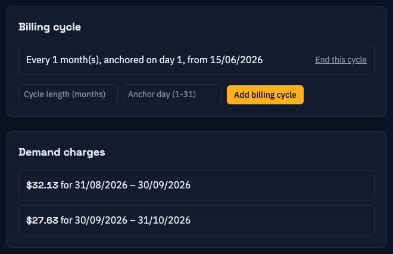

# 7. Billing

[Contents](index.md) · Previous: [The dashboard](06-dashboard.md) · Next: [Account settings](08-account-settings.md)

The **Billing** page (sidebar link **Billing**) holds the parts of your electricity bill that are not a per-kWh price: fixed charges, time-of-day rules and the date your bill closes. [Amber prices](05-sources.md#connecting-amber-electric) or the rates of a [fixed tariff](05-sources.md#setting-up-a-fixed-tariff) cover the per-kWh part.

The page has three cards: [Tariffs](#tariffs), [Billing cycle](#billing-cycles) and [Demand charges](#demand-charges).

## Before you start

Have a recent bill or your retailer's tariff sheet open. You need:

- The daily supply (service availability) charge, in cents per day.
- The monthly account fee, if you have one, in dollars.
- Any demand charge: its time window, days, months and rate in cents per kW per day.
- Any time-based feed-in bonus or penalty.
- Any credit for keeping grid import low during set hours: its hours, days, months, power limit and amount in cents.
- The day of the month your bill closes and how many months a bill covers.

## How the cost is calculated

WattWise builds each cost figure minute by minute:

1. **Energy bought**: kWh imported in that minute × the buy price.
2. **Energy sold**: kWh exported × the sell price (a payment to you). A positive [export adjustment](#export-adjustments) that applies at that time raises the payment, a negative one lowers it.
3. **Daily service charge**: the tariff's cents per day, added in proportion to how much of the day has passed.
4. **Monthly fee**: the tariff's monthly fee (or its [discounted amount](#monthly-fee-discounts)), divided evenly across the days of the [billing cycle](#billing-cycles). Without a billing cycle, no monthly fee is charged.
5. **Demand charge**: the [demand charge](#demand-charges) for the billing period, spread across the minutes inside the demand window.
6. **Conditional credits**: a [conditional credit](#conditional-credits) subtracts a fixed amount for each day your average grid import in its time window stays below its limit.

The **Cost** total and the billing period tiles include all six parts. The cost line on the history chart shows only the energy parts (1 and 2) plus the demand charge, so fixed fees and conditional credits do not show up as a spike at one instant. The one exception is a [daily allowance](#daily-allowance), whose refunds appear on the history line at each midnight. Prices and energy come from your sources. Everything on this page comes from you. Whenever a minute has energy but no price, that minute is left out, except that its export still counts toward a daily allowance. See [Net and gross cost](06-dashboard.md#net-and-gross-cost) for the two ways the energy side can be counted.

## Tariffs

A **tariff** is a set of fixed charges that applies from the moment you add it until you end it.

The section heading names your price supplier: "Amber Tariffs" with an Amber source, "Origin Fixed Tariffs" with a local source called Origin Fixed, and "Tariffs" with neither. The supply charge, monthly fee, billing cycle, demand windows, export adjustments, conditional credits and fee discounts on this page apply to every kind of pricing source. Per-kWh rates for a local source are set in [Sources](05-sources.md#setting-up-a-fixed-tariff).

### Adding a tariff

1. In the **Tariffs** card, fill in the form at the bottom:
   - **Service availability (cents/day)**: your daily supply charge, for example `98.45`.
   - **Monthly fee ($/month)**: optional. Leave it empty if your bill has no monthly account fee.
2. Click **Add tariff**.

The tariff starts at the moment you click the button.

### Changing a tariff

Tariffs are not edited in place, so past bills keep their original rates.

1. Click **End this tariff** on the active tariff.
2. Add a new tariff with the new numbers.

Ended tariffs stay in the list, struck through. Click one to see its windows. Always end the old tariff before you add its replacement.

> **Note:** Demand windows, export adjustments, conditional credits and fee discounts belong to one tariff. The forms for them appear under an active tariff once it exists. When you add a replacement tariff, enter them again under the new one.

### Demand windows

A **demand window** is a repeating period when your highest power draw sets a charge. Retailers use it to price peak demand on the network.

Add one under an active tariff:

| Field | What to enter |
|-------|---------------|
| **Window label** | A name, for example `Summer peak`. |
| **Months** | Month numbers separated by commas, `1` to `12`. For December to February: `12,1,2`. |
| **Days of week** | Day numbers separated by commas, `0` = Monday to `6` = Sunday. Weekdays: `0,1,2,3,4`. |
| **Start time** / **End time** | 24-hour times as `HH:MM`, for example `16:00` and `21:00`. |
| **Rate** | Cents per kW per day. |

Click **Add demand window**. The list shows each window as, for example, `16:00–21:00 · Mon, Tue, Wed, Thu, Fri · Dec, Jan, Feb · every 30 min`. The "every 30 min" is the measurement interval: WattWise averages your grid import over 30-minute spans and takes the highest one.

While a window is in effect, the [dashboard](06-dashboard.md#demand-window-notice) shows **DEMAND WINDOW ACTIVE**. Times use the [site's time zone](04-sites.md#creating-a-site).

### Export adjustments

An **export adjustment** raises or lowers your feed-in price during a repeating period. Use it for a retailer bonus (positive) or a penalty such as a low-export-price period (negative).

| Field | What to enter |
|-------|---------------|
| **Adjustment label** | A name. |
| **Export months**, **Export days of week**, **Export start time**, **Export end time** | Same format as a demand window. |
| **Adjustment** | Cents per kWh. Positive is an incentive, negative is a disincentive. |
| **Daily allowance** | kWh of exports per day that are not adjusted. Leave it blank or 0 if there is none. |

Click **Add export adjustment**. If several adjustments cover the same minute, they add together.

#### Daily allowance

Some export tariffs charge a fee per kWh exported but include a free amount each day, for example "10 kWh a day free, then 3c/kWh". Enter `-3` as the adjustment and `10` as the daily allowance.

The allowance builds up through the billing period. On day 3 you have 30 kWh of allowance in total, whatever you exported on days 1 and 2. Allowance you have not used also counts backwards: if you export 30 kWh on day 1 you are charged for 20 kWh, and that charge drops to 10 kWh on day 2 and to 0 on day 3 if you export nothing more. The count starts again at the start of each [billing cycle](#billing-cycles).

The allowance starts on the day its tariff starts and ends when the tariff ends. If you end a tariff and add a new one, the new tariff's allowance starts counting days from its own start date.

- Only exports inside the adjustment's months, days and times use up the allowance.
- The allowance counts grid export, the same as the [net](06-dashboard.md#net-and-gross-cost) cost.
- Without a billing cycle the allowance is ignored and every exported kWh is adjusted.
- On the export price graphs the adjustment appears only once your exports so far have used up the allowance so far. For times in the future the graph assumes you export nothing more.

### Conditional credits

A **conditional credit** takes a fixed amount off your bill on each day that your average grid import, between two times of day, stays below a limit. Use it for a retailer offer such as "keep your evening import under 300 W and get 50 cents".

| Field | What to enter |
|-------|---------------|
| **Credit label** | A name. |
| **Credit months**, **Credit days of week**, **Credit start time**, **Credit end time** | Same format as a demand window. The end time must be later than the start time, so a window cannot cross midnight. |
| **Average import below (W)** | The limit in watts. |
| **Credit (cents)** | The amount for each qualifying day. |

Click **Add conditional credit**. On each matching day, WattWise averages your grid import from the start time up to the end time. If the average is below the limit, that day earns the credit.

- The test uses power drawn from the grid only. Power you export does not offset it, and it does not change with the [net or gross](06-dashboard.md#net-and-gross-cost) setting.
- Equal to the limit does not qualify.
- A day earns nothing until its end time has passed.
- A minute while you are exporting counts as 0 W of import. If any minute in the window has no grid reading at all, for example because a collector was offline, that day earns nothing.
- If several credits qualify on the same day, they add together.
- Credits lower the **Cost** total and the billing period tiles. They do not appear on the history chart.

### Monthly fee discounts

If your tariff has a monthly fee, a **fee discount** replaces that fee with a lower amount for a fixed span of dates, for example a first-year promotion. The form appears only under a tariff that has a monthly fee.

| Field | What to enter |
|-------|---------------|
| **Discount label** | A name. |
| **Discount starts (YYYY-MM-DD)** / **Discount ends (YYYY-MM-DD)** | The first and last dates, for example `2026-11-01`. |
| **Discounted fee** | The dollars per month you pay during the span instead of the normal fee. |

The dashboard's **Including Discounts** tile adds up the discounted fee for every day of the current billing period that a discount covers. A discount that covers the whole period shows its full discounted fee, for example $25.00. Before your billing cycle's first anchor day, the period runs from the anchor day before the day you added the cycle (the 1st for anchor day 1), and a discount covering it also shows its full discounted fee.

Click **Add fee discount**. Expired discounts stay in the list, struck through. Only one fee applies on a given day.

## Billing cycles

A **billing cycle** tells WattWise when your bill closes. It drives the **Billing Period** tile and the [demand charge](#demand-charges) calculation.

1. In the **Billing cycle** card, enter:
   - **Cycle length (months)**: `1` for monthly, `3` for quarterly.
   - **Anchor day (1-31)**: the day of the month each bill period starts, for example `15`.
2. Click **Add billing cycle**.

The list shows it as, for example, *Every 1 month(s), anchored on day 15, from 13/10/2026*. To change it, click **End this cycle** and add a new one. Periods that were already worked out keep the old cycle.

Without a billing cycle, the dashboard hides the **Billing Period** tile and no demand charges are calculated.

## Demand charges

The **Demand charges** card lists the demand charge for each billing period.

WattWise works it out once a day, shortly after midnight, and again each day until the period ends:

1. It measures your grid import in rolling 30-minute spans (or the window's own interval).
2. It finds the highest span in the billing period.
3. It multiplies that peak, in kW, by the window's rate and by the number of days in the period.

Example: a peak of 6 kW, a rate of 45 cents per kW per day and a 30-day period give 6 × 45 × 30 = 8,100 cents, which is `$81.00`.

Notes:

- The card says *No demand charges yet* until enough data exists for a billing period.
- The figure for the period in progress is an estimate. It is final once the period ends and the data has no gaps. A collector outage can leave a period without a final figure.
- Without a demand window on the tariff, no demand charge exists.

## Next

- [The dashboard](06-dashboard.md#cost-and-credit): where these numbers show up
- [Troubleshooting costs](09-troubleshooting.md#costs-look-too-low-or-are-missing)
- [Glossary](10-glossary.md)
