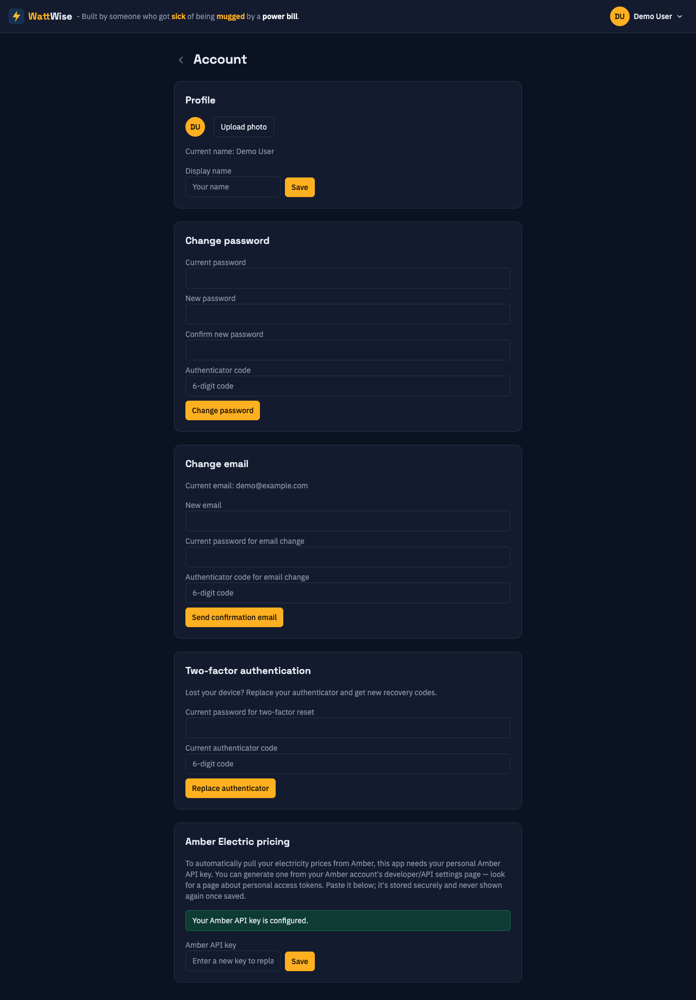

# 8. Account settings

[Contents](index.md) · Previous: [Billing](07-billing.md) · Next: [Troubleshooting](09-troubleshooting.md)

Open your settings from the header: click your name in the top right corner, then **Account settings**. Use the back arrow at the top left of the page to return to your sites.

Changes to your password, email address and authenticator ask for your current password and a code. This stops someone who finds your signed-in browser from taking over the account. In the code field you can enter either an authenticator code or an unused [recovery code](03-signing-in.md#recovery-codes).

## Profile

| Setting | How it works |
|---------|--------------|
| **Display name** | Type a name and click **Save**. It appears in the header. Until you set one, WattWise shows your email address. |
| **Photo** | Click **Upload photo** and choose an image. JPEG, PNG and WebP files up to 2 MB are accepted. Click **Remove** to go back to the default avatar. |

## Change password

1. Enter your **Current password**, the **New password** (8 to 72 characters) and **Confirm new password**.
2. Enter an **Authenticator code**.
3. Click **Change password**. The card shows *Password changed.*

If the two new passwords differ, the card says so and nothing is changed. Forgotten your current password? Sign out and use [Forgot password](03-signing-in.md#forgotten-password).

## Change email

1. Enter the **New email**, your current password and an authenticator code.
2. Click **Send confirmation email**.
3. Open the link in the email sent to the new address. On **Confirm your new email address**, click **Confirm email change**.
4. When you see **Email confirmed**, click **Go to login** and sign in with the new address.

Your email address does not change until you open the link. If the new address already belongs to another account, WattWise refuses the change. Asking again cancels any earlier unused link.

## Two-factor authentication

Use this card when you have a new phone or lost the old one. For the first-time setup, see [Setting up two-factor authentication](03-signing-in.md#setting-up-two-factor-authentication).

1. Enter your current password and your current authenticator code (or a recovery code).
2. Click **Replace authenticator**.
3. Scan the new QR code, or type the **Manual entry key**.
4. Enter the new 6-digit code and click **Confirm**.
5. Save the 10 new recovery codes, tick **I've saved these codes** and click **Done**.

> **Warning:** The old authenticator and all old recovery codes stop working as soon as you confirm.

## Amber API key

Amber pricing needs your personal API key.

1. Create a key in the developer settings of your Amber account. Look for a page about personal access tokens.
2. Paste it into **Amber API key** and click **Save**.
3. The card changes from *No Amber API key set yet.* to *Your Amber API key is configured.*

WattWise stores the key securely and never shows it again. To replace it, paste a new key. The key applies to every site you own. Then [add an Amber pricing source](05-sources.md#connecting-amber-electric) to each site that uses Amber.

## Next

- [Sources](05-sources.md)
- [Signing in and account security](03-signing-in.md)
- [Troubleshooting](09-troubleshooting.md#sign-in-problems)
