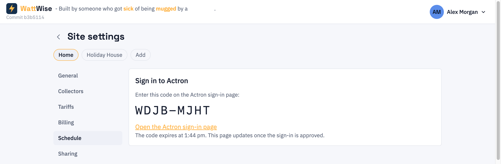
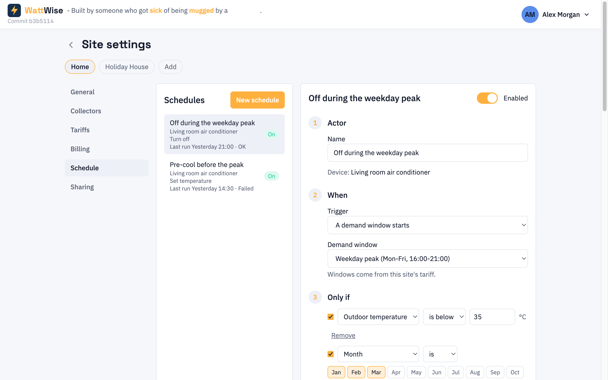
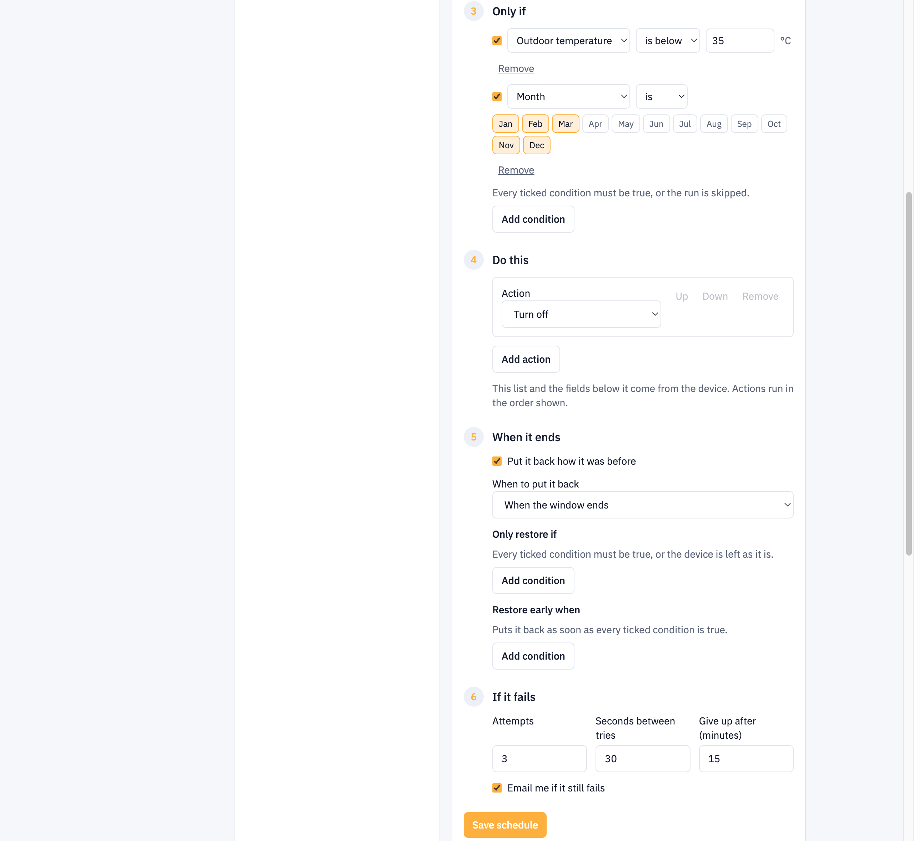
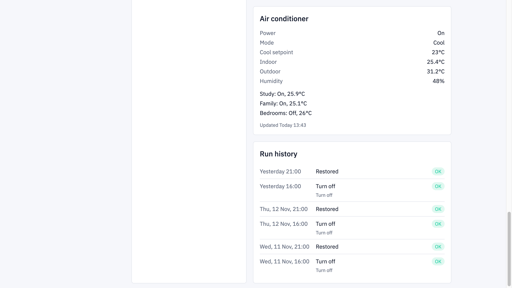
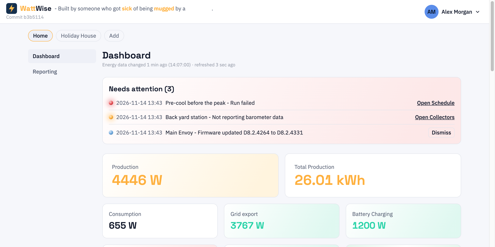

# 8. Schedules and the air conditioner

[Contents](index.md) · Previous: [Billing](07-billing.md) · Next: [Account settings](09-account-settings.md)

A **schedule** tells WattWise to do something to a device at a set moment. Today the device is an Actron Neo air conditioner. The usual use is to turn it off while a [demand window](07-billing.md#demand-windows) runs, so its draw stays out of your peak-demand charge, and to turn it back on afterwards.

This chapter is for the site owner. Other people with access to the site see the **Schedule** tab read-only.

A small program called an **actor** carries out the schedules. It runs next to the collectors, signs in to your Actron account and checks the schedules every 30 seconds. See [Getting started](02-getting-started.md#how-the-pieces-fit-together).

## Adding the air conditioner

1. Open **Site settings**, pick the site and open the **Schedule** tab.
2. Type a name for the air conditioner and add it.

3. The page shows an Actron code and a link. Open the link, sign in to Actron and enter the code. The page checks every 10 seconds. When you approve, the code disappears.
4. The actor reads what your unit can do. **New schedule** becomes available when it has.

If the code expires, the page shows a new one after about 30 seconds. Other people with access to the site see only a line saying you are signing in. They never see the code.

> **Note:** WattWise uses the first air conditioner on your Actron account.

## Making a schedule

Click **New schedule**. The form has numbered steps. Click **Save schedule** at the end.

| Step | What you choose |
|------|-----------------|
| **Actor** | A name for the schedule. The device it commands is shown under the name. An **Enabled** switch turns the whole schedule on or off. |
| **When** | The trigger: a demand window starts or ends, a set time on chosen days, the price goes above a level, or the indoor or outdoor temperature crosses a level. |
| **Only if** | Optional conditions. Every ticked row must pass or the run is skipped. |
| **Do this** | One to eight actions, run in order, such as turn off, set mode, set temperature, set fan speed, switch zones or set a zone's temperature. |
| **When it ends** | Whether and when to put the unit back as it was. |
| **If it fails** | How many tries, the seconds between tries, when to give up, and **Email me if it still fails**. |

### Only if

A row can test a reading, such as indoor temperature above 27, or the calendar. A reading that is missing or older than 5 minutes fails the row. The calendar rows use the site's time zone and never fail for missing data:

| Row | Passes when |
|-----|-------------|
| **Month** | The current month is, or is not, one you picked |
| **Day of week** | The current day is, or is not, one you picked |
| **Week** | The week is odd or even. Weeks run Monday to Sunday. |
| **Demand window** | A window, or any window, is running now, or is not |

For example, "only in summer, when it is over 30 outside and no demand window is running" is a Month row for December to February, a reading row for the outdoor temperature and a Demand window row set to is not active. Untick a row to keep it but ignore it.

### When it ends

The unit is put back only if every action in the schedule can be undone. The choices are:

- **When the window ends**, if the trigger is a demand window starting.
- **After a set number of minutes.**
- **At a set time.**
- **Only when a condition below is met**, with 24 hours as the limit.

Two optional condition lists refine this. **Only restore if** holds the unit off until every ticked row passes. **Restore early when** puts it back sooner when every ticked row is true. A reading that is missing counts as passing the first list, so a dead sensor never keeps the unit off.

If you changed a setting on the unit by hand while it was off, WattWise leaves that setting alone when it restores.

## Testing

Select a schedule and click **Test now**. The actor runs every action within about 30 seconds, ignoring the trigger and conditions. If the schedule restores, it puts the unit back after 30 seconds. Use it after saving to check the unit responds.

## Run history

The bottom of the schedule's card, under **Test now**, lists that schedule's newest runs.

| Pill | Meaning |
|------|---------|
| **OK** | Every action worked. |
| **Skipped** | A condition failed, another schedule held the unit, or the actor was down for more than 10 minutes after the trigger. The message says which. |
| **Failed** | The actor gave up. The message has the last error. |
| **You took over** | You changed the unit yourself after the action. WattWise does not restore it. |
| **Queued** / **Running** | Not finished. |

If one action of several fails, the others still run and the run is recorded as partial, with the failed action named.

The unit's current state, with each zone, is shown in its own card below the schedule. It reads **Not updating** when the actor has not reported for 2 minutes.

## The log

At the top of the site's dashboard, the log lists what needs you: failed schedule runs and problems that collectors report. It also lists each action run that finished OK in the last 24 hours. When there is nothing to list, the log does not appear. Test runs and restore runs that succeed are not listed.

Each row is one line: a coloured bulb, the date and time in the site's time zone, the source or schedule and a message, then one button on the right, except on a **Ran OK** row, which has none. Red is a failure, amber is a problem that leaves part of a device working, and blue is a notice. Red and amber bulbs pulse slowly while the problem lasts. The log glows red, amber or blue to match the worst row that is still a problem. A successful run does not change the glow.

When WattWise sees a problem go away, the bulb shows a grey centre inside a ring in its old colour. The row stays for one hour and then disappears. A cleared row does not change the log's colour. The log lists the five most serious rows and links to the rest.

| Row | Meaning | What to do |
|-----|---------|------------|
| **Ran OK** | The schedule's action finished OK. A blue row stays for 24 hours. | Nothing. |
| **Run failed** | An action or restore did not work after its tries. | Check the unit and turn it on if a restore failed. |
| **Still off** | The unit is still off after its restore time. | Turn it on, then check the restore settings. An **Only restore if** row that never passes causes this. |
| **Not reporting** | The unit is held off and the actor has been silent for 5 minutes. | Ask your administrator to check the actor container. See [Troubleshooting](10-troubleshooting.md#the-air-conditioner-schedule-is-not-working). |
| **Needs sign-in** | Actron rejected the stored sign-in. | Open the **Schedule** tab, click **Sign in again** and approve the code. This works while the unit is held off. |
| An alert from a collector | A device or service needs you, for example an Envoy that cannot be reached. The message is one short line. | Click **Open Collectors**, read the message and fix the cause. It clears itself. The collector log has more detail. |
| A notice with **Dismiss** | Something changed that you should know about, such as an Envoy firmware upgrade or a certificate re-pin. See [Certificate pinning](05-sources.md#certificate-pinning). | Read it and click **Dismiss**. It stays until you do, even after the cause is gone. |

**Email me if it still fails** emails you when a run fails, and once more if the unit stays off or the actor goes silent.

## Limits

- You cannot delete a schedule or the air conditioner while a run still owes a restore. Wait for the restore, or fix the sign-in.
- While a schedule holds the unit off, you cannot change its trigger, actions or restore settings. Disabling it brings the restore forward.
- Two schedules on one unit are not checked for overlap when saved. The second one is skipped while the first is active.
- Deleting a schedule or the air conditioner deletes its run history.

## Next

- [Billing](07-billing.md#demand-windows): the windows a schedule can follow
- [Troubleshooting](10-troubleshooting.md)
